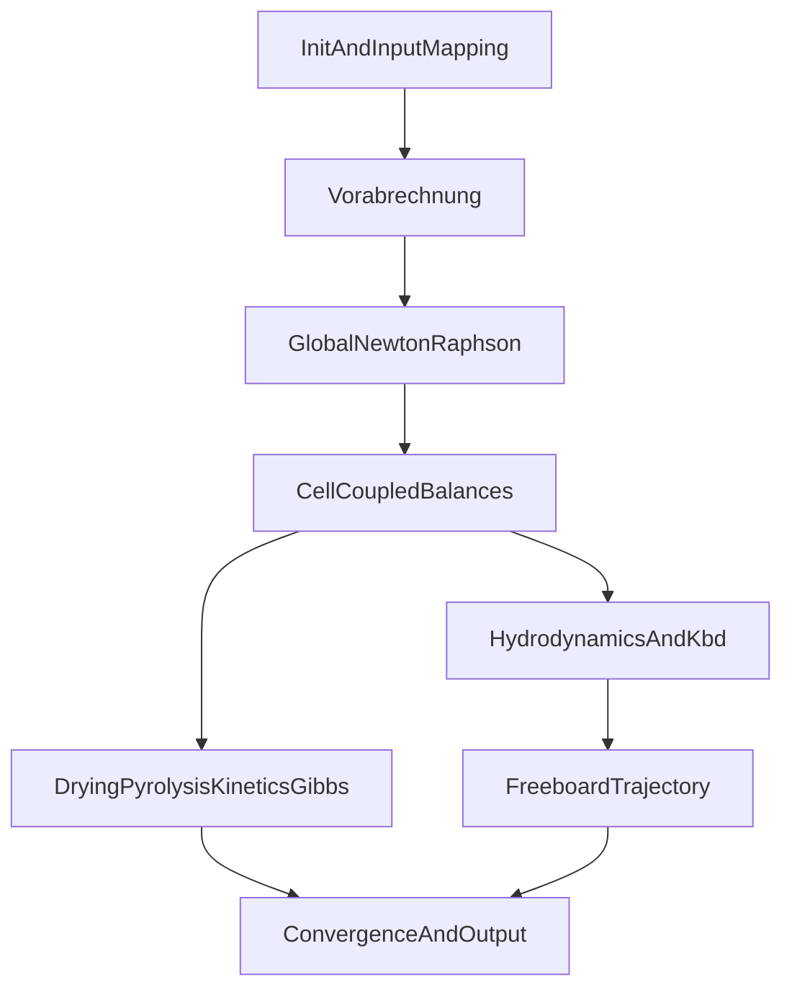

# 文档索引（Hamel 算法与模型）

本目录文档按用途分层。**方程级权威规格**以 `hamel_submodels/` 与 `specs/hamel_checked_algorithm_spec.md` 为准；叙事/流程/工程补缝文档不得覆盖前者。

## L0 — 主文献

| 资源 | 说明 |
|------|------|
| `docs/_2001_VDI-Dis._…Brennstoffe.pdf` | Hamel (2001) VDI 博士论文 PDF（本地-only，见 `.gitignore`） |
| `docs/_1997_VDI-Dis._Wirsum_Klaerschlamm_blasenbildende_Wirbelschichtfeuerungen.pdf` | Wirsum (1997/98) VDI-6/383；阻尼 Newton §2.3.3 |
| `docs/wirsum_1997_nr_solver_notes.md` | Wirsum NR/阻尼摘录与本仓库对照 |
| [`wirsum_1997_named_f_rate_continuation.md`](wirsum_1997_named_f_rate_continuation.md) | 具名核速率延拓（R12→R11、F_E7/E8；求解路径，不是 Hamel 方程） |
| [`handoff_named_f_e8_2026-09-16.md`](handoff_named_f_e8_2026-09-16.md) | **具名 \(F\) 接到 F_E8 的交接**（已完成 / 未启动原因 / 待决问题；2026-09-16） |
| [`audit_reports/named_f_e8_review_2026-09-16.md`](audit_reports/named_f_e8_review_2026-09-16.md) | F_E8 二次评估与 P0–P4 计划 |
| [`audit_reports/named_f_reaction_coverage_p0_2026-09-17.md`](audit_reports/named_f_reaction_coverage_p0_2026-09-17.md) | P0 反应覆盖表（区域/相/单位/催化基准） |
| [`../data/named_e8_endpoint_2026-09-17.json`](../data/named_e8_endpoint_2026-09-17.json) | P0 后 F_E8 端点快照（x / P(x) 字段 / F / 源码 hash；须现场认证） |
| `docs/siegen_cell_model_lineage.md` | Siegen 细胞模型谱系与完整书目；含 Hamel & Krumm, *Powder Technology* 120 (2001) |

## L1 — 方程转录（子模型 SoT）

目录：`docs/hamel_submodels/`（本地-only）

| 分册 | 内容 |
|------|------|
| `00_readme_and_citation_rules.md` | 引用规则、页锚点核对表、分册索引 |
| `01_global_nr_and_connectivity.md` | Eq.2.9、块三对角、Nebenelemente |
| `02_cell_balances_and_exchange.md` | Eq.2.x 守恒与相间交换 |
| `03_hydrodynamics_core_chain.md` | Eq.3.41–3.50 水力学主链 |
| `04_freeboard_particle_trajectory_analytic.md` | Eq.3.71–3.105 自由板轨迹 |
| `05_drying_and_daem_pyrolysis.md` | Ch.4 干燥 / DAEM |
| `06_kinetics_r1_r11_and_equilibrium_driving.md` | Ch.5 动力学、R8/R10、Table 5.4 |
| `07_appendix_a1_gibbs_solver.md` | 附录 A1 Gibbs NR |

源码 docstring 与审计脚本应引用上述分册，**不再**引用已清理的 `specs/00–04`。

## L1.5 — 已核验摘要

| 文档 | 说明 |
|------|------|
| `specs/hamel_checked_algorithm_spec.md` | 已核验方程清单 + 代码映射 + 已知差异（本地-only） |
| `specs/README.md` | 规格目录说明 |

## L2 — 结构、流程与 B 档

| 文档 | 说明 |
|------|------|
| `gasifier_model_flowchart_trilingual.mmd` | Bild 2.2 三语流程；对接 `simulation_runner` |
| `hamel_b_tier_thesis_extraction.md` | Verbindungsmatrix、拓扑 cell、NR 结构（B 档） |
| `vorab_init_abgleich_vs_outer_preinner.md` | Init / Outer / Check1–2 求解语义 |
| `hamel_engineering_bridge_notes.md` | 论文未给细节的 bed/freeboard/side-element 工程布局 |
| [`validation_cases_chemistry_map.md`](validation_cases_chemistry_map.md) | **Ch.7–8 验证工况化学地图**（氧化剂分支、轴向分工、多 case 调参优先级） |
| [`validation_cases_hamel_provenance.md`](validation_cases_hamel_provenance.md) | **Table 7.1–7.4 原文摘录与缺口清单** |
| [`validation_cases_master_table.md`](validation_cases_master_table.md) | **15 Case 主表**（入口/出口/尺寸/燃料分析；[`JSON`](../data/validation_cases_master_table.json) 由 `scripts/build_validation_cases_master_table.py` 生成） |
| `hamel_dissertation_vs_python_architecture.svg` | 论文模块 ↔ Python 架构对照图 |

## L3 — 同构验收台账

| 文档 | 说明 |
|------|------|
| `hamel_isomorphic_gap_implementation_checklist.md` | 开放差距、P0/P1 任务、**§0.5 证据矩阵 + §0.6 生产默认**（本地-only；2026-07-08 同步） |
| `audit_reports/hamel_parity_audit_summary_2026-07-04.md` | 7 scope parity 汇总 + 闭合时间线 |
| `audit_reports/hamel_parity_*_2026-07-*.md` | 分项报告（exchange-cell、energy、global-nr、a1-gibbs、hydro） |

已清理的重复层（勿再引用）：`hamel_original_algorithm_reconstruction.md`、`hamel_evidence_matrix.md`、`hamel_doc_trace_index_latest_to_earliest.md`。

## 工程与代码架构（非方程规格）

| 文档 | 说明 |
|------|------|
| `CLAUDE.md` | Agent 开发约定、Phase 顺序、全局编程规则 |
| [`wirsum_1997_named_f_rate_continuation.md`](wirsum_1997_named_f_rate_continuation.md) | 具名核快氧化 **速率延拓**（路径 ≠ 模型；与 Startwert / 生产 `r5_scale` 分名） |
| [`handoff_named_f_e8_2026-09-16.md`](handoff_named_f_e8_2026-09-16.md) | **具名 \(F\) → F_E8 交接**（下一任 agent 必读；未完成项与未启动原因） |
| `module_dependency_overview.md` | GitNexus 模块依赖与分层 |
| `codebase_optimization_index.md` | 重复代码 / 体量优化索引 |
| `opt_implementation_plan.md` | OPT 实施计划 |
| [`optimization_handoff_summary.md`](optimization_handoff_summary.md) | **瘦身 handoff（接手收敛/调参必读）** |
| [`handoff_extent_isomorph_nr_convergence_2026-08.md`](handoff_extent_isomorph_nr_convergence_2026-08.md) | **同构去限幅 × Phase2 NR 平台期交接（2026-08；下一任 agent 必读）** |

## 归档

| 路径 | 说明 |
|------|------|
| `archive/docs_legacy/BFB_ModelArchitecture.html` | 旧架构 HTML 可视化（已由 `flowchart.mmd` + 模块依赖文档取代） |
| `archive/docs_legacy/` | Phase1 审计矩阵、历史计划等 |

## 算法总览（执行层级）

**使用边界**：标注「部分一致 / 不一致」的条目不得写成「已完全复现 Hamel 原版」；整改项以 `hamel_isomorphic_gap_implementation_checklist.md` 为准。
