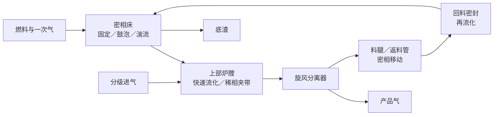

一颗燃料进入流化床后，不会永远停留在一种流动状态。它可能先落入高浓度密相床，在气泡尾涡中上升，又在颗粒返混中下沉；粒径较小或密度逐渐降低后，它会被带入自由空间，进入稀相夹带，随后被旋风分离器捕集，经料腿和回料密封返回床层。在循环流化床（Circulating Fluidized Bed，CFB）中，这条循环更加明显：同一批颗粒会反复穿过底部高浓区、上升管快速流化区、旋风分离器和密相返料系统。

因此，“鼓泡流化床（Bubbling Fluidized Bed，BFB）”和“CFB”首先是装置与操作方式的名称，并不能完整描述每一处颗粒的水力学状态。通用模型要覆盖的不是几个炉型标签，而是颗粒群沿设备回路不断变化的流化状态。

## 最容易通用的是设备连接和方程装配

德国锡根大学（Universität Siegen）的 Stefan Hamel 已经把炉体、自由空间和旋风分离器分成 cell（计算单元），再用连接矩阵表示物料从哪里流向哪里。这一思路可以继续向前推进：不再编写一个只能计算某台 BFB 的固定程序，而是先定义一张设备图。

每个设备块对外声明五类信息：

1. 本地状态向量 $x_k$；
2. 本地守恒残差 $F_k$；
3. 气体、固体、能量和压力端口；
4. 本地雅可比块或可自动微分的残差函数；
5. 与其他设备端口的连接关系。

全局方程由设备图 $G$ 自动装配：

$$
F(x;G,\theta)=0
$$

$$
J=\frac{\partial F}{\partial x}
$$

$\theta$ 是各设备块内的水力学、传质和反应参数。如果用户把燃料入口从第 2 个 cell 移到第 5 个 cell，或在炉顶与床底之间增加一条返料边，改变的应当是 $G$ 和少量本地块，而不是整个求解器。

雅可比矩阵的非零结构也可以由设备图直接推导。某个上升管 cell 与相邻 cell 交换物料，就产生相邻的块带；旋风分离器将固体送回底部，就产生一组跨越许多 cell 的非局部块。设备拓扑同时成为了线性代数的稀疏图。

## Reh 图把炉型分类变成了颗粒状态图

20 世纪 60 年代以后，德国工程师 Lothar Reh 用无量纲状态图整理气固体系从固定床、流化床到气力输送的连续变化。图中的边界来自重力、浮力、黏性力和惯性力之间的相对大小。颗粒雷诺数和阿基米德数可以写成：

$$
Re_p=\frac{\rho_g |u_g-u_p|d_p}{\mu_g}
$$

$$
Ar=\frac{g d_p^3\rho_g(\rho_p-\rho_g)}{\mu_g^2}
$$

$d_p$ 和 $\rho_p$ 是颗粒直径和密度，$u_g-u_p$ 是气固滑移速度，$\rho_g$ 和 $\mu_g$ 是气体密度和黏度。给定颗粒与气体性质后，提高气速会改变惯性力与重力的竞争；颗粒磨损、破碎、团聚或焦炭转化又会改变粒径和密度，使状态点沿另一条方向移动。加压还会改变气体密度和黏度，所以同样的颗粒与表观气速在常压和加压床内未必处于同一水力学状态。

这正适合描述气化炉内的颗粒。气体沿炉高受热、膨胀并被分级气化剂补充，局部气速不断变化；燃料颗粒同时经历干燥、热解、焦炭反应、缩粒和夹带。颗粒在状态图上对应的不是一个固定点，而是一条随位置和转化历程移动的轨迹。宽粒径分布还意味着同一 cell 内会同时存在多条轨迹：粗颗粒仍留在密相床，细颗粒已经进入夹带甚至气力输送状态。

Reh 图提供了这种观察方法，但单靠两三个无量纲数还不能描述工业 CFB。Bi–Grace 等后续流态图把鼓泡、湍流、快速流化和向上输送放进更完整的操作图；具体水力学计算还必须考虑局部空隙率、固体通量和循环库存。它们共同说明，流态不是反应器铭牌上的一个名词，而是局部气体、颗粒和固体循环共同决定的状态。

## 水力学计算就是流化状态的定量展开

流态图给出的是区域和边界，水力学模型则要算出状态内部的具体数值。对第 $i$ 个 cell 中第 $k$ 个粒级，可以构造一组局部状态指标：

$$
q_{i,k}=\left(
Re_{p,i,k},\ Ar_{i,k},\ \frac{u_{g,i}}{u_{mf,i,k}},\
\frac{u_{g,i}}{u_{t,i,k}},\ \varepsilon_i,\ G_{s,i}
\right)
$$

$u_{mf}$ 是最小流化速度，$u_t$ 是颗粒终端速度，$\varepsilon$ 是空隙率，$G_s$ 是固体通量。流态名称只是 $q_{i,k}$ 的简写；真正进入物料衡算、能量衡算和反应速率计算的，是下列水力学结果：

- 床层空隙率、膨胀高度和单位高度压降；
- 气体与各粒级颗粒的速度、滑移速度和停留时间；
- 向上夹带、向下返混以及截面净固体通量；
- 气泡尺寸、上升速度、尾涡携带和泡—密相传质；
- 快速床中的颗粒聚团、核心—边壁环隙结构和轴向固体浓度；
- 自由空间夹带衰减、旋风入口负荷、分级效率和返料通量。

因此，水力学模块不应只返回一个枚举值，例如 `BUBBLING` 或 `FAST_BED`。它应当返回一组能够进入守恒方程的连续状态量，并附带当前模型的适用范围。流态判断是这些计算结果的物理摘要，也是检查所用模型是否自洽的诊断量。

## 设备类型和流化状态是两条坐标

鼓泡床的经典两相表达包含气泡相和乳化相。泡径、上升速度、气泡穿流与泡—密相传质都有清晰意义。进入湍流化后，气泡不断破碎，相界很难像低气速时那样辨识。再进入快速流化，模型往往转向固体通量、滑移速度、颗粒聚团或核心—边壁环隙结构。

这些是水力学状态。旋风分离器、料腿和回料密封则是设备部件，两者不能混成一套分类。通用框架需要同时声明：当前 cell 属于哪种设备块，以及其中各粒级颗粒处于怎样的水力学状态。

| 设备块 | 在回路中的作用 | 需要连接的端口 |
|--------|----------------|----------------|
| 炉体／上升管 | 气固接触、反应和轴向输运 | 气体、分粒级固体、能量、压力 |
| 自由空间 | 颗粒轨迹、夹带衰减和气相反应 | 夹带固体、产品气、散热 |
| 旋风分离器 | 按粒径分离气体与固体 | 含尘气、净化气、捕集固体 |
| 料腿／返料管 | 建立固体库存和压封 | 固体通量、料位、窜气 |
| 回料密封 | 在压差下把颗粒送回反应器 | 返料固体、流化气、压力 |

| 局部水力学状态 | 主要物理结构 | 关键计算结果 |
|------------------|--------------|----------------|
| 固定床／密相移动床 | 颗粒接触网络承重 | 空隙率、压降、滤流和移动速度 |
| 鼓泡流化 | 气泡相＋乳化相 | 泡径、上升速度、尾涡和相间传质 |
| 湍流流化 | 破碎气团＋高浓度颗粒 | 固体通量、混合强度和气泡可辨识性 |
| 快速流化 | 颗粒聚团或核心—边壁环隙 | 滑移、轴向浓度和壁面下行通量 |
| 稀相输送 | 颗粒随气流加速与夹带 | 颗粒速度、停留时间和沉降分离 |

可以把 cell 的本地残差写成：

$$
F_i=F_i\!\left(x_i;D_i,H_{i,1},H_{i,2},\ldots,H_{i,K}\right)
$$

$D_i$ 表示设备类型，$H_{i,k}$ 表示第 $k$ 个粒级在该 cell 中的水力学状态。粗颗粒和细颗粒可以在同一空间内采用不同的输运描述，但它们仍共享局部气体、温度、压力和守恒约束。只要端口上的组分流量、分粒级固体流量、能量和压力定义一致，方程装配器就能连接不同长度和不同内部结构的本地状态向量。

## 设备图给出颗粒去哪里，水力学给出颗粒怎么走

稳态 cell 模型不必追踪某一颗真实颗粒的瞬时轨迹，而是追踪各粒级颗粒群在设备图上的平均输运。气化反应使颗粒质量、粒径和密度改变，破碎和磨损把质量转入更细粒级，夹带把细颗粒送入上部 cell，旋风分离和返料又把其中一部分送回底部。每一条固体连接边都携带粒径分布和转化状态。

水力学计算在每个 cell 内根据气体性质、局部气速、颗粒性质和固体库存求出 $q_{i,k}$，再计算相邻 cell 之间的上行、下行和返料通量。装配后的解应同时满足三类一致性：

1. 流态诊断与所采用的水力学模型一致；
2. 各粒级进出通量与本地固体库存守恒；
3. 整个炉体、旋风分离器和返料回路的总固体库存闭合。

这样得到的不是一串“BFB—湍流床—CFB”标签，而是一幅更详细的状态场：每个位置有哪些粒级，它们处于多高的固体浓度，以怎样的滑移速度和净通量运动，又有多少颗粒进入夹带、分离和返料。

## 硬切换会把流态边界变成数值断层

假设某个指标 $r$ 低于阈值时使用鼓泡床模型 $F_B$，高于阈值时立即改用湍流床模型 $F_T$，那么残差甚至会在阈值两侧跳变。牛顿法刚走到边界一侧，方程就换了一套，下一步可能又被推回去。

在有物理重叠区的情况下，可以先研究平滑过渡：

$$
F=(1-w)F_B+wF_T
$$

$$
0\leq w(r)\leq1
$$

$w$ 在重叠区内平滑变化。这不是随意平均两套经验式：过渡前后必须使用一致的物料、能量和固体库存定义，而且 $w$ 需要由跨流态实验约束。若两套模型的内部状态根本不兼容，更合理的做法是定义专门的过渡 cell，而不是强行混合公式。

流态转换还可能有滞后和多稳态。同一气速下，逐步升高负荷与逐步降低负荷不一定走过同一条路径。模型需要用参数延拓跟踪解支，不能默认每个工况只有一个状态。

## 一个巨大的“超集状态向量”不会带来通用性

如果每个 cell 都同时拥有气泡、乳化相、团聚、核心区和环状区，再根据流态把不需要的相分率压到零，形式上似乎一套方程覆盖了所有装置。实际上，那些接近消失的相会留下退化方程、不可识别参数和近奇异雅可比矩阵。

类型化 cell 更符合物理：设备端口协议统一，内部相结构和水力学模型可以不同，装配器负责连接不同维度的残差块。这种设计可以先保证设备拓扑通用，再逐步扩展颗粒状态的计算范围。

## 通用性必须通过一张验证矩阵建立

一条可行的研究路线可以分为七步：

1. 用同一装配器生成无返料 BFB 和带旋风返料 BFB。
2. 由设备图自动生成雅可比稀疏结构，新增进料口时不手工修改全局矩阵。
3. 建立旋风分离器、料腿和回料密封块，用全系统固体库存闭合循环通量。
4. 对每个 cell 和粒级输出 $Re_p$、$Ar$、$u/u_{mf}$、$u/u_t$、空隙率、滑移速度、压降和固体通量，形成局部水力学状态场。
5. 加入经验关联式适用范围和流态一致性检查，再为湍流流化、快速流化和稀相输送建立各自的水力学模型。
6. 用粒径、密度、气速和循环通量扫描颗粒状态轨迹，在重叠操作区研究过渡 cell、平滑混合和解支延拓。
7. 建立“设备拓扑 × 颗粒状态 × 压力 × 燃料”验证矩阵，分开报告连接正确性、局部水力学、固体库存和整体反应器误差。

这套设想的历史起点很清楚：Rajan 和 Wen 把流化床物理分成 cell，Wozny 与 Hartleben 把 cell 装配成可联立求解的方程组，Hamel 再把它扩展到带分级进料、加压和固体返流的 BFB 气化炉。Reh 图提供了另一条重要线索：颗粒状态会随气速、粒径、密度和气体性质连续移动，反应器名称不能替代这种状态计算。向湍流床、快速床和 CFB 扩展时，需要把设备拓扑、颗粒状态和水力学模型三者分开。

因此，更准确的目标不是一条通吃所有流态的“万能关联式”，而是一套能够沿设备回路计算颗粒群水力学状态，并据此组装局部输运、传质和反应方程的通用流化床模型框架。

## 参考资料

- R. R. Rajan and C. Y. Wen, “A comprehensive model for fluidized bed coal combustors,” *AIChE Journal*, 26, 642–655, 1980. [DOI](https://doi.org/10.1002/aic.690260416)
- S. Hamel, *Mathematische Modellierung und experimentelle Untersuchung der Vergasung verschiedener fester Brennstoffe in atmosphärischen und druckaufgeladenen stationären Wirbelschichten*, VDI Fortschritt-Berichte, Reihe 6, Nr. 469, 2001。
- L. Reh, “Fluidized bed processing,” *Chemical Engineering Progress*, 67(2), 58–63, 1971.
- L. Reh, “The circulating fluid bed reactor—A key to efficient gas/solid processing,” in *Circulating Fluidized Bed Technology*, 105–118, 1986. [DOI](https://doi.org/10.1016/B978-0-08-031869-1.50013-2)
- H. T. Bi and J. R. Grace, “Flow regime diagrams for gas-solid fluidization and upward transport,” *International Journal of Multiphase Flow*, 21, 1229–1236, 1995. [DOI](https://doi.org/10.1016/0301-9322(95)00037-X)
- N. Sun and J. Zhu, “A consolidated flow regime map of upward gas fluidization,” *AIChE Journal*, 65, e16672, 2019. [DOI](https://doi.org/10.1002/aic.16672)
- P. Basu, *Circulating Fluidized Bed Boilers: Design, Operation and Maintenance*, Springer, 2015. [DOI](https://doi.org/10.1007/978-3-319-06173-3)
