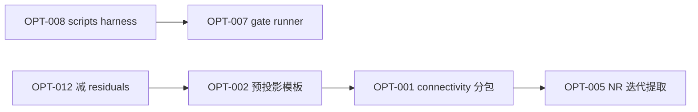

# bfb-gasifier 代码重复与体量优化索引

> 基于 [`module_dependency_overview.md`](module_dependency_overview.md) 的模块分层，结合 GitNexus 影响半径、AST 相似度扫描与行数统计整理。  
> 目标：定位**重复代码块**、**低效调用**、**单文件/脚本过长**根因，并给出可执行的 refactor 索引。

**扫描方法**

| 手段 | 发现类型 |
|------|----------|
| `wc -l` + AST 最长函数 | 体量热点 |
| `difflib` 同文件函数相似度 ≥0.72 | 复制粘贴型重复 |
| `grep cell.residuals()` / `apply_bc_fn()` 计数 | 运行时低效调用 |
| scripts 模式统计 | 脚手架重复 |

**体量 Top（src，>600 行）**

| 行数 | 文件 | 主要膨胀原因 |
|------|------|--------------|
| 3476 | `tests/test_global_nr_solver.py` | 测试矩阵（OPT-T01 已抽 fixtures） |
| 978 | `src/core/freeboard/trajectory_hamel.py` | 全局投影 Hamel 轨迹 + segment driver |
| 1684 | `src/core/connectivity/preprojection.py` | 各类 preproject_* / outer pre-inner bridge |
| 2658 | `src/solvers/vorabrechnung/` 包 | Gibbs/x0/预算/映射/refresh 五模块 |
| 1711 | `src/solvers/global_nr_solver.py` | `solve_global_nr` 单函数 ~749 行 |
| 1308 | `src/core/phase_gate_checks.py` | 5 个 gate + 内联 audit 逻辑 |
| 1251 | `src/core/reactor.py` | 配置 + 拓扑 + `_solve_global_nr` |
| 1139 | `src/core/connectivity_graph.py` | 显式图构建 + 路由 |
| 317 | `tests/validation/case_lu_loader.py` | JSON 加载 / inlet 拓扑 / gate（原 monolith 已拆） |
| 717 | `src/solvers/result_builder.py` | `build_exit_summary` ~559 行 |
| 504 | `src/workflow/steps/init_precalc_step.py` | init 全阶段单函数 ~381 行 |

**活跃 scripts：** 50 文件；**活跃目录已全部接入 `_lu_harness`**（`sys.path.insert` 仅保留在 harness 与 `_deprecated/`）。若干脚本顺带修复了缺失的 `load_case_lu` / `load_validation_case_node` import。

---

## 优化索引总表

| ID | 优先级 | 类型 | 目标 | 预估节省 | 风险 | 状态 |
|----|--------|------|------|----------|------|------|
| [OPT-001](#opt-001-connectivitypy-按职责拆包) | **P0** | 结构 | `connectivity.py` 拆分 | ~800–1200 行可读性 | 中 | **已完成** |
| [OPT-002](#opt-002-预投影-relax-循环模板化) | **P0** | 重复 | 预投影 relax 循环 | ~400–600 行 | 中 | **已完成** |
| [OPT-003](#opt-003-freeboard_segment-轨迹策略化) | P1 | 重复 | 自由板轨迹三实现 | ~800–1200 行 | 高 | **已完成** |
| [OPT-004](#opt-004-vorabrechnungpy-子模块拆分) | P1 | 结构 | Vorabrechnung | ~300 行 + 导航性 | 中 | **已完成** |
| [OPT-005](#opt-005-solve_global_nr-迭代体提取) | P1 | 结构 | NR 主循环 | ~200 行单文件 | 中 | **已完成** |
| [OPT-006](#opt-006-result_builder-分段汇总) | P1 | 结构 | exit summary | ~300 行 | 低 | **已完成** |
| [OPT-007](#opt-007-phase-gate-统一-runner) | **P0** | 重复 | 5× gate runner | ~200 行 scripts | 低 | **已完成** |
| [OPT-008](#opt-008-scripts-公共-harness) | **P0** | 重复 | LU audit/benchmark | ~2500–3500 行 scripts | 低 | **已完成** |
| [OPT-009](#opt-009-validation_case_utils-拆分) | P1 | 结构 | 验证配置 SSOT | 导航性 | 低 | **已完成** |
| [OPT-010](#opt-010-nr_inner_step-消除嵌套重复) | P2 | 重复 | inner 闭包 | ~100 行 | 低 | **已完成** |
| [OPT-011](#opt-011-gasifiermodels-双轨收敛) | P2 | 死代码 | GlobalState 旧路径 | ~200+ 行 | 低 | **已完成** |
| [OPT-012](#opt-012-connectivity-冗余-residuals-调用) | **P0** | 性能 | BC 预投影热路径 | 运行时 30–50% | 中 | **已完成** |
| [OPT-013](#opt-013-init_precalc_step-阶段函数化) | P1 | 结构 | init 单函数 | ~150 行 | 中 | **已完成** |
| [OPT-014](#opt-014-comparebenchmark-脚本合并) | P2 | 重复 | Phase2 对比脚本 | ~400 行 | 低 | **已完成** |
| [OPT-T01](#opt-t01-test_global_nr_solver-参数化) | P2 | 测试 | 4042 行测试 | 维护成本 | 低 | **已完成** |

**接手收敛验证 / 调参**：见 [`optimization_handoff_summary.md`](optimization_handoff_summary.md)（迁移地图、shim、命令、调参旋钮）。

---

## P0 — 优先处理（重复 + 性能 + scripts 体量）

### OPT-001: `connectivity.py` 按职责拆包 ✅ 已完成

**交付物（2026-06）：**

```
src/core/connectivity/
  __init__.py          # 对外 API re-export（import 路径不变）
  gas_inlet.py         # ~327 行
  joint_gate.py        # ~166 行
  preprojection.py     # ~1684 行
  solid_transport.py   # ~635 行
  routing.py           # ~261 行
  nr_boundary.py       # ~420 行
  topology.py          # ~71 行
```

- 原 `connectivity.py`（3357 行）已删除；`_preproj_*` 经 `__init__` 继续 re-export（benchmark legacy shim 兼容）
- QA-D：`test_connectivity_graph` + `test_bottom_gas_inlet_split` + `sanity_checks` 通过

**位置（历史）：** `src/core/connectivity.py`（3301 行，**87 个** top-level 函数）

**问题：** 单文件混合四类职责，GitNexus 显示 `_bottom_joint_gate_merit` 等为 CRITICAL hub，但文件过大导致改 joint/BC 时 diff 噪声极高。

**建议拆分（import 路径可保留 re-export）：**

```
src/core/connectivity/
  __init__.py          # 对外 API 不变，from .preprojection import ...
  preprojection.py     # preproject_* / run_bottom_joint_* / run_outer_preinner_*  (~1200L)
  solid_transport.py   # update_bed_solid_* / propagate_* / seed_holdup_*        (~900L)
  gas_inlet.py         # bottom gas split / staged primary / recycle             (~400L)
  nr_boundary.py       # apply_*_nr_boundary_data / apply_local_*                (~350L)
  joint_gate.py        # _bottom_joint_* / _measure_nr_init_*                      (~250L)
```

**验证：** `pytest tests/test_connectivity_graph.py tests/test_bottom_gas_inlet_split.py tests/test_global_nr_solver.py -q`

**关联模块：** [`module_dependency_overview.md`](module_dependency_overview.md) § convergence connectivity

---

### OPT-002: 预投影 relax 循环模板化 ✅ 已完成

**交付物（2026-06）：**

- `src/core/preprojection_engine.py` — `run_improvement_gated_lsq`、`run_lsq_preprojection`、`run_relax_schedule`、`PreprojectionBcContext`
- 已迁移：`solid_holdup`、`phase_split`、`T-local`、`gas/T energy closure`
- joint relax：`_attempt_bc_aware_bottom_joint_projection`、`run_bottom_joint_start_value_preprojection` 使用 `run_relax_schedule`
- `tests/test_preprojection_engine.py`（7 项）；QA-A/B/C 通过

**位置（历史）：** `connectivity.py` 内多函数共享同一骨架（AST 人工比对 + 行号）：

| 函数 | 行号 | 行数 |
|------|------|------|
| `preproject_bed_gas_temperature_to_energy_closure` | 567–908 | ~341 |
| `preproject_bed_major_gas_phase_split_to_exchange_closure` | 318–494 | ~176 |
| `preproject_bed_solid_holdup_to_transport_closure` | 911–1026 | ~115 |
| `run_bottom_joint_start_value_preprojection` | 1653–1801 | ~148 |

**重复模式（每处 15–40 行 × N 次）：**

```python
original_* = snapshot(...)
def _invalidate_state_cache(): ...
initial_res = cell.residuals()
# ... trial loop ...
if apply_bc_fn is not None:
    apply_bc_fn()
cell.residuals()
# restore on failure
```

**建议：** 提取 `src/core/connectivity/preprojection_engine.py`：

- `@dataclass PreprojectionTrial`：snapshot / restore / merit / accept 判据
- `run_relax_preprojection(trial_fn, relax_candidates, apply_bc_fn, *, improvement_factor)` 统一 relax 与 restore

**预估：** 减少 **400–600 行**重复；joint gate 改 merit 时只改一处。

**验证：** `test_init_precalc_records_guarded_joint_preprojection_relax`、bed0 joint 相关 init 测试。

---

### OPT-012: connectivity 冗余 `residuals()` 调用 ✅ 已完成

**交付物（2026-06）：**

- `cell_residual_pipeline.execute_cell_residual_pipeline(..., groups=..., copy=...)` — 支持 `gas` / `solid` / `energy` 子集，预投影 trial 跳过无关 balance
- `Cell.residuals(groups=(...), copy=...)` — 对外 API 扩展（默认行为不变）
- `connectivity._preproj_*` helpers — partial residual、trial 用 `apply_local_bc_fn`、accept/reject 用 full `apply_bc_fn`
- `init_precalc_step` / `reactor._run_outer` — 传入 `apply_local_bc_fn=reactor._apply_local_bc_for_nr`
- `tests/test_bottom_gas_inlet_split.py::test_partial_cell_residual_groups_match_full_vector_slices`

**效果：** 预投影 LSQ 内不再每次 trial 做 solid balance + 全 reactor BC；`cell.residuals()` 在 connectivity 中仅保留 accept/reject 同步调用。

**验证：** `pytest tests/test_bottom_gas_inlet_split.py tests/test_connectivity_graph.py`；`scripts/benchmark_preinner_perf_experiments.py`（可选前后对比）

---

### OPT-007: phase gate 统一 runner ✅ 已完成

**交付物（2026-06）：**

- `scripts/run_phase_gate.py` — 统一 CLI（`00`–`40`、`all`、`--json`、`--strict` 仅 gate 00）
- `scripts/run_phase_gate_{00,10,20,30,40}.py` — 薄 wrapper，兼容 `run_test_sequence.py`
- `tests/test_run_phase_gate_cli.py` — registry / import / mock JSON smoke
- `run_test_sequence.py` — heavy gates 改为 `run_phase_gate.py all --strict`

**用法：**

```bash
python3 scripts/run_phase_gate.py 20 --json
python3 scripts/run_phase_gate.py all
```

**预估：** 减少 **~200 行** scripts + 5 个维护点 → 1 个 SSOT。

---

### OPT-008: scripts 公共 harness ✅ 已完成

**交付物（2026-06）：**

- `scripts/_lu_harness.py` — `ensure_repo_path`、`build_phase2_reactor`、`run_phase2_init`、`timed_phase2_solve`、`LADDER_LEVELS`、`load_case_lu`、`phase1_global_nr_solve_kwargs` 等
- `tests/test_lu_harness.py` — 9 项契约测试
- **活跃 `scripts/*.py` 全部接入**（Phase1/Phase2 audit、benchmark、calibrate、gate runner 等；`_deprecated/` 不强制迁移）
- 顺带修复：多处脚本调用 `load_case_LU()` / `PHASE1_HTW_LU_GLOBAL_NR_SOLVE_KWARGS` 却未 import 的隐性 bug；freeboard audit 误用 phase1 solve kwargs 改为 `phase2_solve_kwargs()`

**原建议 API（已实现）：**

| 函数 | 用途 |
|------|------|
| `ensure_repo_path()` | 替代 46 处 sys.path |
| `build_phase2_reactor(**cfg_overrides) -> Reactor` | 统一 config + cells |
| `run_phase2_solve(reactor, *, outer=..., json_out=...)` | 统一 solve + 计时 |
| `emit_json_or_text(payload, args)` | 统一 argparse/json |

**高重复脚本簇（优先迁移）：**

- ~~`compare_vorab_march_staged_lu.py` / `compare_staged_march_weights_lu.py`~~ → 已合并为 `compare_vorab_march_lu.py --scenario staged|weights|both`（2026-07-04）
- `compare_low_nr_init_temperature_lu.py`（仍独立）
- `benchmark_phase2_*` sweep 类 → 已归档至 `scripts/_deprecated/nr/` 与 `calibration/`（2026-07-04）；主链保留 `benchmark_phase2_convergence_ladder.py`、`benchmark_phase2_multi_case_matrix.py`
- `audit_bed_*` / `audit_char_*` / `sensitivity_*` — 部分已登记 INDEX；`_audit_common.py` 已抽取 bed 分析公共逻辑

**预估：** 活跃 scripts **2500–3500 行**可收敛（avg 206 → ~120 行/脚本）。

**验证：** 各脚本 `--json` 输出与现有 `data/phase2_*_latest.json` 快照 diff。

---

## P1 — 结构拆分（src  mega-file）

### OPT-003: `freeboard_segment` 轨迹策略化 ✅ 已完成

**交付物（2026-06）：**

```
src/core/freeboard/
  __init__.py              # 77 行 — 公开 re-export
  types.py                 # 93 行 — FreeboardState / FreeboardBackground + 常数
  transport.py             # 422 行 — 气相 profile、粒径 bundle、class transport
  trajectory_common.py     # 563 行 — Wirsum ODE / bisect / delta_neg 辅助
  trajectory_surrogate.py  # 153 行 — surrogate / force_balance 轨迹
  trajectory_wirsum.py     # 531 行 — analytical_wirsum 边界事件推进
  trajectory_hamel.py      # 978 行 — global_projected_hamel + driver
  reaction.py              # 323 行 — 气相反应步 + background profile
  segment.py               # 622 行 — simulate_freeboard 编排
```

- 原 `freeboard_segment.py`（3345 行）→ **7 行 re-export shim**；`from src.core.freeboard_segment import simulate_freeboard` 等路径不变
- `transport ↔ reaction` 环依赖：`transport._freeboard_inventory_char_sink_diag` 内 lazy import `_freeboard_reaction_step`

**验证：** `test_freeboard_analytical_trajectory.py` 8/8；global NR freeboard smoke 6/6；`sanity_checks` 17/17

**位置（历史）：** `src/core/freeboard_segment.py`（3345 行）

**高相似大块（同文件三轨并行，已拆至子模块）：**

| 函数 | 行号 | 行数 |
|------|------|------|
| `_advance_particle_samples_analytical_wirsum` | 1119–1594 | ~475 |
| `_advance_particle_samples_global_projected_hamel` | 1875–2358 | ~483 |
| `_simulate_freeboard_global_projected_hamel` | 2361–2780 | ~419 |
| `simulate_freeboard` | 2783–3345 | ~562 |

**问题：** Wirsum / stable / exact Hamel 三套 ODE 步进、事件检测、drag 系数大量平行逻辑。

**建议：**

```
src/core/freeboard/
  segment.py           # simulate_freeboard 编排
  trajectory_wirsum.py
  trajectory_hamel.py
  trajectory_common.py # _quadratic_ode_step, _bisect_event_time, _gas_concentrations
```

抽象 `FreeboardTrajectoryIntegrator` 协议：`advance(samples, dt) -> samples`。

**预估：** 单文件 ≤1200 行；重复 **800–1200 行**可合并到 common。

**风险：** 高（自由板数值敏感）。**验证：** `tests/test_freeboard_analytical_trajectory.py`、Phase2 freeboard audit。

---

### OPT-004: `vorabrechnung.py` 子模块拆分 ✅ 已完成

**交付物（2026-06）：**

```
src/solvers/vorabrechnung/
  __init__.py           # 66 项 re-export（import 路径不变）
  vorab_gibbs_seed.py   # ~519 行 — Gibbs/热解 seed
  vorab_budgets.py      # ~996 行 — 预算链、VM 分区、温度 march
  vorab_cell_mapping.py # ~504 行 — bed 映射 / apply_vorabrechnung_*
  vorab_x0.py           # ~650 行 — generate_initial_x0、holdup seed
  vorab_refresh.py      # ~95 行 — refresh_* / initialize_fixed_*
```

- 原 `vorabrechnung.py`（2658 行）已删除；`vorab_cell_abgleich.py` 仍负责 Check2 单 cell 对齐
- 跨子模块调用使用 lazy import 避免 budgets ↔ mapping ↔ refresh 环依赖

**验证：** `test_vorabrechnung_*` + `test_init_precalc_step_stages` + `sanity_checks` 17/17

**位置（历史）：** `src/solvers/vorabrechnung.py`（2658 行，**40+** 函数）

**建议分包：**

| 新模块 | 迁入函数（示例） |
|--------|------------------|
| `vorab_gibbs_seed.py` | `_solve_major_gibbs_seed`, `_solve_pyrolysis_gibbs_reduced`, `solve_pyrolysis_gas_gibbs_composition` |
| `vorab_budgets.py` | `build_vorabrechnung_cell_budgets`, `_compute_vorabrechnung_cell_budget`, VM zone spread |
| `vorab_x0.py` | `generate_initial_x0`, `seed_*_holdup_*` |
| `vorab_refresh.py` | `refresh_vorabrechnung_for_cells`, `refresh_cell_hydrodynamics_for_frozen_inner` |

**与现有重叠：** `vorab_cell_abgleich.py`（494 行）与 budget/x0 部分职责交界 — 拆分时把 **Check2 单 cell 对齐** 留在 abgleich，**轴向预算** 留在 budgets。

**验证：** `tests/test_vorabrechnung_*.py`、`test_vorabrechnung_hamel_x0_transport.py`

---

### OPT-005: `solve_global_nr` 迭代体提取 ✅ 已完成

**交付物（2026-06）：**

- `src/solvers/global_nr_iteration.py` — `execute_global_nr_solve`（~790 行，NR 主循环 + 线搜索 + GD fallback）
- `src/solvers/global_nr_solver.py` — `solve_global_nr` 薄编排（~50 行），通过 `_gnr` 模块别名保留 monkeypatch 兼容
- 修复 `Any` 类型导入缺失

**验证：** `test_solve_global_nr_*` 线搜索/重试 mock 测试、`sanity_checks` 17/17

**位置（历史）：** `src/solvers/global_nr_solver.py:962–1711`（**749 行**单函数）

**问题：** 初始化 timing/counts、Jacobian lag、线搜索、Wirsum/LM/PTC 分支、收敛诊断全在一个函数；GitNexus `impact solve_global_nr` 风险高。

**建议提取：**

```python
# global_nr_solver.py
def _nr_iteration_state(...): ...      # timing, counts, history dataclass
def _nr_build_step(...): ...           # J, dx, linear solve
def _nr_line_search_accept(...): ...   # merit, backtrack, hydro refresh
def solve_global_nr(...):              # <150 行编排
```

**预估：** 主文件 **~200 行**可读性提升；行为不变。

**验证：** `tests/test_global_nr_solver.py` 全量。

---

### OPT-006: `result_builder` 分段汇总 ✅ 已完成

**交付物（2026-06）：**

- `src/solvers/result_exit_summary.py` — `build_exit_summary_segments`（bed / freeboard / side-block / thesis topology）
- `src/solvers/result_builder.py` — 717 → **~165 行**；`build_exit_summary` 薄 wrapper + `finalize_global_nr_result` 不变
- `_explicit_freeboard_reaction_bundle` 提升为模块级函数

**验证：** `test_build_exit_summary_*` 5/5、`sanity_checks` 17/17

**位置（历史）：** `build_exit_summary` `src/solvers/result_builder.py:82–641`（**559 行**）

**问题：** 单 dict 构建混合：气相出口、固相库存、自由板、cyclone、热损失、轴向 profile。

**建议：**

```python
def _exit_gas_summary(reactor) -> dict: ...
def _exit_solid_inventory(reactor) -> dict: ...
def _exit_freeboard_sideblock(reactor) -> dict: ...
def build_exit_summary(...):
    return {**gas, **solid, **fb, ...}
```

**预估：** ~300 行重复式字段赋值可模块化；**风险低**。

---

### OPT-009: `validation_case_utils` 拆分 ✅ 已完成

**交付物（2026-06）：**

```
tests/validation/
  case_lu_loader.py           # ~317 行 — JSON 加载、单位换算、inlet 拓扑、gate
  config_mutators.py          # ~53 行 — secondary air / case stream 重分配
  config_phase1.py            # ~126 行 — Phase1 GS/NR/refined builders
  config_phase2_freeboard.py  # ~146 行 — Phase2 freeboard / VTT / local refine
  solve_kwargs.py             # ~18 行 — PHASE1/2 shared solve kwargs
tests/validation_case_utils.py  # ~94 行 — 24 项 re-export（import 路径不变）
```

- 原 monolith（776 行）拆为 5 职责子模块；`phase_gate_checks` 仍 lazy-import `tests.validation_case_utils`
- **验证：** `test_validation_case_utils` + `test_table2_LU_global_nr`（非 slow）13/13；`test_lu_harness` 9/9；`sanity_checks` 17/17

**位置（历史）：** `tests/validation_case_utils.py`（776 行）

**问题：** Phase1/Phase2/global_nr/freeboard 四套 `build_*_reactor_config` + JSON 加载 + 单位换算混在一文件；27 个 scripts 依赖 Phase2 builder。

---

### OPT-013: `init_precalc_step` 阶段函数化 ✅ 已完成

**交付物（2026-06）：**

- `_InitPrecalcState` — 五阶段共享状态
- `_resolve_init_strategy_and_seed_T` — 阶段 1
- `_run_vorabrechnung_snapshot` — 阶段 2
- `_run_post_vorabrechnung_holdup_and_reactive` — 阶段 3
- `_run_bottom_zone_preprojections` — 阶段 4
- `_run_init_abgleich_and_joint_preprojection` — 阶段 5
- `run_init_and_precalc_for_global_nr` — 薄编排（~15 行）
- `tests/test_init_precalc_step_stages.py` — 阶段顺序契约

**位置（历史）：** `run_init_and_precalc_for_global_nr` `init_precalc_step.py:123–504`（**381 行**）

**建议按 mmd 阶段拆函数（顺序不变）：**

1. `_resolve_init_strategy_and_seed_T`
2. `_run_vorabrechnung_snapshot`
3. `_initialize_nr_hydrodynamics_freeze_cache`（已有 reactor 方法则调用）
4. `_run_zone_solid_energy_preprojections`
5. `_run_bottom_joint_preprojection`（依赖 OPT-002 引擎）

**验证：** `test_init_precalc_*`、`sanity_checks.py`

---

## P2 — 次要重复与清理

### OPT-010: `nr_inner_step` 消除嵌套重复 ✅ 已完成

**交付物（2026-06）：**

- `_solve_inner_nr(...)` 提升为模块级函数（Vorab 冻结 + `solve_global_nr` 参数装配）
- `build_global_nr_inner_solve_fn` 改为 `functools.partial` 绑定 reactor/cfg/cells
- monkeypatch 路径不变（运行时仍 `import src.solvers.global_nr_solver as _gnr`）

**验证：** `test_outer_loop_convergence` 29/29、`sanity_checks` 17/17

**位置（历史）：** AST 相似度 **0.97** — 内嵌 `_solve_inner` 与 builder 重复

---

### OPT-011: `gasifier/models` 双轨收敛 ✅ 已完成

**交付物（2026-06）：**

- ``models/__init__.py`` / ``domain/__init__.py``：Phase0 ``*Model`` / ``GlobalState`` 经 ``__getattr__`` 导入时 ``DeprecationWarning``，并指向 canonical 模块
- 各 Phase0 实现文件（``connectivity``、``hydrodynamics``、``balances`` 等）模块 docstring 标注 **非 production API**
- ``connectivity.py`` 明确 canonical：**``src.core.connectivity``**（与已删除 monolith 不同，避免误改）
- ``models.correlations``、``gasifier.workflow``、``gasifier.solvers`` **保持活跃**（重导出 / 关联式测试）
- ``tests/test_gasifier_phase0_deprecation.py`` — 弃用警告 + canonical re-export 契约

**验证：** ``test_gasifier_phase0_deprecation`` + ``test_correlation_priority`` + ``sanity_checks`` 17/17

**位置（历史）：** ``GlobalState`` 简化模型 vs ``src/core/connectivity/`` 完整实现并行

---

### OPT-014: compare/benchmark 脚本合并 ✅ 已完成

**交付物（2026-06，簇 A）：**

- `scripts/compare_vorab_march_lu.py` — 合并 staged / weights 两套 scenario；`--scenario staged|weights|both`
- 簇 B：`LADDER_LEVELS` 已在 `_lu_harness.py` 作为 SSOT（`benchmark_phase2_convergence_ladder.py` 复用）

**验证：** `test_run_phase_gate_cli` import 烟雾；`compare_vorab_march_lu.py` 为唯一 Vorab compare 入口

**位置（历史，已删除/合并 2026-07-04）：**

- ~~`compare_vorab_march_staged_lu.py`~~ / ~~`compare_staged_march_weights_lu.py`~~ → `compare_vorab_march_lu.py`

**簇 B — benchmark sweep 共享 LADDER / kwargs：**

- `benchmark_phase2_convergence_ladder.py` 已定义 `LADDER_LEVELS` — 可作为 **唯一 ladder SSOT**，vm_zone / temperature_chain sweep 只传不同 override keys。

---

### OPT-T01: `test_global_nr_solver` 参数化 ✅ 已完成

**交付物（2026-06）：**

- `tests/global_nr_fixtures.py` — 共享 reactor builder / harness（~450 行自原 monolith 提取）
- 参数化合并：
  - Major Gibbs 回退/严格模式 4→1
  - Freeboard trajectory smoke 4→1
  - Thesis inner NR knob 透传 3→1
  - Gauss-Seidel 拒绝 3→1
  - `band_plus` local callback 忽略 2→1
- `test_global_nr_solver.py`：**4043 → ~3476 行**（−567）；线搜索失败类测试保持独立

**验证：** 新参数化用例 + `sanity_checks` 17/17

**位置（历史）：** `tests/test_global_nr_solver.py`（4042 行，128 个 test 函数）

---

## 低效调用链（运行时，非行数）

与 [`module_dependency_overview.md`](module_dependency_overview.md) 残差链对照：

```
solve_global_nr
  → global_residual          # 每 NR 步 + 线搜索 trial × N
       → apply_all_nr_boundary_data
       → execute_cell_residual_pipeline (per affected cell)
            → assemble_cell_residual_vector
                 → calc_cell_hydrodynamics / kinetics / balances ...
```

| 热点 | 位置 | 现象 | 优化方向 |
|------|------|------|----------|
| 预投影 trial | `connectivity.py` | 71× `residuals()` | OPT-012 |
| Joint relax | `run_bottom_joint_*` | 每 relax 全 reactor BC + 全残差 | 局部 BC + partial metrics |
| Inner NR 接受步 | `global_nr_solver.py` | 可选 `refresh_cell_hydrodynamics_for_frozen_inner` 每 accepted step | 仅在 merit 含 hydro-sensitive 项时 refresh |
| Init 顺序 | `init_precalc_step.py` | zone preproj 在 hydro freeze 前后多次全量 BC | 文档化顺序 + 减少中间 full residual（见 OPT-013） |

---

## 推荐实施顺序



1. **Week 1（低风险、立刻减 scripts 行数）：** OPT-007 + OPT-008  
2. **Week 2（收敛性能）：** OPT-012 → OPT-002  
3. **Week 3（core 可维护性）：** OPT-001 → OPT-013  
4. **并行（按需）：** OPT-005、OPT-004、OPT-003  

---

## 快速命令

```bash
# 重新扫描体量 Top
find src scripts tests -name '*.py' -exec wc -l {} + | sort -n | tail -25

# GitNexus 改前 impact
npx gitnexus@latest impact global_residual
npx gitnexus@latest impact _bottom_joint_gate_merit

# 预投影性能基线
python scripts/benchmark_preinner_perf_experiments.py
python scripts/benchmark_phase2_convergence_ladder.py --levels baseline,p2 --outer-max 10
```

---

## 交叉引用

- 模块分层与 hub：`docs/module_dependency_overview.md`
- Hamel 流程静态映射：`src/workflow/simulation_runner.py` → `describe_hamel_flowchart_mapping()`
- Scripts 目录索引：`scripts/SCRIPTS_INDEX.md`（OPT-008 后需更新）
