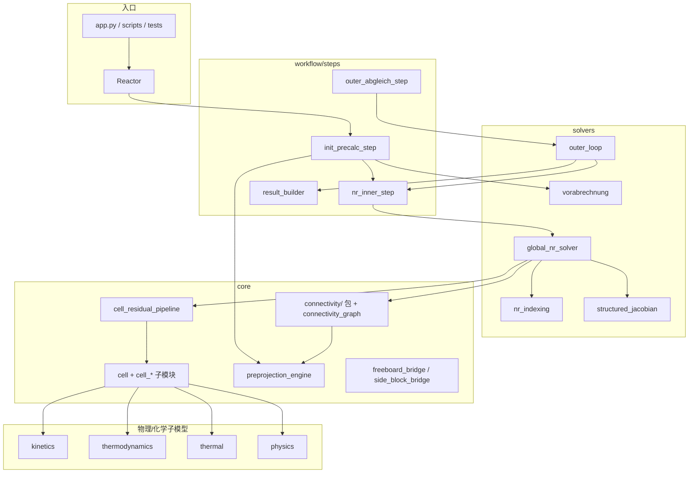

# bfb-gasifier 模块依赖总览

> 基于 GitNexus 索引（**2026-06-26**，OPT-001/002/013 瘦身后重建）与 `src/` import 静态分析整理。  
> 索引位置：`.gitnexus/`（LadybugDB 图 + FTS，未启用向量检索）。

## GitNexus 索引概况

当前索引已收窄至 **模型源码 + 测试**（见下方项目配置）。三阶段对比如下：

| 指标 | 全仓（首次） | 收窄后（2026-06-25） | **瘦身后（2026-06-26）** |
|------|-------------|----------------------|--------------------------|
| 索引文件 | 422 | 292 | **318** |
| 图节点 | 5951 | 3755 | **3903** |
| 边 | 13135 | 8699 | **8951** |
| 社区（clusters） | 178 | 146 | **153** |
| 跨模块流程（processes） | 300 | 300 | 300 |
| 向量嵌入 | 0 | 0 | 0 |

**瘦身后索引变化说明：**

- `src/core/connectivity.py`（单文件 3357 行）已自索引中移除，替换为 `src/core/connectivity/` 包（8 个子模块 + `__init__.py` re-export）。
- 新增 `src/core/preprojection_engine.py`、`tests/test_preprojection_engine.py`、`tests/test_init_precalc_step_stages.py` 等文件进入图。
- 节点/边数**略高于**瘦身前收窄索引（+148 nodes / +252 edges），符合「单文件拆包 + 新引擎模块」的预期，**不是依赖丢失**。
- `node .gitnexus/run.cjs analyze .` 可正常完成；当前环境下 `impact` / `context` 仍可能 SIGSEGV（LadybugDB 查询路径）。精确调用链以本节下方**静态 import 审计**为准。

常用命令（需在项目根目录、非 sandbox 环境）：

```bash
# 重建索引（选项已写入 .gitnexusrc，直接 analyze 即可）
npx gitnexus@latest analyze .

# 状态
npx gitnexus@latest status

# 符号上下文（精确调用链）
npx gitnexus@latest context solve_global_nr
npx gitnexus@latest context Reactor

# 自然语言检索流程
npx gitnexus@latest query "Reactor outer abgleich convergence"

# 变更影响（blast radius）
npx gitnexus@latest impact _solve_global_nr
npx gitnexus@latest impact solve_global_nr
```

**符号名提示：** `impact` 用短名 `_solve_global_nr` / `solve_global_nr` 有效；`Reactor._solve_global_nr` 会报 not found。局部变量/闭包名（如 `apply_bc_fn`）通常无法作为 impact 目标。

**瘦身后重建命令：**

```bash
node .gitnexus/run.cjs analyze .   # 推荐；会检测 incrementalInProgress 并强制全量重建
node .gitnexus/run.cjs status
# impact/context 若 SIGSEGV，可先 rm -f .gitnexus/lbug.wal 后重试；仍失败则用下方静态审计
```

### 项目配置（已落地）

**`.gitnexusrc`** — 默认 analyze 行为：

```json
{
  "defaultBranch": "main",
  "skipContextFiles": true,
  "skipSkills": true,
  "noStats": true,
  "embeddings": false
}
```

**`.gitnexusignore`** — 白名单式收窄（GitNexus 无 `include` 键，用 ignore 语法实现）：

```
*
!src/
!src/**
!tests/
!tests/**
!app.py
```

如需把 `scripts/` 纳入 impact 分析，在 ignore 中追加 `!scripts/`、`!scripts/**`。

### Cursor MCP（已配置）

已执行 `npx gitnexus@latest setup -c cursor`：

- 全局 MCP：`~/.cursor/mcp.json` → `gitnexus mcp`
- Skills：`~/.cursor/skills/gitnexus-*`（exploring、impact-analysis、refactoring 等 9 个）

**使用前：** 在本仓库运行 `gitnexus analyze` 后，在 Cursor 中打开该项目即可通过 MCP 调用 `context` / `impact` / `query`。若 MCP 未出现，重启 Cursor 或检查 Settings → MCP。

---

## 瘦身后依赖完整性审计（2026-06-26）

OPT-001（connectivity 分包）、OPT-002（preprojection_engine）、OPT-013（init 五阶段）完成后，对 `src/`、`tests/`、`scripts/` 做了 AST 级 import 审计：

| 检查项 | 结果 |
|--------|------|
| 外部 `from src.core.connectivity import …` 唯一符号 | **34** 个，**全部**经 `__init__.py` re-export 可解析 |
| `connectivity.__all__`（83 项）→ 源子模块 | **0** 项断裂 |
| 子模块 smoke import（preprojection / joint_gate / nr_boundary / init_precalc） | 全部 OK |
| 关键链：`preprojection → joint_gate → preprojection_engine` | 保留 |
| 关键链：`nr_boundary → routing / solid_transport / gas_inlet` | 保留 |
| `reactor.py` 中 `*_exec` 别名（如 `_apply_all_nr_boundary_data_exec`） | 指向已导出符号，**非**缺失依赖 |

**connectivity/ 包内依赖边（子模块间 + 引擎）：**

```
gas_inlet ──► solid_transport
routing ──► gas_inlet, solid_transport
nr_boundary ──► gas_inlet, routing, solid_transport
preprojection ──► joint_gate ──► preprojection_engine
```

**connectivity 外部消费者（19 个文件，72 条 import）：** 主入口仍为 `reactor.py`(11)、`vorabrechnung.py`(10)、`init_precalc_step.py`(7)、`test_bottom_gas_inlet_split.py`(8)。

**preprojection_engine 直接 importer：** `connectivity/preprojection.py`(10)、`connectivity/__init__.py`(4)、`connectivity/joint_gate.py`(1) — 与 OPT-002 设计一致。

**结论：瘦身过程未丢失可解析的 Python 依赖；GitNexus 图已反映新包结构（旧 `connectivity.py` 不在 `meta.json` 中）。**

---

## 主求解链路（Hamel 流程图 ↔ 代码）

静态顺序见 `src/workflow/simulation_runner.py` 中 `hamel_global_nr_pipeline_order()`：

```
Reactor.solve(solver="global_nr")
  └─ Reactor._solve_global_nr()
       ├─ [1] init_precalc_step.run_init_and_precalc_for_global_nr
       │      赋初值 · Vorabrechnung 快照 · 水动力冻结 · bed0 joint 预投影
       ├─ [2] nr_inner_step.build_global_nr_inner_solve_fn → solve_global_nr（Check1 内层 NR）
       ├─ [3] outer_abgleich_step → outer_loop.run_global_nr_outer_abgleich（Check2 外层对齐）
       └─ [4] result_builder.finalize_global_nr_result
```

流程图节点到模块的完整映射：`describe_hamel_flowchart_mapping()`（同文件）。



---

## 包级依赖方向（import 耦合）

自 `src/` 内 `from src.*` 统计的**跨包引用次数**（数字越大表示依赖越强）：

| 源包 | 主要指向 |
|------|----------|
| **solvers** | core(32), thermal(2), thermodynamics(2) |
| **core** | solvers(19), kinetics(8), physics(7), workflow(3), thermal(2), thermodynamics(2) |
| **workflow** | solvers(13), core(11) |
| **gasifier** | core(11), solvers(6), workflow(1)（别名/重导出层） |
| **kinetics** | core(6) |
| **thermodynamics** | core(4) |
| **physics** | core(4) |
| **thermal** | core(3), kinetics(1) |

**被引用 hub（fan-in 顶层包，瘦身后）：** `core`(71) ≫ `solvers`(38) > `kinetics`(9) > `physics`(7) > `thermal`(4) ≈ `workflow`(4) ≈ `thermodynamics`(4)。

> 注：上表为 AST 静态计数，高于旧版手工统计，因 core↔solvers 双向回调（NR 残差、vorab refresh、boundary refresh）在瘦身后仍完整保留。

分层结论：

1. **core 是中心枢纽**：Cell 状态、残差装配、连通图、freeboard/side-block 桥接均在此。
2. **solvers 编排 NR 与外层循环**，但残差/Jacobian 仍回调 core。
3. **kinetics / thermodynamics / thermal / physics 为叶子子模型**，主要被 `cell_*` 消费。
4. **gasifier/** 为对外稳定 API 层，实现仍在 core/solvers/workflow。

---

## 关键模块与 GitNexus 影响半径

以下 impact 基于**收窄索引**（src + tests + app.py）。若恢复全仓索引，入口符号（如 `_solve_global_nr`）风险会升至 CRITICAL 并包含大量 scripts。

### 求解链路入口

| 符号 | 文件 | 风险 | 影响规模 | 说明 |
|------|------|------|----------|------|
| `_solve_global_nr` | `reactor.py` | **HIGH** | 1 direct / 7 total | 全流程入口；编排 init → inner → outer → result |
| `solve_global_nr` | `global_nr_solver.py` | 高 | — | Check1 内层 NR 主循环 |
| `run_global_nr_outer_abgleich` | `outer_loop.py` | LOW | 1 direct / 3 total | Check2 外层对齐 |
| `run_init_and_precalc_for_global_nr` | `init_precalc_step.py` | LOW | 1 direct / 5 total | init 顺序敏感（joint 预投影、hydro freeze） |

### 收敛相关 core / connectivity（改 NR 时优先查）

| 符号 | 文件 | 风险 | 影响规模 | 说明 |
|------|------|------|----------|------|
| `global_residual` | `global_nr_solver.py` | **CRITICAL** | 4 direct / 15 total | 每步 NR 残差；动则牵动 cell 残差链 |
| `_bottom_joint_gate_merit` | `connectivity/joint_gate.py` | **CRITICAL** | （impact 暂不可用） | bed0 joint 线搜索 merit；静态链：joint_gate → preprojection_engine → global_nr_solver |
| `execute_cell_residual_pipeline` | `cell_residual_pipeline.py` | 高 | — | 单 cell 残差执行顺序 |
| `assemble_cell_residual_vector` | `cell_balances.py` | 高 | — | 气/固/能残差装配 |

### `solve_global_nr` 出站调用（GitNexus context 摘要）

内层 NR 核心循环直接调用：

- `global_residual` / `build_equation_scales` / `build_jacobian_fd`
- `_rms_norm` / `_state_rms_norm` / `_residual_group_metrics` / `_residual_gas_phase_metrics`
- 接受步后：`refresh_cell_hydrodynamics_for_frozen_inner`（vorabrechnung）

### `global_residual` → Cell 残差链

```
global_nr_solver.global_residual
  → connectivity / connectivity_graph（邻域、BC、joint gate）
  → cell_residual_pipeline.execute_cell_residual_pipeline
       → cell_balances.assemble_cell_residual_vector
            → cell_hydrodynamics / cell_kinetics / cell_balances / cell_pyrolysis ...
```

---

## 目录职责速查

### `src/core/` — 反应器与单元模型

| 模块 | 职责 |
|------|------|
| `reactor.py` | `Reactor` / `ReactorConfig`；`_build_cells`、`_solve_global_nr`、`solve` |
| `cell.py` | `Cell` 状态容器；与 `cell_*` 协同 |
| `cell_balances.py` | 气/固/能量守恒残差 |
| `cell_kinetics.py` | R1–R8 源项装配 |
| `cell_hydrodynamics.py` | U_mf、气泡、K_bd |
| `cell_pyrolysis.py` / `cell_minor_species.py` | 热解与次要物种 |
| `cell_residual_pipeline.py` | 单 cell 残差执行顺序 |
| `connectivity/` | NR 边界、路由、固相输运、气入口、joint gate、预投影（见下表） |
| `freeboard/` | 自由板轴向 segment、三套粒子轨迹、气相反应（见下表）；`freeboard_segment.py` 为 re-export shim |
| `preprojection_engine.py` | LSQ / relax 预投影引擎（OPT-002）；被 joint_gate、preprojection 调用 |
| `connectivity_graph.py` | 显式 freeboard/side-block 图邻域 |

**`connectivity/` 子模块（GitNexus 均已索引）：**

| 子模块 | 行数 | 职责 |
|--------|------|------|
| `__init__.py` | 103 | 83 项公开 re-export + `_preproj_*` benchmark shim |
| `gas_inlet.py` | 330 | 底部气入口、primary gas 分层、hydro dense fraction |
| `routing.py` | 262 | 上游传播、侧块/旋风/返料路由 |
| `solid_transport.py` | 635 | 固相流、holdup seed、freeboard/side-block 输运系数 |
| `nr_boundary.py` | 423 | `apply_all_nr_boundary_data` / local BC refresh |
| `joint_gate.py` | 166 | bed0 joint merit / relax 候选 |
| `preprojection.py` | 1684 | 各类 preproject_* / outer pre-inner bridge |
| `topology.py` | 71 | `build_thesis_connectivity_topology` |

**`freeboard/` 子模块（OPT-003，GitNexus 待重建索引）：**

| 子模块 | 行数 | 职责 |
|--------|------|------|
| `__init__.py` | 77 | 公开 API re-export |
| `types.py` | 93 | `FreeboardState` / `FreeboardBackground` |
| `transport.py` | 422 | 速度采样、粒径 bundle、class transport、inventory char sink |
| `trajectory_common.py` | 563 | Wirsum ABC、二次 ODE、事件 bisect、delta_neg 辅助 |
| `trajectory_surrogate.py` | 153 | surrogate / force_balance 轨迹 |
| `trajectory_wirsum.py` | 531 | `analytical_wirsum` 边界事件推进 |
| `trajectory_hamel.py` | 978 | `global_projected_hamel` 连续追踪 + driver |
| `reaction.py` | 323 | 气相反应步、background profile |
| `segment.py` | 622 | `simulate_freeboard` 编排 |
| `freeboard_segment.py` | 7 | re-export shim（import 路径不变） |

| `freeboard_bridge.py` / `side_block_bridge.py` | 闭包 → 显式 cell 桥接 |
| `phase_gate_checks.py` | Phase gate 验收辅助 |

### `src/solvers/` — 数值求解

| 模块 | 职责 |
|------|------|
| `vorabrechnung.py` | 轴向 T、x0、水动力预计算与 refresh |
| `vorab_cell_abgleich.py` | 单 cell Vorab ↔ 模型对齐 |
| `global_nr_solver.py` | 全域 NR、线搜索、Check1 |
| `outer_loop.py` | 外层 Abgleich、Check2、pre-inner |
| `nr_indexing.py` | 全局未知数索引 |
| `structured_jacobian.py` | 块三对角 / 带状 Jacobian |
| `convergence.py` | Inner/Outer 收敛判据 |
| `result_builder.py` | 结果打包 |
| `wirsum_damping.py` | Wirsum 阻尼 Newton 参数 |

### `src/workflow/` — 薄编排

| 模块 | 职责 |
|------|------|
| `simulation_runner.py` | 流程图映射、pipeline 顺序、`run_global_nr_workflow` |
| `steps/init_precalc_step.py` | INIT + PRECALC（五阶段：strategy/seed → vorab → holdup → bottom preproj → abgleich/joint） |
| `steps/nr_inner_step.py` | 内层 NR 闭包 |
| `steps/outer_abgleich_step.py` | 外层 Abgleich 薄封装 |

### 子模型包

| 包 | 职责 |
|----|------|
| `kinetics/` | Arrhenius 工厂、char/gas 反应、Hamel R5–R7 参考 |
| `thermodynamics/` | Gibbs、平衡、Hamel 约简 Gibbs |
| `thermal/` | 干燥、热解 |
| `physics/` | 最小流化、气泡、相间传质、freeboard 辅助 |

### `src/gasifier/` — 命名空间别名 + Phase0 演示

| 子路径 | 状态 | Canonical 对照 |
|--------|------|----------------|
| `workflow/`、`solvers/` | **活跃** | 重导出 `src.workflow` / `src.solvers` |
| `models/correlations/` | **活跃** | 经验关联式；`tests/test_correlation_priority.py` |
| `models/*Model`、`domain.GlobalState` | **Phase0 已弃用** | 导入时 `DeprecationWarning` → `src.core.*` / `Reactor` |
| `models/connectivity.py` | **Phase0 已弃用** | **`src.core.connectivity`**（NR BC / 预投影 / joint gate） |
| `config/`、`domain/config` | 配置 dataclass | Phase0 演示与 correlations 仍引用 |

新功能**只**在 `src.core` / `src.solvers` / `src.workflow` 实现；勿在 `gasifier.models.*Model` 并行演进。

---

## 测试与脚本如何挂接

当前索引**不含** `scripts/`（有意收窄）。`Reactor` / `_solve_global_nr` 在 tests 中的主要上游：

- `tests/test_global_nr_solver.py`
- `tests/test_outer_loop_convergence.py`
- `tests/test_table2_LU_global_nr.py`
- `tests/test_flowchart_mapping_contract.py`

benchmark / audit 脚本（`scripts/benchmark_phase2_convergence_ladder.py` 等）在全仓索引时才会进入 impact 图；需要时可临时放宽 `.gitnexusignore`。

改求解器或 init 顺序时，优先跑：

```bash
pytest tests/test_global_nr_solver.py tests/test_outer_loop_convergence.py tests/test_flowchart_mapping_contract.py -q
python tests/sanity_checks.py
```

---

## 后续建议

1. ~~Cursor MCP~~ — 已完成；日常在对话中可直接问「impact global_residual」类问题。
2. ~~收窄索引~~ — 已完成；见 `.gitnexusrc` / `.gitnexusignore`。
3. **Wiki（可选）：** `npx gitnexus@latest wiki` 生成叙述性文档；精确依赖仍以本总览 + `describe_hamel_flowchart_mapping()` 为准。
4. **改 core 前必查：** `gitnexus impact <symbol>`，优先 `global_residual`、`_bottom_joint_gate_merit`、`_solve_global_nr`。
5. **收敛调试：** 改 `connectivity/joint_gate.py` 或 `preprojection_engine.py` / `global_nr_solver.py` 线搜索 merit 后，跑 `benchmark_phase2_convergence_ladder.py`（40 outer）验证长跑 energy_rms。
6. **瘦身后改 connectivity：** 优先改对应子模块（`gas_inlet` / `routing` / `solid_transport` / `nr_boundary` / `joint_gate` / `preprojection`），公开 API 仍经 `connectivity/__init__.py` 导出；benchmark shim 使用 `_preproj_*` 别名。

---

## 参考

- **Hamel 算法文档索引：** [`docs/README.md`](README.md)
- **瘦身 handoff（收敛/调参）：** [`docs/optimization_handoff_summary.md`](optimization_handoff_summary.md)
- 流程图 mmd：`docs/gasifier_model_flowchart_trilingual.mmd`
- 工程桥接笔记：`docs/hamel_engineering_bridge_notes.md`
- 静态 pipeline 契约：`src/workflow/simulation_runner.py`
- **重复代码与体量优化索引：** [`docs/codebase_optimization_index.md`](codebase_optimization_index.md)
