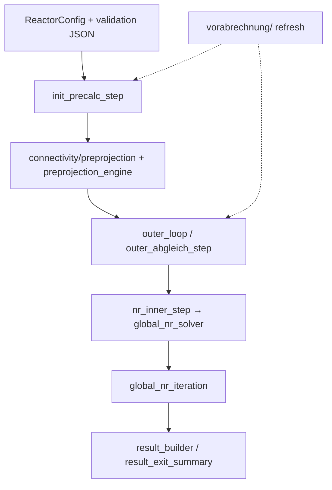

# 代码瘦身 Handoff Summary（OPT 001–014 + T01）

> **读者**：接手「收敛验证 + 模型调参」的 agent。  
> **日期**：2026-06（瘦身完成态）  
> **详细索引**：[`codebase_optimization_index.md`](codebase_optimization_index.md) · **模块依赖**：[`module_dependency_overview.md`](module_dependency_overview.md) · **算法文档**：[`README.md`](README.md)

---

## 1. 一句话结论

- **14/14 OPT + OPT-T01 已全部完成**；目标是**可维护性 / SSOT / 测试复用**，不是求解加速。
- **对外 import 路径基本不变**（shim + re-export）；改代码应优先进**子包**，不要回写已删除的 mega-file。
- **端到端 solve wall time 无明显改善**；唯一性能项 OPT-012 在 init+preinner 上约 **2–3%**（见 `data/opt012_walltime_compare_latest.json`）。
- **下一步**：收敛 ladder、CO/CO₂ 标定、`r*_scale` 扫描 — 脚本与 harness 已就绪，见 §6。

---

## 2. 瘦身交付清单

| ID | 交付物 | 验证 |
|----|--------|------|
| OPT-001 | `src/core/connectivity/` 包（8 子模块） | connectivity 测试 + sanity |
| OPT-002 | `src/core/preprojection_engine.py` | preprojection 相关测试 |
| OPT-003 | `src/core/freeboard/` 包（9 子模块） | `test_freeboard_analytical_trajectory` 8/8 |
| OPT-004 | `src/solvers/vorabrechnung/` 包（5 子模块） | `test_vorabrechnung_*` |
| OPT-005 | `src/solvers/global_nr_iteration.py` | global NR 测试 |
| OPT-006 | `src/solvers/result_exit_summary.py` | exit summary 测试 |
| OPT-007 | `scripts/run_phase_gate.py` | gate CLI 测试 |
| OPT-008 | `scripts/_lu_harness.py` | `tests/test_lu_harness.py` |
| OPT-009 | `tests/validation/`（5 子模块） | validation re-export 24 项 |
| OPT-010 | `nr_inner_step._solve_inner_nr` + partial | outer loop 测试 |
| OPT-011 | `gasifier/models` DeprecationWarning | phase0 deprecation 测试 |
| OPT-012 | partial `cell.residuals(groups=…)` + local BC | bottom_gas_inlet + opt012 benchmark |
| OPT-013 | `init_precalc_step` 阶段函数化 | init 测试 |
| OPT-014 | `scripts/compare_vorab_march_lu.py` | import 烟雾 |
| OPT-T01 | `tests/global_nr_fixtures.py` | 参数化 NR 测试 |

---

## 3. 代码去哪了（迁移地图）

### 3.1 仍用旧路径 import 的 shim（勿删）

| 旧路径 | 实际实现 | 说明 |
|--------|----------|------|
| `from src.core.connectivity import …` | `src/core/connectivity/__init__.py` | 83+ 项 re-export；benchmark 用 `_preproj_*` 别名 |
| `from src.core.freeboard_segment import simulate_freeboard` | `src/core/freeboard/` | 7 行 shim |
| `from src.solvers import vorabrechnung` / `vorabrechnung.*` | `src/solvers/vorabrechnung/` | 包 + `__init__.py` re-export |
| `from tests.validation_case_utils import …` | `tests/validation/` | 94 行 re-export shim |
| `import src.solvers.global_nr_solver as _gnr` | 同模块 + `global_nr_iteration.py` | **测试 monkeypatch 兼容**（OPT-005） |

### 3.2 三大拆分包 — 子模块职责

**`src/core/connectivity/`**

| 文件 | 职责 |
|------|------|
| `gas_inlet.py` | 底部气入口、primary gas 分层 |
| `routing.py` | 上游传播、侧块/旋风路由 |
| `solid_transport.py` | 固相输运系数、holdup seed |
| `nr_boundary.py` | `apply_all_nr_boundary_data` |
| `joint_gate.py` | bed0 joint merit / relax |
| `preprojection.py` | **最大文件 ~1684 行**；各类 `preproject_*`、outer pre-inner |
| `topology.py` | `build_thesis_connectivity_topology` |

**`src/core/freeboard/`**

| 文件 | 职责 |
|------|------|
| `types.py` | `FreeboardState` / `FreeboardBackground` |
| `transport.py` | 速度采样、class transport、inventory char sink |
| `trajectory_common.py` | Wirsum ODE、bisect、delta_neg |
| `trajectory_wirsum.py` | `analytical_wirsum` |
| `trajectory_hamel.py` | `global_projected_hamel` + driver |
| `trajectory_surrogate.py` | surrogate / force_balance |
| `reaction.py` | 气相反应步、background profile |
| `segment.py` | **`simulate_freeboard` 编排** |

环依赖：`transport._freeboard_inventory_char_sink_diag` → lazy import `reaction._freeboard_reaction_step`。

**`src/solvers/vorabrechnung/`**

| 文件 | 职责 |
|------|------|
| `vorab_gibbs_seed.py` | Gibbs / 热解 seed |
| `vorab_budgets.py` | 轴向预算、VM 分区 |
| `vorab_cell_mapping.py` | bed 映射、`apply_vorabrechnung_*` |
| `vorab_x0.py` | `generate_initial_x0` |
| `vorab_refresh.py` | refresh / initialize frozen |

环依赖：budgets ↔ mapping ↔ refresh 用 **lazy import**。

### 3.3 NR / 工作流（调参常改）

| 模块 | 路径 | 备注 |
|------|------|------|
| NR 主入口 | `src/solvers/global_nr_solver.py` | 薄编排；迭代体在 `global_nr_iteration.py` |
| Inner NR step | `src/workflow/steps/nr_inner_step.py` | `_solve_inner_nr` + `functools.partial` |
| Init | `src/workflow/steps/init_precalc_step.py` | 阶段函数化 |
| Outer Abgleich | `src/workflow/steps/outer_abgleich_step.py` | Check2 |
| 预投影引擎 | `src/core/preprojection_engine.py` | LSQ / relax 模板（OPT-002） |
| 结果 | `src/solvers/result_builder.py` → `result_exit_summary.py` | exit 汇总 |
| Vorab 单 cell 对齐 | `src/solvers/vorab_cell_abgleich.py` | Check2 桥接 |

### 3.4 验证配置 SSOT

| 用途 | 入口 |
|------|------|
| JSON 工况 | `data/validation_cases.json` |
| Phase1 LU config | `tests/validation/config_phase1.py` |
| Phase2 freeboard config | `tests/validation/config_phase2_freeboard.py` |
| solve kwargs | `tests/validation/solve_kwargs.py` |
| 加载 / gate | `tests/validation/case_lu_loader.py` |
| 对外 re-export | `tests/validation_case_utils.py` |

脚本侧统一用 **`scripts/_lu_harness.py`**：`build_phase2_config()`、`LADDER_LEVELS`（baseline/p0/p1/p2）、`phase2_solve_kwargs()`、`run_phase2_init()`、`timed_phase2_solve()`。

---

## 4. 求解数据流（调参 / 收敛必看）



**BC 两层（OPT-012）**

- `apply_bc_fn` = `reactor._apply_all_bc_for_nr` — accept/reject、全 reactor 同步  
- `apply_local_bc_fn` = `reactor._apply_local_bc_for_nr` — 预投影 **trial** 内用，避免全炉 BC  

**Partial residual（OPT-012）**

- `cell.residuals(groups=("gas",)|("energy",)|…)` — 预投影 trial 跳过 solid 等  
- 实现：`cell_residual_pipeline.execute_cell_residual_pipeline(..., groups=...)`

---

## 5. 文档 SSOT（算法 vs 工程）

| 层级 | 路径 |
|------|------|
| 方程 SoT | `docs/hamel_submodels/00–07`（本地-only） |
| 已核验摘要 | `specs/hamel_checked_algorithm_spec.md` |
| 开发约定 | `docs/CLAUDE.md` |
| 文档索引 | `docs/README.md` |
| B 档 / 拓扑 | `docs/hamel_b_tier_thesis_extraction.md` |
| Init/Outer 语义 | `docs/vorab_init_abgleich_vs_outer_preinner.md` |
| 同构台账 + 证据矩阵 | `docs/hamel_isomorphic_gap_implementation_checklist.md` |
| 收敛 ladder 配置 | `scripts/_lu_harness.LADDER_LEVELS` |

**勿再引用**：`specs/00–04`、`hamel_original_algorithm_reconstruction.md`、`hamel_evidence_matrix.md`。

源码 docstring 应指向 **`docs/hamel_submodels/…`**；`scripts/audit_hamel_consistency.py` 会扫描 stale `specs/0x`。

---

## 6. 收敛验证 — 推荐命令

```bash
cd bfb-gasifier

# 快速门禁
python3 tests/sanity_checks.py                    # 期望 17/17
python3 scripts/audit_hamel_consistency.py        # 方程锚点（末尾 solve 段有已知 API 问题，见 §8）

# Phase gate
python3 scripts/run_phase_gate.py 20 --json
python3 scripts/run_phase_gate.py all             # 长跑

# 收敛 ladder（调参主战场）
python3 scripts/benchmark_phase2_convergence_ladder.py --levels p2 --outer-max 20

# CO/CO₂ 标定网格
python3 scripts/calibrate_phase2_co_co2_window.py

# Pre-inner 性能实验（未收成默认）
python3 scripts/benchmark_preinner_perf_experiments.py

# OPT-012 A/B（仅 init+preinner，非 full solve）
python3 scripts/benchmark_opt012_walltime_compare.py --repeats 3

# 自由板 / NR 子集
pytest tests/test_freeboard_analytical_trajectory.py -q
pytest tests/test_global_nr_solver.py -k "vtt_minimal_loop or freeboard_trajectory" -q
pytest tests/test_vorabrechnung_a_tier_budget.py -q
```

**Ladder 级别**（`_lu_harness.LADDER_LEVELS`）：`baseline` → `p0` → `p1` → `p2`（P2 默认 `freeboard_trajectory_coeff_model=exact_hamel`）。

**关键 acceptance 测试**（B/A 档）：`test_vtt_minimal_loop_jacobian_structure_has_no_unexpected_blocks`、`test_vtt_minimal_loop_outer_a_tier_convergence` 等 — 见 `hamel_b_tier_thesis_extraction.md` §10。

---

## 7. 模型调参旋钮（非 monkey patch）

均在 `ReactorConfig` / `Cell`；标定脚本会扫网格：

| 旋钮 | 默认 | 用途 |
|------|------|------|
| `r2_scale`, `r4_scale`, `r5_scale`, `r8_scale` … | 1.0 | 反应强度标定（CO/CO₂ 等） |
| `freeboard_u_gb_scale`, `freeboard_beta_a_scale` | 1.0 | 自由板轨迹 |
| `freeboard_trajectory_coeff_model` | ladder 定 | `stable_mixed_drag_split` vs `exact_hamel` |
| `vorab_bottom_temperature_cap_K_thesis` | ladder 定 | Vorab 温度帽 |
| `improvement_factor`（预投影内） | 0.75 | 收敛工程参数，分散在 `preprojection.py` |
| `nr_bottom_zone_downstream_temperature_blend_thesis` | 0.75 | 床区温度桥接 |

**调参原则**（`docs/CLAUDE.md`）：先 **代码 vs hamel_submodels 一致**，再论文，最后才动 scale。

---

## 8. 已知问题 / 接手陷阱

1. **`audit_hamel_consistency.py` 末尾**：`build_phase2_config(load_case_lu())` 签名不匹配 — 引用审计前半段仍可用；full solve 段待修。  
2. **`test_global_nr_solver.py` 全量很慢**：用 `-k` 子集或 `-m "not slow"`。  
3. **Monkeypatch 路径**：测试 patch `src.solvers.global_nr_solver.*`、`src.solvers.vorabrechnung.*`（包 re-export 后仍有效）；fixtures 在 `tests/global_nr_fixtures.py`。  
4. **Major Gibbs mock**：patch 目标为 `src.solvers.vorabrechnung.vorab_x0._solve_major_gibbs_seed`。  
5. **Jacobian band_plus 容差**：`global_nr_fixtures` 用 `1e-9`（曾从 `1e-10` 放宽）。  
6. **Wall time**：瘦身未加速 full NR；历史 2–4× 来自 Jacobian 策略 / 去 GS warmup（见 archive 报告），与 OPT 包无关。  
7. **Git 未跟踪大量 `data/phase2_*`**：probe JSON 为本地实验产物，非 CI 基线。

---

## 9. 建议的下一步工作顺序

1. **固定 baseline**：对 P2 ladder 跑 `benchmark_phase2_convergence_ladder.py --outer-max 20`，保存 JSON 到 `data/phase2_convergence_ladder_latest.json`。  
2. **收敛诊断**：未收敛时查 `vorab_init_abgleich_vs_outer_preinner.md` — 区分 Init / Pre-inner / Check1 / Check2。  
3. **组分校准（仅 diagnostic）**：`calibrate_phase2_co_co2_window.py` → 结果存 `data/phase2_co_co2_*`；**勿**把单 case optimal scale 写入 `config_phase2_freeboard`。调参物理参考见 [`validation_cases_chemistry_map.md`](validation_cases_chemistry_map.md) §6。  
4. **多 case 趋势**：`python3 scripts/benchmark_phase2_multi_case_matrix.py` → `data/phase2_multi_case_matrix_latest.json`（见化学地图 §7）。2026-06 首跑：LU 收敛；W2/Peat6 未收敛 — **勿**用 LU 默认外推 O₂/Steam 或 VTT 几何。  
5. **自由板**：`exact_hamel` vs `stable_mixed_drag_split` 对照；代码在 `src/core/freeboard/`。  
6. **同构闭合**：`hamel_isomorphic_gap_implementation_checklist.md` §0.5–§0.6 已于 **2026-07-08** 与 parity 汇总同步（R10/Jacobian/能量/固相/自由板/A1 默认）；剩余开放：Fig.7 出口 T、Vorab outer 策略、侧块能量。  
7. **可选性能线**：`benchmark_preinner_perf_experiments.py` 中 `lsq_skip_loose` 等 — 需单独收敛回归后再默认化。

---

## 10. 快速定位表（「我要改 X」）

| 目标 | 改这里 |
|------|--------|
| 预投影 / pre-inner | `connectivity/preprojection.py` + `preprojection_engine.py` |
| 底部 joint / Check2 门控 | `connectivity/joint_gate.py` + `vorab_cell_abgleich.py` |
| NR 迭代 / 线搜索 | `global_nr_iteration.py` + `global_nr_solver.py` |
| Vorab 预算 / x0 | `vorabrechnung/vorab_budgets.py` + `vorab_x0.py` |
| 自由板轨迹 | `freeboard/trajectory_*.py` + `segment.py` |
| 反应源项 | `cell_kinetics.py` + `kinetics/*` |
| 验证 config | `tests/validation/config_phase*.py` |
| **验证工况化学地图** | [`validation_cases_chemistry_map.md`](validation_cases_chemistry_map.md) |
| 审计脚本 | `scripts/_lu_harness.py` + 各 `audit_*` / `benchmark_*` |

---

*本文件随 OPT 完成态生成；结构变更请同步更新 [`codebase_optimization_index.md`](codebase_optimization_index.md) 与本 handoff。*
