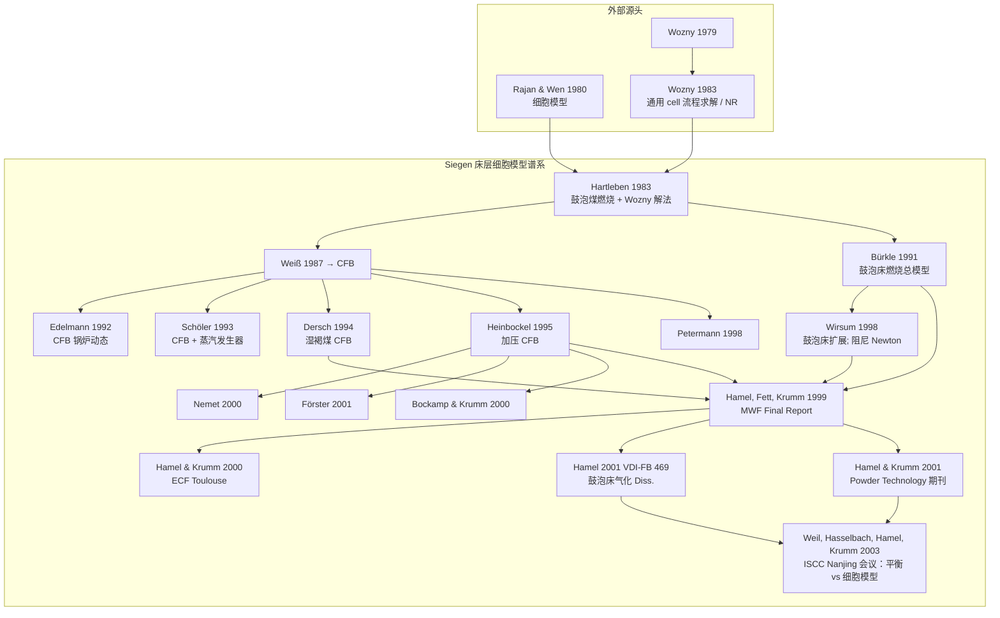
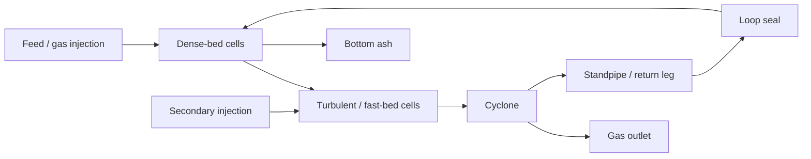
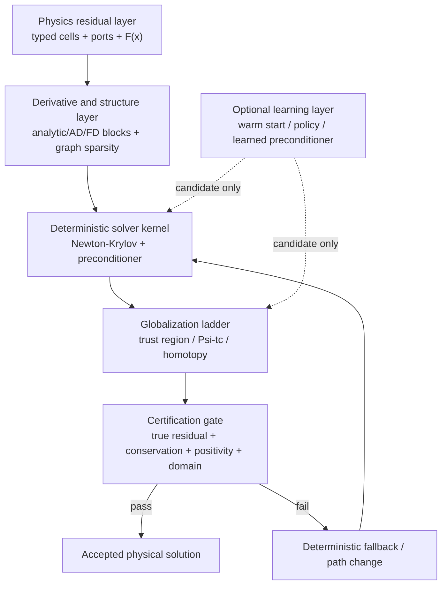

# Siegen 细胞模型方法学谱系（BFB / CFB 燃烧 → 鼓泡床气化）

机构核心：Universität-GH Siegen，**Lehrstuhl für Energie- und Umweltverfahrenstechnik**  
学术环境：Hamel 1996–1998 年在 **F. N. Fett** 的 Institut für Energietechnik 工作，1998 年起转入 **W. Krumm** 的 Lehrstuhl；因此本文将 Fett / Krumm 视为机构与研究计划的承接背景，不简化为一条已证实的“导师传承线”。  
整理依据：Hamel (2001) VDI 博士论文前言、第 1.3 节、第 2–5 章与文献表；Hamel & Krumm, *Powder Technology* 120 (2001) 105–112；已获取的原始论文、图书馆书目与 Siegen 出版物清单。

> 本文件是**方法学谱系的研究底稿**，不是方程 SoT，也不是已完成的 blog 稿。方程级规格仍以 `docs/hamel_submodels/` 为准。

### 研究问题

本文不只回答“谁引用了谁”，而要分别回答：

1. **反应器如何被离散**：一维 cells、bubble / suspension 两相、bed / freeboard / cyclone 与回流如何组成可配置的装置网络。
2. **方程如何被求解**：从单元局部计算转为全装置同时 Newton，以及阻尼、初值和 Vorabrechnung 的作用。
3. **子模型如何嵌入架构**：水力学、相间传质、干燥–热解、颗粒运动、反应动力学和 Gibbs 平衡分别来自哪些文献。
4. **可信度如何建立**：从燃烧到气化、从 BFB 到 CFB、从常压到加压、从实验室到 HTW 商业尺度的验证究竟支持什么结论。
5. **本项目继承了什么**：哪些是 Hamel 原始方法，哪些是可追溯的外部子模型，哪些是 Python 复现中必要的工程桥接。

### 中心命题：气化炉模型的“双重祖先”

这套模型最值得讲述的不是一条从燃烧到气化的单线演化，而是两条原本来自不同工程问题的方法流在 Siegen 汇合：

| 源流 | 原始对象 | 提供的核心东西 | 未单独解决的问题 |
|------|----------|------------------|--------------------|
| **Rajan & Wen (1980)** | 流化床煤燃烧器 | 炉内轴向 compartments、bubble/emulsion 两相、固体反混、夹带和 freeboard；即“炉内有什么、如何划分” | 复杂回流拓扑下的全装置同时非线性求解 |
| **Wozny (1979, 1983; Wozny et al. 1987)** | 精馏/吸收等热分离板式塔与通用流程 | 级/cell 的模块化表达、每级守恒与相平衡方程的联立、Newton–Raphson / relaxation、结构化 Jacobian；即“这些 cell 如何组成并求解” | 流化床特有的气泡–固体–反应–夹带物理 |

**Hartleben (1983) 是第一个明确的融合节点**：按 Hamel §1.3 的历史陈述，他把 Rajan & Wen 的 FBC 细胞模型与 Wozny 的求解法结合，用于鼓泡流化床煤燃烧。这里的“融合”不是把精馏塔的气液平衡公式搬进煤炉，而是把**分级设备的建模与求解思想**移植到了**流化床的反应与运移物理**上。

**Hamel (1999/2001) 是第二个集成节点**：他保留这个“流化床物理 cell + 分级流程同时求解”的骨架，再吸收 Bürkle / Wirsum 的 BFB 燃烧经验、Dersch 的湿料干燥–热解和 Heinbockel 的加压水力修正，并加入欠氧气化反应网络、焦油、Gibbs 热解气分配、freeboard 颗粒轨迹和 HTW 回流拓扑。

因而可以用一句话概括这套方法：

> **Rajan & Wen 定义了流化床中需要被表达的物理世界，Wozny 提供了将分级工程系统组装成非线性方程并同时求解的计算语法；Hartleben 将两者首次融合，Hamel 把这一融合扩展为鼓泡流化床气化炉体系。**

### 证据等级

| 标记 | 含义 | 可用于 |
|------|------|--------|
| **E1** | 已通读该原始文献，能定位原文、方程或图表 | 确认“具体继承了什么” |
| **E2** | Hamel 论文或后续作者明文回顾该关系，但前代全文当前不可获得 | 确认谱系主干，不足以重建前代算法细节 |
| **E3** | 出版商页面、图书馆书目或权威出版清单已核对 | 确认题名、年份、卷期、机构等元数据 |
| **H** | 依时间、引用或模型相似性作出的工作假说 | 仅用于指导继续检索，不得写成定论 |

---

## 1. 传承总览：不是一条线，而是四层组装

下图只画**机构/作者主干与应用分支**；数值算法、外部物理/化学子模型和验证数据谱系见 §7–§8。如果把所有经验关联式和反应子模型也塞入同一张人物图，反而会掩盖“架构继承”与“子模型引入”的区别。

### 传承要点

| 步骤 | 内容 |
|------|------|
| Rajan & Wen → Hartleben | 细胞模型（分区平衡） |
| Wozny → Hartleben | Newton–Raphson + 块三对角 Funktionalmatrix |
| Hartleben → Weiß | 细胞模型与同时求解扩到 CFB；1987 期刊文明确使用 reactor / cyclone / cooler cells 与 Newton–Raphson–relaxation |
| Hartleben → Bürkle → Wirsum | 回到并持续细化 BFB 燃烧；Wirsum 还是 Hamel 阻尼 Newton 细节的直接指向 |
| Weiß 之后的 CFB 应用支线 | Edelmann / Schöler 处理蒸汽发生器、动态与控制；Dersch / Heinbockel 处理湿煤与加压；Petermann / Nemet / Bockamp / Förster 扩展至联合循环、燃机和排放 |
| Bürkle / Wirsum / Dersch / Heinbockel → Hamel | PT 期刊明确将四者列为气化模型的直接前代；它们分别贡献 BFB 架构、污泥/湿料处理、CFB 经验和加压修正 |
| 1999 Final Report → 2000/2001 论文群 | 1999 项目报告是期刊所指的完整 development / formulas / solution procedure 来源；2000 会议、2001 VDI 论文和 PT 文是不同详细度的对外呈现 |
| Hamel → Weil / Hasselbach 等 | 主体架构延续用于焦油转化、气化器设计方法比较和两级工艺，但未形成新的公开求解器主链 |

---

## 2. Hamel & Krumm (2001) 期刊文在谱系中的位置

**完整引用**

Hamel, S.; Krumm, W.  
Mathematical modelling and simulation of bubbling fluidised bed gasifiers.  
*Powder Technology*, **120**, **2001**, pp. **105–112**.  
PII: S0032-5910(01)00356-4  
DOI: [10.1016/S0032-5910(01)00356-4](https://doi.org/10.1016/S0032-5910(01)00356-4)  
本地副本（仓库外）：用户 `BFB-cell-model/reference/` 目录下同名 PDF。

**与博士论文关系**

- 期刊文是 Diss. / 项目报告的**短文验证版**（8 页）：模型概要 + 四套鼓泡床气化算例对照。
- 文中写明：公式与**数值求解过程**细节见  
  **[10] Hamel, S.; Fett, F. N.; Krumm, W.**, Final Report, MWF NRW Project-No. IV A4-9021.1, **1999**  
  （不是期刊正文。）
- 期刊**未展开** Newton / 阻尼 / 线搜索 / merit；不要指望从 PT 文解决当前 NR 接受规则问题。

**期刊文自称的直接前身（References [6]–[9]）**

| # | 文献 | 角色 |
|---|------|------|
| [6] | Bürkle (1991) | 大气鼓泡床煤燃烧 |
| [7] | Wirsum (1998) | 污泥鼓泡床燃烧；**本地全文已入库** `docs/_1997_VDI-Dis._Wirsum_…pdf`；NR 笔记 `docs/wirsum_1997_nr_solver_notes.md` |
| [8] | Dersch (1994) | 大气/湿煤 CFB |
| [9] | Heinbockel (1995) | 加压 CFB |

### 2.1 Siegen 气化项目与 HTW 工业数据的关系

这条模型谱系必须区分两个阶段：

1. **1983—1998 年主要是流化床燃烧与通用求解方法积累。** Hartleben、Weiß、Bürkle、Dersch、Heinbockel、Wirsum 分别处理 BFB/CFB 燃烧、湿燃料、加压水力学和固体循环；现有资料不支持把 1980 年代的整条 Siegen 主线称为“HTW 气化模拟项目”。
2. **1990 年代后半段才明确扩展到 BFB 气化并接入 HTW 数据。** Hamel 自 1996 年进入 Fett 的 Institut für Energietechnik，1998 年转入 Krumm 的 Lehrstuhl für Energie- und Umweltverfahrenstechnik；其工作由北威州 MSWWF 与 DFG 共同资助。

当前可确认的资助和工业合作证据如下：

| 证据 | 可以确认 | 不能据此确认 |
|------|----------|----------------|
| Hamel Diss. 前言 | 研究由北威州 MSWWF 和 DFG 资助 | 两个资助项目的完整任务书、参与单位与治理结构 |
| Hamel & Krumm (2001) Acknowledgements | NRW Project `IV A 4-9021.1`；DFG Project `KR 892/9-1` | 两项目是否属于同一个正式 Verbundprojekt |
| Hamel Diss. 文献表 | `Rheinbraun AG; Krupp Uhde GmbH: Interne Mitteilung: Messdaten aus dem Betrieb der HTW-Druckvergasungsanlage und der HTW-Demonstrationsanlage (1997)` | 数据移交协议、保密条款与完整数据包 |
| Hamel et al. (1999) HTW 会议文 | Hamel / Krumm 与 Abraham / Mittelstädt / Karkowski 共同发表 commercial-scale 与 pilot-scale HTW 对比 | 仅凭公开书目不能还原每位作者在项目中的正式单位与职责 |
| Rheinbraun 专利 DE 195 48 324 C2 的公开转录 | Mittelstädt、Karkowski 是该 HTW 相关专利的发明人，专利权人为 Rheinbraun AG | 不能单独证明 Siegen 是该专利或 HTW 工艺开发成员 |

**当前最稳妥的判断：** Hamel 气化模型是一个受北威州与 DFG 资助的大学研究项目，并与 Rheinbraun / Krupp Uhde 存在直接 HTW 运行数据合作和联合发表关系。这比“仅从公开资料获得数据”更强，但在 1999 Final Report 或北威州项目档案可得之前，仍不足以称为一个已证实的“北威州主导产学研联合体”。

Hamel 的验证数据来源也不是单一工业项目：

- HTW Wesseling / Berrenrath：Rheinbraun / Krupp Uhde 1997 内部运行数据；
- VTT 常压 / 加压气化器：Leppälahti、Kurkela、Ståhlberg 等公开论文；
- Universität Magdeburg WSV 400：Hamel 明确写明数据由 P. Käferstein 提供；
- Siegen 实验室流化床：Hamel、Wirsum、Dietrich 等开展燃料热解、燃烧和气化实验，用于补充热解产率与反应性信息。

因此，“跨尺度验证”来自工业数据共享、公开文献数据、校际数据合作和本校实验四种渠道，而不是一个尚未证实的单一 consortium 数据库。

加压气泡修正明确跟 Heinbockel；干燥–热解跟 Agarwal，并写 Dersch 已成功用于 CFB。

---

## 3. 完整文献表

### A. 外部源头

**Rajan, R. R.; Wen, C. Y.**  
A Comprehensive Model for Fluidized Bed Coal Combustors.  
*AIChE Journal*, 26(4), 1980, pp. 642–655.  
DOI: [10.1002/aic.690260416](https://doi.org/10.1002/aic.690260416)  
本地副本（仓库外）：用户 `Documents/AIChE Journal - July 1980 - Rajan - ….pdf`

**对谱系的实际贡献（读后摘要）**

- **是**：轴向分 compartment 的细胞/级联思想；固相用 **single-phase backflow cell**；气相用 **two-phase bubble assemblage**（bubble+emulsion）；自由板再分 compartment；挥发分释放与固体混合参数耦合。
- **不是**：全局 Newton–Raphson / 阻尼线搜索 / 块三对角 Funktionalmatrix。数值叙述主要是粒径分级 elutriation 的**迭代质量平衡**（猜床层粒径分布与排渣率直至床重一致），以及分 compartment 列物料/能量平衡——与 Wozny→Hartleben→Hamel 的 NR 求解器是**不同一层**。
- Siegen 借走的是 **Zellenmodell 物理骨架**；解非线性方程组的算法来自 **Wozny/Wirsum**，不在本文。

**Wozny, G.**  
Phasengleichgewichte starker Elektrolyte aus Dampfdruckmessungen und deren Anwendung zur Auslegung von Trennkolonnen bei thermochemischen Wasserzersetzungsprozessen.  
Dissertation, RWTH Aachen, 1979.

**Wozny, G.**  
Simulation und energetische Analyse thermischer Trennprozesse in Bodenkolonnen.  
Habilitation, Universität-GH Siegen, 1983.  
（算法细节主文献；CIT 1987 短文回指此文为 [1]。）

**Wozny, G.; Johannisbauer, W.; Jeromin, L.**  
Ein allgemeines Simulationsprogramm zur Berechnung verfahrenstechnischer Prozesse.  
*Chemie Ingenieur Technik*, **59**(2), **1987**, pp. **170–171**.  
DOI: [10.1002/cite.330590232](https://doi.org/10.1002/cite.330590232)  
本地副本（仓库外）：用户 `Documents/Chemie Ingenieur Technik - February 1987 - Wozny - ….pdf`

**CIT 1987 读后摘要（2 页 Kurzmitteilung）**

- 通用流程仿真：稳态用 **Newton–Raphson** 或 **Relaxation**；动态用 RK/Gear/隐式，自稳态求解器扩展。
- 骨架仍是 **Zellenmodell**（多进多出 + 热流）；图示含精馏/吸收/萃取，并明确画出 **Kohlewirbelschicht**（气泡相 B / 乳液相 E + 固相 + 相间交换）与循环床回流。
- 给出耦合塔系的 **Jacobian 非零结构示意**；**无**阻尼因子/线搜索细则（细节在 1983 Habilitation）。
- 算例是脂肪醇精馏与 Batch 蒸馏，不是气化炉验证。

### B. Siegen 主链（床层细胞模型）

**Hartleben, B.**  
Mathematische Modellierung von blasenbildenden Kohlewirbelschichtfeuerungsanlagen.  
Dissertation, Universität-GH Siegen, 1983.

**Weiß, V.**  
Mathematische Modellierung zirkulierender Wirbelschichten für die Kohleverbrennung.  
Dissertation, Universität-GH Siegen, 1987.

**Weiß, V.; Fett, F. N.; Helmrich, H.; Janssen, K.**  
Mathematical modelling of circulating fluidized bed reactors by reference to a solids decomposition reaction and coal combustion.  
*Chemical Engineering and Processing*, **22**(2), 1987, pp. 79–90.  
DOI: [10.1016/0255-2701(87)80034-X](https://doi.org/10.1016/0255-2701(87)80034-X)  
（可公开核对的方法摘要：reactor / cyclone / external cooler 的 cell 结构；各 cell 物料、质量和能量衡算；combined Newton–Raphson–relaxation 同时求解。）

**Bürkle, K. J.**  
Ein Gesamtmodell für klassische Wirbelschichtfeuerungen.  
Dissertation, Universität-GH Siegen, 1991.

**Wirsum, M.**  
Theoretische Beschreibung und experimentelle Untersuchung der Verbrennung von Klärschlamm in blasenbildenden Wirbelschichtfeuerungen.  
Dissertation, Universität-GH Siegen, 1997；Fortschr.-Ber. VDI Reihe 6 Nr. 383, VDI Verlag, Düsseldorf, 1998.

**Hamel, S.**  
Mathematische Modellierung und experimentelle Untersuchung der Vergasung verschiedener fester Brennstoffe in atmosphärischen und druckaufgeladenen stationären Wirbelschichten.  
Fortschr.-Ber. VDI Reihe 6 Nr. 469, VDI Verlag, Düsseldorf, 2001.  
ISBN 3-18-346906-5.  
（仓库本地 PDF：`docs/_2001_VDI-Dis._…Brennstoffe.pdf`）

**Hamel, S.; Krumm, W.**  
Mathematical modelling and simulation of bubbling fluidised bed gasifiers.  
*Powder Technology*, 120, 2001, pp. 105–112.

**Hamel, S.; Fett, F. N.; Krumm, W.**  
Final Report of the MWF Secretary of Science and Research of Nordrhein-Westfalen, Germany, Project-No. IV A4-9021.1, 1999.  
（PT 文 [10]：公式与 **mathematical solution procedure** 细节指向此报告。）

### C. Siegen CFB / 蒸汽 / 加压支线

**Edelmann, H.**  
Modellierung der Dynamik und des Regelverhaltens für einen Dampferzeuger mit zirkulierender Wirbelschichtfeuerung.  
Dissertation, Universität-GH Siegen, 1992.

**Schöler**  
Ein Gesamtmodell für Dampferzeugeranlagen mit zirkulierender Wirbelschichtfeuerung.  
Dissertation, Universität-GH Siegen, 1993.

**Dersch, J.**  
Modellierung von Feuerungsanlagen mit zirkulierender Wirbelschicht bei Einsatz von Braunkohlen mit hohem Feuchtigkeitsgehalt.  
Dissertation, Universität-GH Siegen；Verlag Shaker, Aachen, 1994.

**Heinbockel, I.**  
Simulation des stationären Betriebsverhaltens von zirkulierenden druckaufgeladenen Wirbelschichtfeuerungen.  
Dissertation, Universität-GH Siegen；Fortschr.-Ber. VDI Reihe 6 Nr. 332, VDI Verlag, Düsseldorf, 1995.

**Petermann, A.**  
Theoretische Untersuchung zum stationären Betriebsverhalten eines Kombikraftwerks mit zirkulierender Wirbelschichtfeuerung.  
Dissertation, Universität-GH Siegen；Fortschr.-Ber. VDI Reihe 6 Nr. 386, VDI-Verlag, Düsseldorf, 1998.

**Nemet, A.**  
Mathematische Modellierung und Simulation des stationären und instationären Betriebsverhaltens von zirkulierenden Druckwirbelschichtfeuerungen im Zusammenspiel mit Gasturbinen in ein- und zweiwelliger Bauart.  
Dissertation, Universität-GH Siegen, 1999；Fortschr.-Ber. VDI Reihe 6 Nr. 436, VDI Verlag, Düsseldorf, 2000.

**Förster, M.**  
Untersuchung des Betriebsverhaltens und der Schadstofffreisetzung zirkulierender Druckwirbelschichtfeuerungen bei Einsatz von Stein- und Braunkohle.  
Dissertation, Universität-GH Siegen, Januar 2001.

**Bockamp, S.; Krumm, W.**  
Modellierung und Simulation des dynamischen Betriebsverhaltens eines Kombikraftwerks mit zirkulierender Druckwirbelschicht.  
11. Internationale IGB-Konferenz „Forschung für die Kraftwerkstechnik 2000“, Düsseldorf, 10.–12. Okt. 2000；VGB-Tagungsband 234 A, Essen, 2000, Beitrag E 5.

### D. 同系会议 / 期刊（易检索）

**Fett, F. N.; Dersch, J.; Heinbockel, I.; Wirsum, M.**  
Application of Fluidized Bed Combustor Modelling: A Quasi Experimental Approach to new Concepts and new Fuels.  
Proc. 2nd International Conf. on Fluid Dynamic Measurement and Its Applications, 1994, pp. 1–25.

**Zhang, Y.; Xu, X.; Wirsum, M. C.; Hamel, S.; Fett, F. N.**  
Experimental Study and Modelling of Char Combustion under Fluidized Bed Conditions.  
*Journal of Thermal Science*, 7, 1998, pp. 264–271.

**Hamel, S.; Krumm, W.; Abraham, R.; Mittelstadt, A.; Karkowski, G.**  
Modelling of Pressurized Fluidized Bed Gasification in Comparison with Experimental Data from a Commercial Scale and Pilot Scale HTW-Gasification Plant.  
Proc. 4th International Symposium on Coal Combustion, Beijing, 1999, pp. 411–420.  
（亦为 PT 文 [39]。）

**Hamel, S.; Krumm, W.**  
Modelling and Simulation of Bubbling Fluidized Bed Gasification Reactors.  
Proc. 3rd European Conference on Fluidization, Toulouse, 2000.

**Weil, S.; Hasselbach, H.; Hamel, S.; Krumm, W.**  
Comparison of Different Modeling Strategies for Gasification Reactor Design.  
5th International Symposium on Coal Combustion, Nanjing, 2003.  
（CHEMCAD 平衡模型 vs Siegen cell model；细节回指 Hamel 2001 Diss.）

### E. 旁支（非 Siegen NR 主链，但模型常用）

**Holub, R.; Vonka, P.**  
*The Chemical Equilibrium of Gaseous Systems*.  
D. Reidel, Dordrecht, 1976.  
（Gibbs 平衡 Newton/阻尼；附录 A，非全局 Zellenmodell NR。）

**Agarwal, P. K.; Genetti, W. E.; Lee, Y. Y.**  
Coupled Drying and Devolatilization of Wet Coal in Fluidized Beds.  
*Chemical Engineering Science*, 41(9), 1986, pp. 2373–2383.

---

## 4. 现有证据的使用优先级

由于 **Wozny (1983)、Hartleben (1983) 与 1999 Final Report** 目前仍无法获得全文，块消元与早期融合节点细节仍受限。**Wirsum (1997/98) VDI-6/383 全文已获取**（`docs/_1997_VDI-Dis._Wirsum_…pdf`）：§2.3.3 证实阻尼 Newton 接受准则为 **‖F‖₂ 下降 + 回溯**（`docs/wirsum_1997_nr_solver_notes.md`）。证据使用顺序改为：

1. **Hamel Diss. (2001 VDI-FB 469)** — 当前可用的核心一手文献；用于方程、程序结构、前代归属和验证工况。  
2. **Wirsum Diss. §2.3.3** — 阻尼 Newton **接受准则**的 E1 原文（‖F‖₂；回溯）。  
3. **可获得的同时代期刊文** — Rajan & Wen (1980)、Weiß et al. (1987)、Wozny et al. (1987)、Hamel & Krumm (2001)；用于三角互证架构与公开算法摘要。  
4. **Weil et al. (2003) 与 Siegen 后续出版物** — 用于确认 Hamel 模型的后续用途和方法定位。  
5. **仍不可得全文的书目与 Hamel 转述** — 只证明归属，不补写消元伪代码。

**结论上限：** 可以写“Hamel/Wirsum 使用基于 **残差欧氏范数下降** 的阻尼 Newton（Wirsum Eq. 2.23）”；**不能**把 `merit=max(rms,split,energy)`、fastox、syngas guard 写成 Wirsum 原法。可以写“Wozny 路线导致块三对角 Jacobian”，但仍不能还原其线性消元实现。

---

## 5. 锡根官网出版物清单（辅助索引）

**来源**

Lehrstuhl für Energieverfahrenstechnik — Publikationen  
`https://mb.uni-siegen.de/euvt/publikationen`  
本地网页打印 PDF（仓库外）：  
`…/文献/德国siegon大学/1_mb.uni-siegen.de-Publikationen Lehrstuhl für Energieverfahrenstechnik.pdf`  
（约 28 页，Chromium 打印；按年倒序至约 1990s。）

**性质**

- 是 **Krumm 组公开出版物总表**，不是专为细胞模型编的书目。
- **不含** Hartleben / Weiß / Bürkle / Wirsum / Dersch / Heinbockel 等早期博士论文条目（那些主要靠 Hamel Diss. 文献表）。
- 对找 **BFB 细胞模型 / 仿真** 有用的，集中在 **约 1999–2004 Hamel–Hasselbach–Weil–Krumm** 一段；其后主题转向两级气化（IPV）、固定床、水泥窑、化学链、储能等。

**清单中值得优先对照的建模相关条目**（相对本仓库 BFB cell / NR）

| 年份 | 文献 | 备注 |
|------|------|------|
| 2001 | Hamel & Krumm, *Powder Technology* 120, 105–112 | 已有；期刊短文 |
| 2000 | Hamel & Krumm, Modelling and Simulation of Bubbling Fluidized Bed Gasification Reactors, III European Conf. Fluidization, Toulouse | 会议版模型 |
| 1999 | Hamel et al., Modelling of Pressurized FBG vs HTW data, 4th ISCC Beijing | HTW 验证 |
| 2000 | Hamel, Bockamp, Förster, Funk, Krumm: Simulation of Complex Fluidized Bed Systems, INFUB Porto | 复杂流化床系统 |
| 2002 | Hamel, Mintus, Hasselbach, Krumm: **Simulation of Fluidised Bed Gasifiers**, 6th INFUB, Lisbon | 标题直接相关；或有实现叙述 |
| 2002 | Hamel, Hasselbach, Krumm: Theoretische Untersuchung des Teerumsatzes bei der Wirbelschichtvergasung, DGMK 2002-2 | 床内焦油动力学 |
| 2002 | Bockamp & Krumm: **Solution procedure** for dynamic simulation of water/steam cycles…, ECOS 2002 | 动态水汽循环求解（非 BFB NR，但含 “solution procedure”） |
| 2003 | Weil et al.: Comparison of Different Modeling Strategies…, ISCC Nanjing | 已读 |
| 2003 | Weil et al.: Modeling Strategies / Different Modelling Strategies…, Pittsburgh Coal / Sheffield Waste | 同上主题平行稿 |
| 2003 | Hasselbach, Weil, Hamel, Krumm: **Simulation of Tar Conversion in a Fluidized Bed Gasifier**, Pittsburgh Coal | 细胞模型应用（焦油） |
| 2003 | Hasselbach, Hamel, Krumm: Simulation of Tar Conversion in a Bubbling Fluidised Bed Gasifier, Sheffield | 同上 |
| 2004 | Weil, Hamel, Krumm: Modeling a Fixed Bed Gasifier…, Pittsburgh Coal | 已转向固定床 |
| 2007 | Hamel, Hasselbach, Weil, Krumm: Autothermal two-stage gasification…, *Energy* 32, 95–107 | 两级工艺；非经典单床 BFB NR |

**用法建议**

1. 把该 PDF 当 **出版时间线和题名核对清单**，不把清单本身当成技术内容证据。  
2. 对 **NR / 阻尼**：只使用 Hamel Diss. 已给出的结构和文献归属；不再以不可得的 Wirsum / 1999 Final Report 为 blog 前置条件。  
3. 对 **模型验证与焦油子模型**：若 INFUB 2002 或 2003 Tar Conversion 全文也不可得，则仅核对其题名与后续应用方向，不归纳新公式。

当前仓库里 `merit = max(rms, split, energy)`、energy↔split 对抗接受规则等，属于工程桥，**不在**上述 Siegen 公开短文中。

---

## 6. Weil / Hasselbach / Hamel / Krumm (2003) 会议文

**完整引用**

Weil, S.; Hasselbach, H.; Hamel, S.; Krumm, W.  
Comparison of Different Modeling Strategies for Gasification Reactor Design.  
*5th International Symposium on Coal Combustion*, Nov. 23–26, Nanjing, PR China, **2003**.  
本地副本（仓库外）：`…/文献/德国siegon大学/1_ConferencePaper_2003_Comparison of different modeling strategies….pdf`

**作者与谱系位置**

- 仍属锡根 **Institut für Energietechnik / Krumm** 线。
- **S. Hamel**、**W. Krumm** 为已知主链；**H. Hasselbach** 在 Hamel Diss. 前言中致谢为同 Lehrstuhl 同事；**S. Weil** 为后续参与者（本文第一作者）。
- 时间上接在 Hamel Diss. (2001) / PT (2001) **之后**，用同一套 Siegen **cell model** 做方法对比，不是新的求解器论文。

**内容要点（与算法相关度）**

| 策略 | 工具 / 含义 | 文中结论 |
|------|-------------|----------|
| 单段平衡 Case A | CHEMCAD Gibbs，绝热（温度迭代） | 温度/转化率偏差大 |
| 单段平衡 Case B | 等温 Gibbs（给定 T） | 组分常偏；CH₄ 系统性偏低 |
| 两段平衡 Case C | 床 + 自由板两区绝热 Gibbs；可二次风 | 趋势可用，细节不足 |
| **Cell model** | Siegen 动力学细胞模型 | 与实验吻合最好；可设计几何 |

文中写明细胞模型细节见 **[6] Hamel PhD Thesis, VDI Verlag, ISBN 3-18-346906-5 (2001)**——即 VDI-FB 469，**不在本会议文展开**。  
**无** Newton / 阻尼 / Jacobian / 线搜索内容。平衡侧用商业软件 CHEMCAD®，与仓库全局 NR 不是同一条实现线。

**验证算例（与 PT 2001 重叠族）**

- Magdeburg 大气鼓泡床（锯末）[1]  
- VTT 加压鼓泡床（褐煤等）[2] Kurkela & Stahlberg 1992  
- VTT 大气泥炭床 [3] Leppälahti & Kurkela 1991  

**对找 NR 细节的用途：** 低。价值在于确认 **2003 年锡根仍以 Hamel Diss. 细胞模型为「复杂动力学」标杆**，并用平衡模型作对照推荐。

---

## 7. 核心模型的发展：五次关键的方法转换

### 7.1 从“炉内分区”到“可组装的 cell 网络”

Rajan & Wen (1980) 的核心价值不是留下了一组永久不变的关联式，而是把流化床燃烧器拆成可写守恒式的轴向 compartments，再在每个 compartment 中表达气泡相、乳化/悬浮相、固体反混和自由板。这一层解决的是**物理空间如何离散**。

Hartleben (1983) 在 Siegen 做的关键组合，是将这种炉内 cell 骨架与 Wozny (1979, 1983) 从热分离流程发展的求解方法结合。从这一步开始，cell 不再只是绘图上的分区，而成为可连接、可列方程、可整体求解的计算单元。这是 Siegen 谱系中最重要的方法论融合。

Hamel 进一步将 reactor bed、freeboard、connection pipes、cyclone 和 recycle 都纳入同一套连接语义。因此它不只是“一维炉子”，更接近一个**有稀疏拓扑的装置级反应–运移网络**。

### 7.2 从顺流逐格计算到全局同时求解

对强耦合反应器，沿高度顺次 marching 很容易把上游误差传向下游，也无法自然处理固体向下返混、旋风分离回流和能量的双向耦合。Wozny / Hartleben 路线的回答是：把所有 cell 的物料、固体和能量残差组成一个非线性方程组，同时求解。

一维相邻耦合使 Jacobian 天然呈块三对角；旋风分离器回流等非相邻连接只增加边带非零项。这个结构不是数值技巧的偶然，而是**物理拓扑在 Jacobian 中的直接投影**。

Hamel 第 2.3 节明确使用 Wozny (1983) 的 Newton–Raphson 框架，并指向 Wirsum (1998) 的 damped Newton 来改善初值距离解较远时的收敛性。但 Hamel 本文只给出更新框架 Eq. (2.9)，没有公开当前 Python 实现所需的完整接受准则、线搜索和 merit 定义。

### 7.3 从 BFB 燃烧骨架到 CFB 与整厂系统拓扑

Weiß (1987) 的意义不只是换了一种炉型。其公开期刊文已将 reactor、cyclone 和 external fluidized-bed cooler 表达为 cells，并用组合 Newton–Raphson–relaxation 同时解物料、质量与能量衡算。CFB 将“非相邻回流”从特殊边界情形变成了主体结构。

后续 Edelmann、Schöler、Petermann、Nemet 与 Bockamp 把同一建模思想扩展到蒸汽发生器、汽水循环、燃气轮机与动态控制。这些工作对理解 Siegen 的“装置级通用仿真”很重要，但不应全部画成 Hamel BFB 气化核心方程的直接前身。

### 7.4 从燃烧到气化：不是换一套反应式

燃烧模型转为气化模型时，真正增加的不只是 Boudouard、水煤气和甲烷化等反应。系统从富氧、强放热、接近完全转化，转向欠氧、放吸热反应并存、大量中间产物存在的工况。因此必须同时处理：

- 湿颗粒加热、干燥与热解的时间重叠；
- 焦、焦油和热解气的元素分配；
- 气相氧化、水煤气变换、甲烷重整与异相焦反应的竞争；
- 反应放吸热、局部流动和传质之间的反馈；
- 焦油与 CH₄ 这类显著偏离完全平衡的产物。

这也解释了为什么 Weil et al. (2003) 中的单段或两段 Gibbs 模型可以给出大趋势，却难以替代有几何、停留时间和动力学的 cell model。

### 7.5 从常压实验室到 2.5 MPa HTW：模型“可迁移”的真正考验

Heinbockel (1995) 将加压 CFB 经验引入 Siegen 主线。Hamel 不是只通过气体密度间接体现压力，而是明确采用 Heinbockel 对 Hilligardt 气泡模型的压力修正 Eq. (3.41)–(3.44)，以重现 Olowson & Almstedt 的加压实验趋势。

这一步体现了该模型的基本哲学：保留一个可迁移的守恒与 cell 框架，再根据压力、煤种、湿度和粒径替换或修正经验关联式及反应子模型。因此，Hamel 的“跨尺度验证”支持的是整体架构在多类工况下有用，不等于每一个局部子模型都获得了独立验证。

---

## 8. 子模型与算法的多源谱系

这张表比单纯的师承图更接近“Hamel 模型究竟是什么”。它是一个集成模型，不是由 Siegen 单一团队从头发明的全部方程。

| 层次 | 主要来源 | 进入 Hamel 的内容 | Hamel 锚点 | 证据 |
|------|----------|------------------|------------|------|
| 反应器离散 | Rajan & Wen (1980) | 轴向 cell / compartment，气泡–悬浮两相，固体反混，freeboard 分区 | §1.3, Ch.2 | E1/E2 |
| 通用流程求解 | Wozny (1979, 1983) | Newton–Raphson，cell 连接后的稀疏结构 | §1.3, §2.3 | E2；1983 细节待取得 |
| 燃烧反应器融合 | Hartleben (1983) | 将 Rajan–Wen cell 与 Wozny 求解器结合用于 BFB 煤燃烧 | §1.3 | E2 |
| CFB 拓扑 | Weiß et al. (1987) | reactor / cyclone / external cooler cells，回流与同时 NR–relaxation | §1.3；1987 期刊摘要 | E2/E3 |
| BFB 细化 | Bürkle (1991), Wirsum (1998) | 鼓泡床燃烧总模型、污泥特性、阻尼 Newton | §1.3, §2.3 | E2 |
| 最小流化 | Ergun (1952) 等 | 压降–流化临界闭合 | Ch.3 | E1（经 Hamel 方程核对） |
| 床内气泡动力学 | Davidson & Schüler; Kunii & Levenspiel; Hilligardt (1986) | 初始泡径、合并/分裂、寿命、上升速度 | §3.1.2 | E1（Hamel 方程级） |
| 加压气泡 | Olowson & Almstedt (1990–1992) → Heinbockel (1995) | 对 Hilligardt 链的压力幂修正 | Eq. (3.41)–(3.44) | E1（Hamel 明文） |
| 气泡–悬浮相传质 | Kunii & Levenspiel; Sit & Grace; Preto | 对流和扩散传质系数 | Eq. (3.46)–(3.50) | E1 |
| 床面夹带与 freeboard | Demnich & Bohnet; Son et al.; Martens; Wen & Chen; Haider & Levenspiel | 床面抛射、颗粒初速分布、曳力与轨迹 | §3.2, Eq. (3.70)–(3.105) | E1（经 Hamel 方程核对） |
| 同时干燥–热解 | Agarwal et al. (1984, 1986) | 湿核蒸发前沿、球内非稳态导热与外壳热解 | Eq. (4.1)–(4.12) | E1（Hamel 明文） |
| DAEM 热解动力学 | Anthony & Howard (1976); Dersch (1994) | 正态分布活化能，褐煤参数组 | Eq. (4.10)–(4.12), Table 4.1 | E1/E2 |
| 热解产物分配 | 实验/半经验 tar/char 产率 + Holub & Vonka (1976) | 先分 char/tar，再对剩余元素池做 Gibbs 最小化 | §4.2–4.3, Anhang A1 | E1 |
| 异相焦反应 | Field et al.; Hobbs et al.; Weeda; Bhatia & Perlmutter; Hegermann | shrinking particle/core、random pore / volume model、水煤气与 Boudouard 速率 | §5.1, Ch.6 | E1 |
| 气相反应 | Hottel; Hayhurst & Tucker; Jensen et al.; Chen et al. | CO/H₂/CH₄ 氧化、WGSR、CH₄ reforming | §5.2 | E1 |
| 焦油二次反应 | Siminski 等（经 Smoot & Smith 转引）、Serio、Corella 等 | 焦油氧化、热裂解和蒸汽重整的 lumped kinetics | §5.2.6, Table 5.4 | E1（部分为转引） |
| 整体模型验证 | Leppälahti & Kurkela; Kurkela & Ståhlberg; HTW 工业数据 | 常压/加压、peat/wood/lignite、有/无 fines recycle、多尺度对比 | Ch.7–8; PT 2001 | E1 |

### 一个重要的评价原则

一条经验关联式或反应子模型被 Hamel 采用，并不自动意味着它在所有验证工况中都被单独辨识。整体产气组成与碳转化率的符合，可能由多个参数和子模型的误差抵消产生。因此 blog 中必须分开：

- **结构验证**：模型能否表达分段进气、回流、旋风分离器和不同几何；
- **整体验证**：出口组成、温度、碳转化率是否吻合；
- **剖面验证**：沿高度温度和组分是否吻合；
- **子模型验证**：泡径、传质、干燥时间、焦反应速率等是否有独立数据支持；
- **参数可迁移性**：更换煤种、生物质或压力后，是否仍无需重新拟合。

---

## 9. Siegen / Hamel 方法与本项目的继承边界

| 方法层 | Hamel 证据 | 本项目对应 | 当前叙述口径 |
|--------|------------|--------------|----------------|
| cell 与连接矩阵 | Ch.2，相邻 cells + Nebenelemente | `src/core/connectivity*`, cell residual assembly | **直接继承的结构** |
| 气/固/能量守恒 | Eq. (2.4)–(2.8) | cell balances, energy residuals | **方程级复现目标** |
| Vorabrechnung ↔ Zellenmodell 外层对齐 | Bild 2.2, §2.1 | `src/solvers/vorabrechnung/` | **结构继承 + Python 工程实现** |
| 全局 damped Newton | §2.3, Eq. (2.9)；细节回指 Wirsum | global NR solver | **方法继承；接受准则不能声称原文同一** |
| 水力学与相间传质 | Ch.3 | `src/physics/`, `src/core/cell_hydrodynamics.py` | **外部经验关联式经 Hamel 集成后继承** |
| freeboard 颗粒轨迹 | Eq. (3.70)–(3.105) | `src/core/freeboard/` | **方程主链可追溯；离散和事件处理是现代实现** |
| 干燥 / DAEM / 热解产物 | Ch.4, Anhang A1 | cell pyrolysis + vorab budgets/Gibbs seed | **子模型继承；需持续审计元素池和冻结语义** |
| R1–R11 反应网络 | Ch.5–6 | `src/kinetics/`, `src/core/cell_reactions.py` 等 | **反应网络继承；动力学参数具有来源与适用域** |
| `merit=max(rms, split, energy)` 等 | Hamel / 公开短文未给出 | Python solver acceptance | **工程桥接，不得反向归因于 Hamel / Wirsum** |
| 精确 Python 状态向量 layout、剪枝与 fallback | 论文无代码级规定 | connectivity / preprojection / solver policy | **同构化设计，需在 engineering bridge 中单独记录** |

该表应与 `docs/hamel_submodels/`、`docs/hamel_engineering_bridge_notes.md` 和同构验收台账联动：谱系文档解释“从哪里来”，方程 SoT 说明“原文究竟写了什么”，engineering bridge 说明“当代实现补了什么”。

**2026-08-04 实现审计备注：** `python3 tests/sanity_checks.py` 的主要水力学、反应、干燥、freeboard 数量级门控通过，但“pyrolysis elemental allocator”在一个测试元素池上报告 `An=b` 不可行。在该问题关闭前，blog 中不应把当前 Python 热解产物分配路径写成“已完全通过 Hamel 一致性验收”。

---

## 10. 不可达原始资料下的证据边界与研究优先级

### P0：将“待获取文献”改为“永久证据边界”

| 当前不可得资料 | 无法直接回答的问题 | 仍可使用的证据 | 写作处理 |
|------------------|----------------------|------------------|----------|
| Wirsum (1998) 全文 | 阻尼因子如何选；是回溯、固定 damping 还是物理可行性约束 | **已获取**：‖F‖₂ 下降（Eq. 2.23）+ 回溯；见 `docs/wirsum_1997_nr_solver_notes.md` | 可讨论接受准则归属；**勿**把 max-merit 写成原法 |
| Wozny (1983) Habilitation | 块三对角线性系统如何消元，side elements 在线性代数层如何处理 | Hamel §2.3 的归属和结构描述（E2）；Wozny et al. (1987) 公开短文；书目（E3） | 只讨论 cell 拓扑、Newton 和 Jacobian sparsity，不声称知道原始消元器 |
| Hartleben (1983) 全文 | Rajan–Wen 物理 cell 与 Wozny 求解器首次融合的代码/方程细节 | Hamel §1.3 的明确历史陈述（E2）；Rajan & Wen 与 Wozny 公开资料 | 可确认“融合发生”，不详写“当时如何实现” |
| Bürkle / Dersch / Heinbockel 等 1980–1990 年代学位论文 | 每一代相比前代的完整 diff | Hamel §1.3 的贡献归纳；Ch.3–4 对 Heinbockel / Dersch 的具体方程与参数转述 | 只讨论 Hamel 可明确锚定的继承项，不制作完整版本差异表 |
| Hamel / Fett / Krumm (1999) Final Report | complete solution procedure 是否比 2001 Diss. 更详细 | PT 参考文献 [10] 与项目致谢（E1/E3）；Hamel Diss. 是当前最完整的可得文本 | 只把 Final Report 作为 1999 模型成熟的文献节点，不声称其包含 Diss. 之外的某个算法 |

这些文献仍保留在书目和谱系中，但状态不是“等待下载”，而是 **metadata verified / full text inaccessible / claims limited**。如果将来意外获得，再升级证据等级；当前 blog 设计必须在没有它们的情况下也能完成。

### P1：优先深挖可获得的一手与期刊资料

| 可行工作 | 应抽取的信息 |
|----------|----------------|
| Hamel Diss. 第 1–2 章逐段证据表 | 将每个历史与算法陈述绑定到页码、原文摘要、可允许结论与禁止外推 |
| Weiß et al. (1987) 期刊可获内容 | CFB reactor / cyclone / cooler cells、回流拓扑与 Newton–Raphson–relaxation 的公开描述 |
| Wozny et al. (1987) 短文 | 通用流程模拟的 cell 表达、静态 NR / relaxation、动态算法和 Jacobian 非零结构 |
| Hamel Ch.3 对 Heinbockel 的转录 | 哪些压力修正是可定位的 Eq. (3.41)–(3.44)，哪些适用域信息在不可得原文中而不能外推 |
| Hamel Ch.4 对 Dersch / Agarwal 的转录 | 可确认的干燥–热解方程、Table 4.1 参数归属与 Hamel 自己的集成方式 |
| Hamel & Krumm (2001) + Weil et al. (2003) | 模型对外声称的功能、验证范围，以及与单/多段平衡模型的可公开比较 |

### P2：建立外部对照系

完整 blog 系列不能只在 Siegen 内部循环引用。至少需要三组对照：

1. **同时代一维动力学模型**：Yan et al.、de Souza-Santos 等，比较分区、net-flow、颗粒群和求解方式。
2. **平衡 / 流程模拟路线**：CHEMCAD / Aspen 中的单段与多段 Gibbs 模型，说明为什么它们快、又为什么容易错在 CH₄、tar 和局部剖面。
3. **CFD / TFM / DEM 路线**：说明 cell model 不是“过时 CFD”，两者解决的空间分辨率、参数可辨识性和计算成本问题不同。

---

## 11. 技术 blog 系列规划（研究版）

### 系列母题

**气化炉模型的双重祖先——从流化床煤燃烧与精馏塔求解，到加压 BFB 气化**

写作方式参照“固定床气化的入炉煤粒度”系列：先用一篇总图给出判断框架，再用每篇单独解决一个问题。不按学位论文年份依次写人物传记。

| 篇序 | 暂定题目 | 核心判断 | 可用证据基线 |
|------|----------|----------|------------------|
| 导言 | 一个气化炉模型，为什么同时祖源于煤燃烧炉和精馏塔？ | Hamel 不是单一论文的产物，而是流化床物理分区、分级流程求解、燃烧模型和外部物理/化学子模型的汇合 | Hamel §1.3 谱系段，双源汇合图 |
| 1 | 为什么是 cell，而不是一个理想反应器？ | 当轴向分段、相间分离、固体反混和 freeboard 同时重要时，单个 CSTR/PFR 不够 | Rajan & Wen 公开论文/报告；Hamel §1.3 对 Hartleben 的历史归纳 |
| 2 | 精馏塔的“级”如何变成通用计算 cell？ | Wozny 路线提供的不是某条精馏公式，而是分级设备的方程组装、Newton / relaxation 和结构化 Jacobian | Wozny et al. 1987 短文；Hamel §1.3/§2.3；不可得学位论文只作书目节点 |
| 3 | 燃烧炉与精馏塔在哪里真正融合？ | Hartleben 将 Rajan–Wen 的 FBC 物理 cell 与 Wozny 求解法结合；融合点是 cell 语义和联立求解，不是两套物理公式相加 | Hamel §1.3 的明确历史陈述；Rajan & Wen、Wozny et al. 可得资料 |
| 4 | 为什么必须全局 Newton？ | 固体向下返混、旋风回流和能量耦合打破了单向 marching；Jacobian 就是装置拓扑 | Hamel §2.3 和 Weiß et al. 1987；Wirsum 只支持 damped Newton 归属，不支持细则 |
| 5 | “预计算 + cell model”是补丁还是架构？ | 流动、停留时间、干燥–热解先做整体预计算，再与 cell 残差外层对齐，是 Hamel 的基本结构 | Bild 2.2、§2.1，本项目 Vorab 实现差异 |
| 6 | 加压不只是把密度改大 | 加压同时改变最小流化、泡径、分裂/合并、上升速度和泡相穿流 | Hamel §3.1.3 对 Heinbockel 链的明文转录；Olowson & Almstedt 可得期刊论文 |
| 7 | 湿煤和生物质为什么逼着模型重写热解 | 干燥和热解在颗粒内并行，“入炉即完成热解”无法稳健外推 | Agarwal 1984/1986 与 Hamel Ch.4；Dersch / Wirsum 只使用 Hamel 明确转述的部分 |
| 8 | 从燃烧模型到气化模型，真正难在哪里？ | 难点是欠氧条件下的多反应竞争、元素分配、放吸热反馈与焦油/CH₄ 非平衡 | Hamel Ch.4–6，PT 2001 对四个直接前代的归纳；不制作无全文支持的逐版 diff |
| 9 | Gibbs 平衡是对手，还是子程序？ | 整炉全平衡可以是粗模型；在热解元素池内，Gibbs 又是 cell model 内部的局部平衡子模型 | Holub & Vonka A1，Weil 2003，本项目 Gibbs coupling |
| 10 | 从实验室到 HTW，跨尺度验证真的证明了什么？ | 它证明框架有迁移价值，但不能证明每个经验关联式或反应子模型都唯一正确 | Ch.7–8 原始 case 数据、PT 2001 对比图 |
| 11 | 在 CFD 时代，一维 cell model 还有什么价值？ | 它用空间分辨率换取装置拓扑、多工况速度、参数分析和整厂耦合，但子模型可识别性是关键短板 | 一维动力学 / equilibrium / CFD / data-driven 对照文献 |
| 暂缓篇 | 复现一个老模型，不是把公式翻译成 Python | 真正的复现包括状态语义、单位、拓扑、初值、收敛准则、证据边界和验证数据；但当前 Python 复现仍有若干堵点，暂不写成总结性文章 | 本项目方程 SoT、engineering bridge、audit reports；待关键收敛与验证堵点闭合后启动 |

### 发布顺序与暂缓条件

当前连载不把“Python 复现总结”作为前 11 篇和未来展望的发布前置条件。建议顺序为：

1. 先完成双重祖先、模型演化、验证与模型定位等历史/方法论文章；
2. universal fluidized-bed framework 与现代求解算法作为独立的研究展望发布；
3. Python 复现过程继续以内部 engineering notes、audit reports 和 benchmark 记录，不急于对外叙述为已经完成的方法；
4. 待下列条件基本满足后，再启动暂缓篇。

暂缓篇的最低启动条件：

- 至少一组代表性 LU/BFB case 能稳定重复收敛，而不是依赖偶然初值或临时阈值；
- recycle/freeboard/outer Abgleich 等当前主要堵点已有可解释的处理结论；
- 质量、元素、能量与固体库存闭合可以统一报告；
- thesis parity、现代重写和工程补缝已经逐项分开；
- 对失败算例也能说明失败发生在哪一层，而不只是给出 “not converged”；
- benchmark、配置和关键结果可以从仓库状态重复生成。

在此之前可以写阶段性开发日志，但不宜使用“完整复现”“复现成功”或“最终实现”作为标题和结论。

### 每篇统一的研究模板

1. 先提出一个可判断的工程问题，不以“某某论文介绍”开头。
2. 给出当时的旧方法为什么不够。
3. 说明新工作新增的状态、方程、经验关联式、反应子模型或求解步骤。
4. 用一张图或一个最小方程组说清机制，避免堆公式。
5. 说明它解决了什么，又新增了哪些参数和不可识别性。
6. 用实验或仿真对比说明证据边界。
7. 最后对照本项目：直接继承、现代重写、还是工程补缝。

### 写作与发布格式约定

为降低 Markdown 转 HTML、静态网站或公众号排版时的兼容风险，系列文章统一采用以下格式：

- 行内数学公式使用美元符号包围，例如 $F(x)=0$；
- 独立数学公式使用单独成行的双美元符号，不再使用反斜线圆括号或反斜线方括号；
- 标题、段落、列表、引用、链接和表格优先使用通用 Markdown / GitHub Flavored Markdown 语法；
- 代码、伪代码和 Mermaid 图使用带语言标识的 fenced code block；
- 正文不依赖站点专用 shortcode、应用指令、自定义容器或未经说明的 raw HTML；
- 引文使用普通 Markdown 链接，并在文末给出可独立阅读的参考文献表；
- 重要公式尽量放在表格之外；表格内只保留较短的行内公式，避免不同渲染器造成错位；
- Mermaid 只作为增强展示，正文必须同时解释图中的关键关系；
- 正式网络发布时，Mermaid 图应预先导出一份 SVG/PNG fallback，以兼容不支持 Mermaid 的 HTML 平台；
- 图片使用相对路径和有信息量的 alt text；图题、来源和证据等级写在正文中，不只嵌入图片本身。

本文件中的 HTML 换行标签目前只用于 Mermaid 节点内部换行，不作为正文排版手段。

### 不宜现在就写成定论的内容

- Wirsum 的 damping 算法细节：全文当前不可得，因此这是明确的证据边界；不应把当前 merit / line search 写成原法。
- Wozny 块三对角求解的线性代数细节：短文和 Hamel 只足以确认结构，不足以确认消元算法。
- Schöler 与 Edelmann 的直接先后箭头：二者年份与 Hamel 措辞不支持简单线性传承，应暂作并行应用支线。
- 2001 dissertation “先于” 2001 PT 文：更稳妥的共同源头是 1999 Final Report / 研究计划，两篇 2001 文献的精确成稿先后尚不必推断。
- “验证了 Hamel 所有子模型”：目前只能说整体模型在四类气化器上获得了总体足够好的对比。

---

## 12. 未来展望 I：从 Siegen cell model 到 universal fluidized-bed modeling framework

### 12.1 先回答：“universal”可以通用到哪一层？

从 Siegen 谱系继续向前推，提出一个可组装的 universal fluidized-bed model 是有可能的，但必须分清三种含义：

| 层次 | 通用性判断 | 理由 |
|------|------------|------|
| **守恒法则** | 高度通用 | 气相组分、固体组分/粒径级、能量与总压降仍需闭合，不因炉型名称改变 |
| **设备拓扑与方程/Jacobian 装配** | 高度通用 | bed、riser、freeboard、cyclone、standpipe、return leg、loop seal、feed/injection 和 heat exchanger 都可表示为带 ports 的 residual blocks |
| **水力学模型和经验关联式** | 有条件通用 | 鼓泡、湍流、快速床和 CFB 对相结构、滑移、固体浓度和夹带的抽象不同；可共用接口与选择机制，不太可能共用一条经验式 |

因此，比“universal fluidized-bed model”更准确的名称可能是：

> **Universal fluidized-bed equation-assembly framework with regime-aware hydrodynamic models**  
> 能够根据局部流态选用水力学模型的通用流化床方程装配框架。

### 12.2 第一层通用性：设备拓扑与 Jacobian 自动装配

这一层是最有希望真正做到 universal 的部分。模型不再预设“一台 BFB”或“一台 CFB”，而是由用户定义一张设备图：

每个设备块只需对外声明：

1. 本地状态向量 `x_local`；
2. 本地守恒残差 `F_local`；
3. 气体、固体、能量和压力 ports；
4. 本地 Jacobian blocks 或可自动微分的 residual function；
5. 与相邻/非相邻设备的连接关系。

全局系统随后根据连接图自动形成：

$$
F(x;\,G,\theta)=0,
\qquad
J=\frac{\partial F}{\partial x},
$$

其中 $G$ 是设备与物流拓扑，$\theta$ 是局部经验关联式、反应子模型及其参数。改变进料高度、增加二次风、插入旋风分离器、改变返料腿或增加外置换热器，应当只改变 $G$ 和局部 block，不需要重写全局求解器。

这正是 Wozny–Hartleben–Hamel 路线在现代稀疏矩阵、自动微分和 graph-based modeling 条件下可以继续生长的方向。

### 12.3 第二层通用性：流态不是炉型标签，而是局部状态

一台工业 CFB 不会沿全高度处于单一流态。底部可能是高浓鼓泡/湍流区，上部是 fast-fluidization 或 core–annulus 结构，再向上进入稀相输送和旋风分离。因此流态应在**cell 级**判别，而不是在 reactor 级预先写死。

每个 cell 的 regime descriptor 至少需要考虑：

- $Ar$、$Re$、$u/u_{mf}$ 与终端速度比；
- 局部空隙率、压降梯度与固体 holdup；
- 固体循环通量 $G_s$ 和净固体通量；
- 颗粒尺寸分布、密度与 Geldart 类型；
- 局部气固滑移、夹带/沉降与 cluster/bubble 结构。

对应的水力学模型可以初步分为：

| 局部流态 | 主要状态抽象 | 关键模型与关联式 |
|----------|--------------|---------------|
| 鼓泡床 | bubble + dense suspension | 泡径/寿命/上升速度、bubble–dense 传质、wake 夹带 |
| 湍流床 | 破碎气泡/团聚 + dense phase | 气泡可辨识性衰减、湍流扩散、滑移与固体通量 |
| 快速床 / riser | cluster/core–annulus 或轴向 solids-flux | drag/slip、solids holdup profile、wall flux、entrainment |
| CFB loop | riser + cyclone + standpipe + loop seal | 旋风分级效率、料腿压封、返料阀关系、全系统固体库存 |

这里最危险的做法，是根据一个阈值硬切换两套经验式。硬切换会使 residual 和 Jacobian 不连续，并可能导致 Newton 在流态边界来回跳转。更可行的方向是：

1. 先将 regime map 用于**诊断**，不立即切换方程；
2. 对重叠区建立平滑 blending / homotopy；
3. 保证混合前后的质量、能量和固体库存严格守恒；
4. 使用 continuation 跟踪气速、负荷和 $G_s$ 变化时的解分支；
5. 显式处理流态转变的滞后和多稳态，而非默认唯一状态。

### 12.4 不应设计一个巨大的“超集状态向量”

鼓泡床中可辨识的 bubble phase，到湍流和 fast-fluidization 区未必仍是同一物理对象。如果为了形式上通用，强迫所有 cell 都拥有 bubble、dense、cluster、core、annulus 的全部状态，会产生大量退化方程、不可辨识参数和奇异 Jacobian。

更稳健的设计是：

- 使用**统一 ports**（组分、总气量、固体类别/粒径级、能量、压力）；
- 使用**多种 typed cell residuals**（bubbling、turbulent、fast-bed、freeboard、cyclone、standpipe）；
- 由 assembler 处理不同局部状态维度和跨 cell 连接；
- 在转换区使用专门 transition cell 或连续相分数，不强迫所有流态共用同一套内部变量。

### 12.5 最小可行研究路线

| 阶段 | 研究目标 | 成功标准 |
|------|----------|----------|
| 1. Topology kernel | 把现有 Hamel Verbindungsmatrix 提升为 typed graph + ports + residual blocks | 同一 assembler 可生成无回流 BFB、带 cyclone recycle 的 BFB 两种拓扑 |
| 2. Sparse Jacobian | 由 graph 自动生成 sparsity pattern，本地解析/自动微分 block 混合装配 | 新增 feed / recycle 连接无需手改全局 Jacobian |
| 3. CFB loop blocks | 增加 cyclone、standpipe/return leg、loop seal 和全局 solids inventory | 完成固体循环通量与库存闭合，不依赖指定一个不守恒的回流比 |
| 4. Regime diagnostics | 在不改变水力学模型的情况下，输出每个 cell 的流态指标和适用范围警报 | 可指出 Hamel BFB 关联式在哪些 cells 越界 |
| 5. Alternative models | 为 turbulent / fast-bed cells 实现独立的 hydrodynamic policy | 每套水力学模型先通过自己的实验数据集，不靠全炉出口反调参 |
| 6. Smooth transitions | 实现重叠流态区的 homotopy / transition cells | 跨流态扫描时 residual、解和 Jacobian 无非物理跳变 |
| 7. Validation matrix | 建立“拓扑 × 流态 × 压力 × 物料”验证矩阵 | 严格区分设备拓扑、局部子模型与整体反应器三个层次的验证 |

### 12.6 可能形成的新方法论主张

如果这条路线成立，它不是简单的“Hamel 加几个方程”，而是对双重祖先思想的第三次融合：

1. Rajan & Wen 将流化床物理分解为 cells；
2. Wozny / Hartleben 将 cells 组装为可同时求解的稀疏方程系统；
3. Hamel 将这一架构扩展到复杂 BFB 气化、加压与回流；
4. 未来框架则要将**设备拓扑、局部流态和水力学模型选择机制彻底解耦**，使同一 equation assembler 能生成多种流化床反应器。

这个命题最值得探索的地方，不是“能否把所有关联式放进一个软件”，而是：

> **能否建立一套共同的状态、ports、守恒残差和 Jacobian 装配协议，同时允许不同流态保留各自正确的物理抽象？**

## 13. 未来展望 II：从 damped Newton 到 physics-certified intelligent solver

### 13.1 先修正一个历史判断：Newton 没有过时，过时的是单一求解策略

Wozny–Wirsum–Hamel 路线使用 Jacobian 装配、Newton–Raphson、relaxation / damping，并不意味着它在今天已经成为一条应当被完全替换的“旧算法”。截至目前，PETSc SNES、SUNDIALS KINSOL 等主流科学计算框架仍以 Newton-like methods 为核心；变化在于 Newton 已不再是一个孤立的更新公式，而是一个可组合的求解体系。PETSc 目前同时提供 line-search Newton、trust-region Newton、arc-length continuation、quasi-Newton、nonlinear GMRES、nonlinear multigrid、nonlinear Schwarz 和 nonlinear preconditioning；KINSOL 也将线搜索、变量约束、缩放和多种线性求解器纳入统一接口。

因此更准确的代际划分是：

| 代际 | 典型形式 | 主要局限 |
|------|----------|----------|
| 1980–1990s Siegen 路线 | 显式/有限差分 Jacobian + 直接线性求解 + damped Newton + 经验初值 | 全局化机制有限；强依赖初值；每步 Jacobian 成本高；对奇异/病态、变量边界和多稳态缺少系统处理 |
| 现代确定性求解栈 | sparse AD / matrix-free linearization + inexact Newton–Krylov + physics-based preconditioning + trust region / pseudo-transient continuation + homotopy | 需要更清楚地暴露方程结构、尺度、可行域和物理分块 |
| 物理认证的 AI 混合求解 | 现代确定性求解栈 + learned warm start / preconditioner / solver policy | 训练域外可靠性、可解释性和失败认证仍是核心研究问题 |

这里所说的“刚性”也需要拆开。对稳态代数系统 (F(x)=0)，难收敛可能来自：

- 化学时间尺度、传质和能量反馈跨越多个数量级；
- 不同方程量纲和残差尺度失衡；
- Jacobian 病态或近奇异；
- 相分配、夹带关联式或流态判据含硬阈值，导致不可微或导数不连续；
- 物理变量越界，使经验关联式进入无定义区；
- 多稳态、转折点或分岔使“寻找一个根”本身不再是单值问题。

简单减小 damping 只能限制步长，不能分别解决这些问题。未来算法层的重点应是先诊断失败类型，再选择相应机制。

### 13.2 第一条主线：更可靠地得到 Newton 方向

#### 先建立一套面向一般读者的“最小数学词典”

气化炉模型最终可以写成：

$$
F(x)=0.
$$

这条式子看起来抽象，实际含义很朴素：

- $x$ 是所有待求状态组成的长向量，例如每个 cell 的温度、气体组分流量、固体库存和粒径级质量；
- $F(x)$ 是把这些状态代回方程后得到的“不平衡量”；
- $F_i(x)=0$ 表示第 $i$ 条物料、元素、能量、相间交换或连接方程已经闭合；
- 求解器的任务，就是调整 $x$，把所有不平衡量同时压到接近零。

例如，可把某个 cell 的两条残差想象成：

$$
\begin{aligned}
F_{\mathrm C}
&=\text{碳流入}-\text{碳流出}-\text{碳反应消耗},\\
F_E
&=\text{入口焓}+\text{反应热}-\text{出口焓}-\text{散热}.
\end{aligned}
$$

如果 $F_{\mathrm C}>0$，说明当前猜测下有碳“积存”而未被平衡；如果 $F_E<0$，说明能量支出超过收入。真正的困难在于温度会改变反应速率，反应又改变组分和放热，组分又改变气固传质，因此不能逐条独立修正。

Jacobian 就是这张耦合关系的局部地图：

$$
J_{ij}(x)=\frac{\partial F_i}{\partial x_j}.
$$

它回答的问题是：“如果第 $j$ 个状态轻微改变，第 $i$ 条平衡会改变多少？”例如

$$
\frac{\partial F_E}{\partial T}
$$

描述温度变化对能量残差的局部影响，而

$$
\frac{\partial F_{\mathrm C,top}}
     {\partial m_{\mathrm{char,bottom}}}
$$

可能反映返混或循环回料造成的非局部耦合。Jacobian 的稀疏图样因此不是纯数学产物，而是设备拓扑和物理耦合的投影。

Newton 法在当前点用一阶近似

$$
F(x+s)\approx F(x)+J(x)s
$$

预测走一步 $s$ 后的残差。令这个近似残差等于零，就得到 Newton correction：

$$
J(x)s=-F(x),
\qquad
x_{k+1}=x_k+s_k.
$$

通俗地说，它不是盲目试错，而是先用 Jacobian 建立一张“附近地形图”，再计算哪一个方向有希望一次抵消当前不平衡。Newton 在接近正确解时非常快；远离正确解时，这张局部地图可能失真，所以才需要下文的 damping、trust region、伪瞬态和 continuation。

#### 缩放：先让不同单位的残差可以公平比较

气相残差可能以 mol/s 计，固相以 kg/s 计，能量以 W 计。直接计算“所有残差的长度”，会让数值大的单位支配求解器。引入物理参考尺度 $S_F$ 后：

$$
\hat F=S_F^{-1}F,
\qquad
\phi(x)=\frac12\lVert \hat F(x)\rVert_2^2.
$$

$\hat F$ 是无量纲或至少经过量级归一化的残差，$\phi$ 是衡量“总体不平衡”的 merit function。这里的 $S_F$ 应来自进料流率、典型库存和热负荷等物理参考量，而不能为了制造数值收敛而随意调节。

现有 damped Newton 可写为：

$$
x_{k+1}=x_k+\alpha_k s_k,
\qquad 0<\alpha_k\leq 1.
$$

$\alpha=1$ 是完整 Newton 步；$\alpha<1$ 相当于沿相同方向少走一些。回溯 line search 会逐步减小 $\alpha$，直到真实 merit $\phi(x_k+\alpha s_k)$ 获得足够下降且状态仍处于物理可行域。它解决的是“方向可能对，但一步走得太远”，并不能修复错误导数、奇异 Jacobian 或错误的物理子模型。

#### A. 稀疏自动微分与混合 Jacobian

现有仓库已经从全稠密有限差分走向 topology-aware structured / hybrid Jacobian；下一步可以将每个 residual block 写成可微函数，用解析导数或 automatic differentiation（AD）生成局部块，再由设备 graph 装配全局稀疏 Jacobian。图着色可以把结构上互不冲突的列压缩到同一次导数/扰动计算中，这是稀疏 Jacobian 计算的成熟路线，而非 AI 方法。

对本项目更合理的方案不是“一次性把所有代码改写成 AD”，而是：

1. 守恒与物流连接块优先解析化；
2. 平滑的动力学、物性和传热块逐步 AD 化；
3. 遗留经验关联式暂时保留结构化 finite difference；
4. 对每种导数来源做 directional derivative 和 block-level consistency test；
5. 带硬裁剪、条件分支或内部迭代的子模型必须先处理可微性，不能假定 AD 自动等于正确 Jacobian。

#### B. Inexact Newton–Krylov 与 JFNK

经典 Newton 每次精确解

$$
J_k s_k=-F_k
$$

往往是不必要的。Inexact Newton 只要求线性子问题达到随非线性进展自适应变化的精度：

$$
\lVert J_k s_k+F_k\rVert
\leq \eta_k\lVert F_k\rVert,
\qquad 0\leq\eta_k<1.
$$

早期迭代不必把错误线性化解得很精，接近根时再收紧 forcing term。Newton–Krylov 则以 GMRES 等 Krylov 方法求解 Newton correction；JFNK 进一步用

$$
J(x)v \approx \frac{F(x+\epsilon v)-F(x)}{\epsilon}
$$

计算 Jacobian-vector product，而不显式存储完整 $J$。这对未来更大的 CFB loop 和多设备网络具有吸引力。

这里的直觉是：普通做法先把整张 Jacobian 地图逐项画出来；JFNK 只在当前想尝试的方向 $v$ 上询问“沿这个方向走一点，残差如何变化？”因此它节省了显式存储，但并没有免除 residual evaluation，也不自动解决病态问题。

但 **Jacobian-free 不等于 physics-free**。没有好的预条件，Krylov 迭代数会随 cell 数、反应刚性和设备回路迅速增长。对本项目，预条件器可以直接来自第 12 节的 topology / residual blocks：

- cell 内气相–固相–能量耦合作为局部对角块；
- 轴向 bed/riser 主链作为 block-banded 近似；
- cyclone–return-leg 非局部连接作为低秩或 Schur-complement correction；
- 快化学、慢固体库存和全局能量模式采用 field split 或 approximate Schur complement；
- 现有 band-LU + Woodbury 可以保留为小中规模基线，未来也可作为 Krylov preconditioner，而不是直接废弃。

预条件后的线性问题可写为：

$$
P^{-1}J s=-P^{-1}F,
\qquad P\approx J.
$$

$P$ 可以理解成一张“较粗但便宜”的 Jacobian 地图。理想的 $P$ 足够接近 $J$，能把难问题变得容易迭代；同时应用 $P^{-1}$ 又必须远比精确解 $J^{-1}$ 便宜。cell blocks、轴向主链和回流 side blocks 正好为构造这种物理预条件器提供结构。

### 13.3 第二条主线：扩大收敛域，而不只是事后减半步长

| 机制 | 解决的问题 | 对流化床模型的具体用法 |
|------|------------|------------------------|
| **Trust-region Newton** | Newton 线性模型只在局部可信；简单回溯反复失败 | 根据实际/预测残差下降比调节可信半径；对强温度–反应正反馈比固定 damping 更系统 |
| **Pseudo-transient continuation, $\Psi tc$** | 初值离稳态根远，直接稳态 Newton 无吸引域 | 解 $(M/\Delta t_k+J_k)s_k=-F_k$，先沿有物理意义的瞬态靠近稳态，再逐步增大 $\Delta t_k$ 恢复 Newton |
| **Parameter homotopy / continuation** | 满负荷、全反应、全回流问题过难 | 从低反应强度、低进料、低压力、弱 recycle 或等温问题开始，逐步推进到目标工况 |
| **Pseudo-arclength continuation** | 解支在转折点附近无法用单一负荷参数跟踪 | 跟踪气速、固体循环量或热损失变化下的稳定/不稳定分支，研究多稳态和流态转变 |
| **Bound-constrained / variable-transform methods** | Newton 步产生负流量、负库存、越界温度或组分 | 对正变量用 log/softplus 等变换，或采用 active-set / variational-inequality solver；接受准则始终检查经验关联式和子模型的适用范围 |
| **Nonlinear preconditioning / decomposition** | 单一全局 Newton 难以同时处理局部强反应和全局回路 | bed cells、freeboard、cyclone loop 先做局部非线性平滑，再由 outer Newton / nonlinear GMRES 协调 |
| **Deflation + continuation** | 一个工况存在多个稳态，单次收敛会漏解 | 找到一个根后修改残差以避免再次回到同一根，系统搜索其它解支；适合作为研究工具，不宜默认用于生产求解 |

其中对当前项目最值得先试的是 **pseudo-transient continuation + parameter homotopy**。原因不是它们“比 Newton 更新公式更高级”，而是它们利用了气化炉问题天然存在的物理路径：可以逐步打开反应热、气固循环、加压和非等温耦合。相比不透明地尝试大量初值，这些路径也更容易解释和复现实验。

#### Trust region：先问局部地图在多大范围内可信

信赖域方法不只沿 Newton 方向不断减半，而是在半径 $\Delta_k$ 内寻找能让线性化残差最小的步：

$$
\min_{\lVert s\rVert\leq \Delta_k}
\frac12\lVert \hat F_k+\hat J_k s\rVert_2^2.
$$

走完候选步后，再比较“真实下降”与“局部模型预测下降”：

$$
\rho_k=
\frac{\phi(x_k)-\phi(x_k+s_k)}
     {m_k(0)-m_k(s_k)}.
$$

- $\rho_k$ 接近 1：Jacobian 的局部预测可靠，可以扩大 $\Delta$；
- $\rho_k$ 很小或为负：真实结果比预测差，应拒绝该步并缩小 $\Delta$；
- 因而它同时回答“往哪走”和“当前局部模型能信多远”。

#### 伪瞬态延拓：先让系统“缓慢松弛”，再恢复 Newton

伪瞬态方法可写为：

$$
\left(\frac{M}{\Delta t_k}+J_k\right)s_k=-F_k.
$$

当伪时间步 $\Delta t_k$ 很小时，$M/\Delta t_k$ 抑制过大的状态跳跃，算法更像让库存和能量随时间缓慢松弛；当解逐渐接近稳态后，增大 $\Delta t_k$，$M/\Delta t_k$ 的影响减弱，公式自然趋近 $J_ks_k=-F_k$ 的 Newton 步。

这也是它适合反应器问题的原因：$M$ 可以承载气体、固体和能量库存的物理时间尺度，而不是只使用一个没有物理含义的统一 damping factor。

#### 参数延拓：不要一步把“简单炉子”变成“最难工况”

可以构造一族从容易问题连续过渡到目标问题的方程：

$$
H(x,\lambda)
=(1-\lambda)F_{\mathrm{easy}}(x)
+\lambda F_{\mathrm{target}}(x)=0,
\qquad 0\leq\lambda\leq1.
$$

$\lambda=0$ 时先解低反应强度、弱回流、低压力或等温问题；随后逐步增大 $\lambda$，并把前一步的收敛解作为下一步初值；$\lambda=1$ 才到达完整目标模型。读者可以把它理解成沿着一串间距较小的踏脚石过河，而不是一次跳到对岸。

普通参数延拓在解支出现回折时可能失效，因为同一个 $\lambda$ 可能对应多个稳态。伪弧长延拓额外限制每一步在“状态–参数空间”中走固定距离：

$$
\lVert x-x_{k}\rVert_W^2
+\beta(\lambda-\lambda_k)^2
=\Delta s^2.
$$

这样即使 $\lambda$ 暂时需要向回走，算法仍可沿解支前进，用于识别点火/熄火、热失控边界或流态转变附近的多稳态。

#### 变量变换：让“不可能的状态”根本不进入搜索空间

如果某个变量必须为正，例如固体库存 $m>0$，可以不直接求 $m$，而改求一个无约束变量 $y$：

$$
m=\exp(y).
$$

无论 Newton 如何更新 $y$，还原后的 $m$ 都不会为负。若变量必须位于 $a<x<b$，可使用：

$$
x=a+(b-a)\frac{1}{1+\exp(-y)}.
$$

这比每一步结束后把负值强行裁成零更平滑，因为硬裁剪会在边界制造不可微点，并破坏 Newton 用到的局部导数。不过变量变换也会改变尺度；接近上下界时导数可能很小，所以仍需结合缩放或 bound-constrained solver。

需要注意：

- $\Psi tc$ 中的 $M$ 不能随意取单位阵；应反映气体、固体库存和能量状态的时间尺度与代数变量划分。
- continuation 路径不是唯一的。错误路径可能跨出经验关联式或子模型的适用范围，或进入非目标解支。
- trust region、line search、$\Psi tc$ 不是互斥替代品，可以组成有优先级的 fallback ladder。

### 13.4 AI 最适合放在哪里？

AI 的合理定位不是“神经网络直接宣布方程已经解完”，而是给确定性求解器提供建议，然后由真实物理残差认证。可以按风险由低到高分为四层：

| AI 作用 | 输入 → 输出 | 潜在收益 | 必须保留的确定性护栏 | 成熟度判断 |
|---------|-------------|----------|----------------------|------------|
| **Learned warm start** | 工况、燃料性质、拓扑 → 初始状态场 | 减少 Vorabrechnung 与 continuation 步数；扩大有效初值覆盖 | 用真实 $F(x)$、守恒、正性和子模型适用范围检查；失败即回退物理初值 | 最适合近期验证 |
| **Learned solver policy** | 当前残差谱、step history、Jacobian/Krylov 诊断 → damping、trust radius、forcing term 或 continuation 步长 | 替代大量手工阈值；适应不同失败模式 | policy 只能提出候选；接受/拒绝仍由确定性 merit 与可行域规则决定 | 可研究，需大量失败轨迹 |
| **Learned preconditioner / coarse correction** | Jacobian graph、局部状态和参数 → 近似逆作用或 Krylov correction | 降低大系统线性迭代数；跨相近网格/工况复用 | 放入 flexible Krylov；监测真实线性残差；性能退化时回退物理预条件器 | 活跃研究方向 |
| **Learned solution operator / surrogate solver** | 边界和参数场 → 全状态场 | 批量扫描、优化和数字孪生中推理很快 | 只能作为 predictor 或 coarse solver；最终必须由守恒方程 corrector 收敛 | 不宜近期替代主求解器 |

以风险最低的 learned warm start 为例，可以写成：

$$
x_0^{\mathrm{AI}}=g_\theta(p,G),
\qquad
x^*=\operatorname{Corrector}\!\left(x_0^{\mathrm{AI}};F,J\right).
$$

其中 $p$ 是压力、负荷、燃料性质等工况，$G$ 是设备连接图，$g_\theta$ 只负责预测初值；随后仍由确定性 corrector 把它推进到真实方程的根 $x^*$。AI 预测即使看起来很像历史解，只要真实残差或守恒检查不通过，就不能被接受。

#### 本节符号速查

| 符号 | 一般读者可以怎样理解 |
|------|----------------------|
| $x$ | 当前猜测的完整反应器状态 |
| $F(x)$ | 当前状态下各条方程还差多少才能平衡 |
| $J$ | 状态变化如何影响各条残差的局部耦合地图 |
| $s$ | 求解器建议的状态修正量 |
| $\alpha$ | damping/line search 决定这一步实际走多远 |
| $\phi$ | 把全部缩放残差汇总成一个总体不平衡指标 |
| $\eta$ | inexact Newton 对当前线性子问题要求多精确 |
| $P$ | 比真实 Jacobian 粗糙但更便宜的预条件模型 |
| $\Delta$ | trust region 允许局部模型影响的搜索半径 |
| $\rho$ | 实际改善与预测改善的比值 |
| $M,\Delta t$ | 伪瞬态中的库存/时间尺度与伪时间步 |
| $\lambda$ | 从容易模型逐步过渡到目标模型的进度参数 |
| $g_\theta$ | 用历史收敛数据训练出的 AI 初值预测器 |

2024 年的 FCG-NO 工作给出了一个值得借鉴的范式：神经算子不直接替代高精度 PDE 解，而是作为 flexible conjugate-gradient 的非线性预条件器，最终精度仍由 Krylov residual 控制。这个“**AI proposes, physics solver verifies**”原则比端到端替代更适合守恒型反应器模型。

对本项目还可以探索两种低风险用法：

1. **失败分类器**：根据 residual-by-equation、被拒步原因、最小物理裕度和 Jacobian 条件代理，识别“尺度问题 / 越界 / 线性求解失败 / 解支问题”，选择确定性 fallback；
2. **经验关联式的 differentiable emulator**：只替代计算昂贵且已有高保真数据的局部关联式，同时输出适用范围和不确定度；其输出仍进入守恒残差，不绕过全局 balance。

不应优先做的事情包括：

- 用 PINN 或大模型直接替换当前全局守恒求解器，并把训练 loss 当作收敛证明；
- 让强化学习策略自行接受一个使 surrogate merit 下降、但真实质量或能量不闭合的步；
- 用只覆盖单一 BFB 工况的网络宣称可泛化到 turbulent / fast bed / CFB；
- 把 AI 对尚未解析的流化床物理现象的拟合能力误称为 universal fluidized-bed theory。

### 13.5 建议的三层求解架构

这套架构的关键不是是否使用某个 AI 模型，而是 **认证门与学习层解耦**：

$$
\text{accept}(x) =
\bigl(\lVert \hat F(x)\rVert \leq \tau_F\bigr)
\land \text{conservation}
\land \text{positivity}
\land \text{submodel-domain}
\land \text{topology-consistency}.
$$

AI 即使给出非常好的初值，也不能改变这一接受定义。对于训练分布外工况，应记录 uncertainty / distance-to-training-domain，并自动回退到纯确定性路径。

### 13.6 针对当前仓库的分阶段研究路线

当前代码已经具备 residual projection、物理参考量行缩放、structured/hybrid Jacobian、band LU + Woodbury side correction、Jacobian lagging、阻尼和 line-search merit。因此研究不应从重新实现 textbook Newton 开始。

| 阶段 | 工作 | 对照实验与成功标准 |
|------|------|--------------------|
| **A. Solver observability** | 统一记录每次 residual evaluation、Jacobian build、linear solve、accepted/rejected step、物理越界和 wall time | 所有 LU/VTT/回流算例都能自动归因失败，而非只报告 `not converged` |
| **B. Deterministic benchmark** | 固定一组简单、刚性、差初值、强回流和近流态边界算例；冻结当前 damped Newton 为 baseline | 同时比较成功率、总 residual calls、wall time、末态守恒，而不只比较 Newton iteration 数 |
| **C. Globalization ladder** | 先加 parameter homotopy 与 $\Psi tc$ prototype，再比较 trust-region fallback | 在 baseline 失败或需要大量 halvings 的算例上提高成功率，且不降低解的物理认证标准 |
| **D. Linear algebra upgrade** | 在 cell 数显著增加时试 inexact Newton–GMRES；将现有 structured solver 作为 preconditioner | 随 cell 数扩大时内存和 wall time 优于 full direct solve；Krylov iteration 不随规模失控 |
| **E. Derivative upgrade** | 局部解析/AD blocks + graph coloring；保留 FD fallback | directional derivative 误差达标；Jacobian build time 和 residual calls 可量化下降 |
| **F. Learned warm start** | 用已收敛的 continuation/参数扫描数据训练 topology-aware predictor | 在严格留出的燃料、压力、负荷和拓扑上减少 time-to-solution；OOD 时不会降低求解成功率 |
| **G. Learned preconditioner/policy** | 只有在 C–F 建立强 baseline 后再做 | 必须对 classical physics preconditioner、简单启发式和相同计算预算做消融；真实 residual 决定接受 |

benchmark 至少应分开报告：

- nonlinear success rate 与 time-to-certified-solution；
- residual / Jacobian / linear-solver 调用次数；
- line-search rejection、trust-region shrink、$\Psi tc$ step 与 continuation retry 次数；
- 质量、元素、能量和固体库存闭合误差；
- 最小组分/流量/库存、最高温度及子模型适用范围越界次数；
- 对新燃料、新压力、新拓扑和不同 cell 数的分布外泛化；
- 多稳态问题中解支是否一致，而不是只比较最后 residual 大小。

### 13.7 这一展望与“universal fluidized-bed model”的关系

第 12 节解决的是 **模型如何组装**，本节解决的是 **组装后的模型如何可靠求解**。两者必须共同成立：

1. typed cell / port graph 提供稀疏结构和物理分块；
2. 结构信息生成 Jacobian、preconditioner 和 continuation 参数；
3. 现代 globalization 处理远初值、强耦合、流态边界与多稳态；
4. AI 利用历史求解轨迹提出初值、预条件和控制建议；
5. 同一套真实守恒残差与认证门保证不同拓扑、流态和算法之间的可比性。

由此可以形成第二个未来方法论命题：

> **所谓 intelligent universal solver，不应是一个取代方程的黑箱网络，而应是一套能读取设备图和物理分块、自动选择求解路径、并由守恒残差最终认证的组合算法。**

### 13.8 本节可核对的方法文献与证据边界

- Eisenstat, S. C. & Walker, H. F. (1996), “Choosing the Forcing Terms in an Inexact Newton Method,” *SIAM Journal on Scientific Computing* 17, 16–32. [DOI: 10.1137/0917003](https://doi.org/10.1137/0917003).
- Kelley, C. T. & Keyes, D. E. (1998), “Convergence Analysis of Pseudo-Transient Continuation,” *SIAM Journal on Numerical Analysis*. [DOI: 10.1137/S0036142996304796](https://doi.org/10.1137/S0036142996304796).
- Knoll, D. A. & Keyes, D. E. (2004), “Jacobian-free Newton–Krylov methods: a survey of approaches and applications,” *Journal of Computational Physics* 193, 357–397. [DOI: 10.1016/j.jcp.2003.08.010](https://doi.org/10.1016/j.jcp.2003.08.010).
- Gebremedhin, A. H., Manne, F. & Pothen, A. (2005), “What Color Is Your Jacobian? Graph Coloring for Computing Derivatives,” *SIAM Review* 47, 629–705. [DOI: 10.1137/S0036144504444711](https://doi.org/10.1137/S0036144504444711).
- Brune, P. R., Knepley, M. G., Smith, B. F. & Tu, X. (2015), “Composing Scalable Nonlinear Algebraic Solvers,” *SIAM Review* 57, 535–565. [DOI: 10.1137/130936725](https://doi.org/10.1137/130936725).
- Farrell, P. E., Birkisson, Á. & Funke, S. W. (2015), “Deflation Techniques for Finding Distinct Solutions of Nonlinear Partial Differential Equations,” *SIAM Journal on Scientific Computing* 37, A2026–A2045. [DOI: 10.1137/140984798](https://doi.org/10.1137/140984798).
- Rudikov, A. et al. (2024), “Neural operators meet conjugate gradients: The FCG-NO method for efficient PDE solving,” *Proceedings of ICML 2024*, PMLR 235, 42766–42782. [PMLR 原文](https://proceedings.mlr.press/v235/rudikov24a.html).
- [PETSc SNES 官方手册](https://petsc.org/main/manual/snes/)：用于核对当前可用的 line-search/trust-region Newton、arc-length continuation、nonlinear Krylov、FAS、Schwarz 和 nonlinear preconditioning；它证明这些是已实现的现代求解组件，但不证明其对本气化炉模型必然优于现有实现。
- [SUNDIALS KINSOL 官方文档](https://sundials.readthedocs.io/en/latest/kinsol/Usage/index.html)：用于核对 nonlinear system、line search、scaling、constraints 与线性求解接口。

**证据边界：** 上述算法在通用非线性方程、PDE 或线性子问题上已有理论和软件依据；目前没有证据可以直接声称某一种方法会在 Siegen/Hamel BFB 模型上稳定胜出。尤其是 FCG-NO 处理的是特定 PDE 线性子问题，不能直接外推为“神经算子已解决反应器全局非线性收敛”。本节提出的是可检验的研究路线，最终判断必须来自第 13.6 节的本项目 benchmark。
