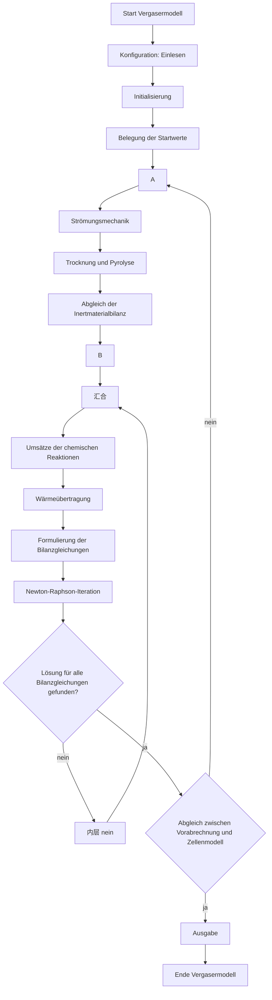

# T18 原文答卷：预计算、外层循环与阻尼牛顿法

| 项 | 内容 |
|---|---|
| 任务卡 | T18（`docs/tasks/T18-solver-structure.md`） |
| 执行者 | cursor |
| 会话 | 全新会话。未沿用做过 T4、T8、T9、T11–T17 或 worktree 清理的会话。工作树 `../bfb-T18`，分支 `task/T18-solver-structure`，自 `origin/main`（`3922409`）建立 |
| 日期 | 2026-10-17 |
| 审查方 | codex |
| 修订 | 2026-10-17，按 PR #66 的退回意见。内层冻结只限于 ADR 点名的系数和边界量。残差在试探点评价 |
| 本卡做什么 | 原文答卷与数据流规格。不写 `hamel/` 代码，不新增解释性裁定 |

Hamel 页面图像按 hamel-source-check 第一节第 2 项，链接到主工作树的 `refs/hamel/pages/`。Wirsum 页面链接到主工作树的 `refs/wirsum/pages/`。文本层只用于定位。下面的式子和德文原句已对照页面图像。

已读范围：

- Hamel §2.1，PDF 15 右至 PDF 17 左 / S. 11–14（含 Bild 2.1、表 2.1、表 2.2、Bild 2.2）。
- Hamel §2.3，PDF 20 左 / S. 20，式 (2.9)。
- Wirsum §2.3.3 的求解过程：PDF 20 右 / S. 21 自该节标题起，至 PDF 21 / S. 22–23。S. 21 标题之上的 Bild 2.4 与式 (2.14) 在同一半页上，本答卷不采用。
- 已批准的 ADR 0002、0007、0009、0012、0013、0014。式 (2.9) 的逆号和 Bild 2.2 的章号偏移，STATUS 已有裁定摘要，据此读了 ADR 0011 第 5 条和第 13 条，不重开这两条。

未读：Wirsum S. 15。该页的 „Abgleich“ 只引用 T13 答卷。未引入 Wirsum 的物理关联式。第 6 问的比对在第 1–3 问写完之后才打开 `docs/hamel_submodels/01_global_nr_and_connectivity.md` 和 tag `archive-2026-10-12` 的求解器，判定用词与 T8 相同：一致、旧转录错、旧代码错、原文有歧义。

字形：式 (2.9) 的左端、Wirsum 算法第 2 步的 \(\mathbf{F}'(\mathbf{x}_0)\)、第 4 步的 \(2^i\) 均经放大核对。没有留给目标所有者的未决字形。

---

## 问题 1：程序结构

❓ **Q1 出处**：

- §2.1 标题与配置的读入：PDF 15 右 / S. 11。
- 初始化、两种初值、预计算、单元模型、外层循环：PDF 16 左 / S. 12。
- 表 2.1、表 2.2：PDF 16 右 / S. 13。
- Bild 2.2：PDF 17 左 / S. 14。
- Bild 2.1 在同一节之前，PDF 15 右 / S. 11，是单个 cell 的物流图，不是程序框图。

❓ **Q2 变量与单位**：

程序分成正文点名的三个主模块，图上在这三个模块之外还有输出。图的走向如下。

配置「Einlesen」列出：

- 一般控制量，例子是输入输出文件、Abbruchkriterium、Startwertwahl。
- 装置数据，图上写 „siehe Tab. 3.1“。
- 运行数据，图上写 „siehe Tab. 3.2“。
- 模型变量，例子是每个装置段的 cell 数。

正文 S. 11 的控制量例子是输入输出文件的标识、单元模型的 Fehlerschranken、初值选择，然后是模型变量、装置数据（Tabelle 2.1）和运行数据（Tabelle 2.2）。

初始化框列出：被衡算的固体和气体、全部被衡算活性固体的粒级数、惰性床料的粒级数、要计入的化学反应、各衡算空间之间的连接。S. 12 写明，变量个数由加入的气固物质、被衡算的粒级、各固体的热解产物和要计入的化学反应确定，并初始化化学计量以及和反应动力学模型的连接。

初值框两条：

- a) 为一个新算例生成初值；
- b) 使用此前模拟的结果。

S. 12 同句：„neu generiert oder wahlweise aus Ergebnissen vorangegangener Simulationen ermittelt.“

预计算框三项，顺序是印刷顺序：

1. Strömungsmechanik（s. Kap. 4）
2. Trocknung und Pyrolyse des Brennstoffs（s. Kap. 5）
3. Abgleich der Inertmaterialbilanz

S. 12 写明预计算尤其包括流动、离析、燃料的干燥与热解。流动模型算出之后才做释放和分配，原句：„die auf- und abwärts gerichteten Gas- und Feststoffströme, die Porosität, der Stoffaustausch und die Verweilzeiten von Gas und Feststoff berechnet“. 假定加入的燃料参与算出的固体混合，„der eingebrachte Brennstoff an der berechneten Feststoffvermischung teilnimmt“，再按反应器高度确定水和热解产物的释放。然后把每个 cell 分到的热解产物份额，以及每个 cell 的固体进出流，按流动模型分配到单元模型上。这些映射结果提供衡算所需的物质流和能量流。

单元模型框，顺序是印刷顺序：

1. 全部化学反应的转化量（s. Kap. 6）
2. 传热
3. 全部 cell 的衡算式：气泡相与悬浮相中气态物质的物流衡算、全部固体和粒级的固体质量流衡算、能量流衡算
4. Newton–Raphson 迭代

内层菱形 „Lösung für alle Bilanzgleichungen gefunden?“ 的 nein 沿单元模型框右缘向上，进入 B 下方的圆圈，再向下进入反应转化量。ja 进入外层菱形。外层菱形 „Abgleich zwischen Vorabrechnung und Zellenmodell“ 的 nein 指向连接符 A，也就是预计算框的入口。ja 进入输出：模拟结果以及全部装置数据和运行数据，然后结束。

表 2.1 的装置参数：各段几何（床层、自由空间、连接管、旋风、返料管），燃料、气化剂、排灰点的位置和数目，固体与气体返料的位置，反应器壁的传热系数。表右侧是分段反应器简图。

表 2.2 的运行参数：一种或多种燃料的质量流；工业分析、元素组成和热值；燃料的初始粒径分布；每个加入点的气化剂体积流；全部进入气流的组成；全部进入气流的温度和压力；床料的组成和粒径分布，或一个平均粒径；床高。床高作为输入的理由印在表内：实际运行靠压差测量把床高保持恒定。简图上的加入箭头标有 \(\mathrm{VM}\)、\(\dot V\)、\(T\)、\(p\)、\(y_i\)，燃料箭头标有 \(\dot m_B\)、\(x_i(d_{P,B,i})\) 以及 \(W\)、\(A\)、\(F\)。这三个字母表内没有展开。

❓ **Q3 德文原句**：

- S. 11：„Das Simulationsprogramm ist in die drei, in Bild 2.2 dargestellten, Hauptmodule ‚Konfiguration‘, ‚Vorabrechnung‘ und ‚Zellenmodell‘ unterteilt.“
- S. 12：„werden die ‚Vorabrechnung‘ und das ‚Zellenmodell‘ abgeglichen, bis die Konvergenzkriterien erfüllt sind (siehe Bild 2.2).“
- 图上预计算第三框：„Abgleich der Inertmaterialbilanz“。

❓ **Q4 上游依赖**：

配置读入的控制量、装置数据和运行数据是后面所有框的输入。初值框在连接符 A 之前。预计算在单元模型之前。单元模型的衡算式使用预计算映射过来的物质流和能量流。外层未对齐时回到 A，不回到配置，也不回到初值框。

❓ **Q5 原文空白**：

**图上的表号和章号与正文、目录不一致。** 图写 Tab. 3.1、Tab. 3.2；正文 S. 11 写 Tabelle 2.1、Tabelle 2.2，S. 13 印出的就是这两张表。图写流动 Kap. 4、热解 Kap. 5、反应 Kap. 6。ADR 0011 第 13 条已裁定：Bild 2.2 的章号比本书目录大 1，流动、热解、反应按第 3、4、5 章理解。本卡沿用该条，不另裁定。表号不在 ADR 0011 里。

表号的可选解释：

- (a) 图上的 3 是笔误，读入的是 S. 13 的表 2.1、表 2.2。影响：配置输入就是这两张表已经列出的项。
- (b) 图确实指向另一套表。影响：S. 13 的两张表和程序框图对不上，配置读什么尚未写明。

不选取。(a) 与正文同页系一致，仍待总司令裁定。

**S. 12 的预计算名单和图上的三个框不是同一份清单。** 正文点了离析，图上没有离析框。图上有惰性料衡算校正，S. 12 这一段没有这个名字。两份都照录。怎样合成一个算法，待定。

**控制量用了三个词。** S. 11 是 Fehlerschranken，图上是 Abbruchkriterium，S. 12 的外层结束语是 Konvergenzkriterien。数值都不在这几页。阈值见问题 4 所引的 ADR 0012，那是项目选择。

**初值怎样生成，原文没有公式。** 只给出 a、b 两种来源（ADR 0002 已确认这一点）。生成规则待定。

**内层 nein 回到反应框之上。** 图上这条线经过传热和衡算式，再进入牛顿框。和 Wirsum 第 4 步合在一起，依赖衡算变量的反应项和传热项在试探点上评价。见问题 2。图上没有另外写缓存方式，缓存方式待定。

**第一轮预计算发生在任何单元解之前。** 初值已经放在 A 之前。第一轮用不用这组初值，S. 12 没有写。待定。

❓ **Q6 与归档旧代码的差异**：

旧转录 `docs/hamel_submodels/01_global_nr_and_connectivity.md` 只锚了 §2.3、Bild 2.2 和式 (2.9)，没有转录配置、初始化、预计算三框和外层菱形。

| 项目 | 旧转录 | 旧代码（`archive-2026-10-12` 的 `src/solvers/`） | 判定 |
|---|---|---|---|
| Bild 2.2 的模块和两条返回线 | 未写各框 | `vorab_cell_abgleich.py` 另有温度掺混、热解刷新开关、分区和最大轮数 | 旧转录未覆盖。这些开关和系数不在 S. 12 与 Bild 2.2 中，旧代码错 |
| 初值的两种来源 | 未写 | `vorab_x0` 等另有种子路径；本卡没有逐条对照 | 原文只有 a、b 两种来源。代码多出的种子不能当成 S. 12 已有的规则 |

---

## 问题 2：阻尼牛顿法

❓ **Q1 出处**：

- Hamel §2.3，PDF 20 左 / S. 20，式 (2.9)。详细过程指 Wirsum（1998）。
- Wirsum §2.3.3：PDF 20 右 / S. 21 自节标题起；式 (2.15)–(2.22) 在 PDF 21 左 / S. 22；阻尼与算法在 PDF 21 右 / S. 23，式 (2.23)。
- 逆号的已有裁定：ADR 0011 第 5 条。采用范围：ADR 0002。

❓ **Q2 变量与单位**：

S. 20 的印刷式，向量带下划线，迭代上标是 \(\nu\)：

\[
\Delta\underline{x}^{\nu}=-\left(\frac{\partial\underline{F}}{\partial\underline{x}}\right)^{\nu}\underline{F}^{\nu},\qquad
\underline{x}^{\nu+1}=\underline{x}^{\nu}+\Delta\underline{x}^{\nu}
\tag{2.9}
\]

放大后，括号右上只有 \(\nu\)，没有 \(-1\)。\(\underline{x}^{\nu}\) 含全部衡算变量的初值。

\(\underline{x}\) 和 \(\Delta\underline{x}\) 的单位是衡算变量的单位，\(\underline{F}\) 的单位是衡算式的单位，两边不是同一套。活性固体未知量是存量，kg；对应残差是式 (2.6)，kg/s（ADR 0007）。气相残差是 mol/s，能量残差是 W（ADR 0012）。气相未知量和能量未知量本身的单位随它们的形式而定，形式待定（问题 4）。雅可比把 \(\Delta\underline{x}\) 的单位映到 \(\underline{F}\) 的单位。S. 20 没有逐分量写出这些单位。

雅可比称为 Funktionalmatrix。cell 沿主流方向一维排列，方程依赖本 cell 和相邻 cell 的变量，矩阵呈块三对角。非相邻 cell 的物质流或能量流造成块外元素。Hamel 的例子是旋风固体返回床层。

Wirsum S. 22 把校正改写成线性方程组。放大图上读到：

\[
\mathbf{F}'(\mathbf{x}_0)\,\Delta\mathbf{x}=-\mathbf{F}(\mathbf{x}_0)
\tag{2.21}
\]

同页写明这是式 (2.19) 的实用形式。式 (2.19) 是带逆矩阵的同一校正，求值点也是 \(\mathbf{x}_0\)。式 (2.22) 是未阻尼的更新 \(\mathbf{x}^{(\nu+1)}=\mathbf{x}^{(\nu)}+\delta\mathbf{x}^{(\nu)}\)。

S. 23 的接受条件用欧氏范数：

\[
\|\mathbf{F}^{(\nu+1)}\|_2\le\|\mathbf{F}^{(\nu)}\|_2
\tag{2.23}
\]

算法原文的六步：

1. 选取全部衡算变量的初值 \(\mathbf{x}_0\)，迭代计数 \(\nu=0\)。
2. 建立 \(\mathbf{F}(\mathbf{x}^{(\nu)})\) 和 \(\mathbf{F}'(\mathbf{x}_0)\)。函数向量在当前迭代点，雅可比的自变量印的是 \(\mathbf{x}_0\)。
3. 由线性方程组 (2.21) 计算 \(\Delta\mathbf{x}^{(\nu+1)}\)。
4. 取满足下式的数 \(j\)。放大图上，试探步的因子是 \(1/2^{i}\)，不等号是严格小于，范数下标是 2：

\[
j\stackrel{\mathrm{def}}{=}\min\left\{i\mid i\ge 0,\ 
\left\|\mathbf{F}\!\left(\mathbf{x}^{(\nu)}+\frac{1}{2^{i}}\Delta\mathbf{x}^{(\nu+1)}\right)\right\|_2
<\|\mathbf{F}(\mathbf{x}^{(\nu)})\|_2\right\}
\]

5. 新的近似：

\[
\mathbf{x}^{(\nu+1)}=\mathbf{x}^{(\nu)}+\frac{\Delta\mathbf{x}^{(\nu+1)}}{2^{j}}
\]

6. 从第 2 步重复。

\(i=0\) 是整步牛顿校正。\(j\) 是使欧氏范数严格下降的最小非负整数。没有印出 \(j\) 的上限。

随后用终止条件代替 \(\mathbf{F}(\mathbf{x}^{(\nu)})=\mathbf{0}\)。原文说这些是可能的终止条件：

1. \(\nu\ge\nu_{\max}\)
2. \(\|\mathbf{x}^{(\nu+1)}-\mathbf{x}^{(\nu)}\|\le\delta\)，\(\delta>0\)。这条没有印范数下标。
3. \(\|\mathbf{F}(\mathbf{x}^{(\nu+1)})\|\le\epsilon\)，\(\epsilon>0\)。这条也没有印范数下标。

\(\nu_{\max}\)、\(\delta\)、\(\epsilon\) 都没有数值。

S. 23 末段：一个 cell 的方程通常只依赖本 cell 和相邻 cell；非相邻物流或能流造成例外。Wirsum 的例子是循环流化床，以及非相邻 cell 之间的颗粒对流传热。后一个例子只说明块外元素从哪来。本卡不引入该传热关联式。Hamel 自己的例子仍是旋风回料（ADR 0002）。

❓ **Q3 德文原句**：

- Hamel S. 20：„die von Wirsum (1998) verwendete ‚gedämpfte‘ Variante des Newton-Verfahrens“。同页：„Eine detaillierte Beschreibung des Lösungsverfahrens ist ebenfalls in Wirsum (1998) zu finden.“
- Wirsum S. 23：„Eine Newton-Iterierte \(\mathbf{x}^{(\nu+1)}\) wird erst dann akzeptiert, wenn für die Euklidische Norm des Funktionsvektors gilt“.
- 同页：„Mögliche Abbruchbedingungen sind“.

❓ **Q4 上游依赖**：

\(\mathbf{F}\) 是问题 1 单元模型框里的全部衡算式。块三对角来自 cell 的一维排列；块外元素来自非相邻物流，Hamel 举的是旋风回料。初值来自问题 1 的 a 或 b。阻尼用的范数是 \(\mathbf{F}\) 的欧氏范数，不另定义目标函数。

❓ **Q5 原文空白**：

**式 (2.9) 没有印出逆号。** 这不是新空白。ADR 0011 第 5 条已裁定：按线性方程组 \(\mathbf{J}\,\Delta\mathbf{x}=-\mathbf{F}\) 求解，不显式求逆。Wirsum 式 (2.21) 就是这个形式。本卡沿用 ADR 0011，不另裁定。

**算法第 2 步把雅可比写在 \(\mathbf{x}_0\)，函数向量写在 \(\mathbf{x}^{(\nu)}\)，第 6 步又从第 2 步重复。** 可选解释：

- (a) 每一轮内层都把雅可比冻在该轮的 \(\mathbf{x}_0\)，只更新 \(\mathbf{F}\)。影响：步长不是标准的全步牛顿法；外层改变预计算之后，是否把新的单元解当成新的 \(\mathbf{x}_0\)，原文没有写。
- (b) \(\mathbf{x}_0\) 是式 (2.19)、(2.21) 的展开点符号，算法清单没有改成 \(\mathbf{x}^{(\nu)}\)。影响：若改成当前点，则每一步重算雅可比。
- (c) 外层每一轮把上一轮单元解当作新的 \(\mathbf{x}_0\)，该轮内部雅可比冻结。影响：内层与外层各算一次雅可比。

不选取。雅可比用解析式还是差分，§2.3.3 没有写。待定。CHARTER §5 允许把雅可比近似登记为求解手段；目前没有 ADR 选择哪一种。

**没有任何 \(i\) 能使范数下降时，算法没有写下一步。** \(j\) 可以没有上界。待定。

**式 (2.23) 用 \(\le\)，第 4 步用 \(\lt\)。** 范数恰好不变时，两处印刷不一致。不选取。

**三条终止条件是「可能的」，没有写「与」还是「或」，也没有数值。** 式 (2.23) 的范数是欧氏范数；终止条件 2、3 没有下标。待定。项目用的残差门是 ADR 0012，见问题 4；它没有规定 \(\nu_{\max}\) 和 \(\delta\)。

**残差在试探点上评价。** Wirsum 第 4 步比较的是 \(\mathbf{F}(\mathbf{x}^{(\nu)}+2^{-i}\Delta\mathbf{x}^{(\nu+1)})\) 与 \(\mathbf{F}(\mathbf{x}^{(\nu)})\)。Bild 2.2 的内层返回线经过反应转化量、传热和衡算式。本轮已经冻结的预计算系数保持不动；原方程里依赖衡算变量的反应项和传热项在这个试探状态上计算。沿用试探前的反应项或传热项，比较的就不是这一步的 \(\mathbf{F}\)。仍待定的是雅可比是否冻在 \(\mathbf{x}_0\)、残差怎么缓存，以及哪些系数属于外层。残差是否使用试探状态，不再标待定。

❓ **Q6 与归档旧代码的差异**：

| 项目 | 旧转录 | 旧代码 | 判定 |
|---|---|---|---|
| 式 (2.9) 的更新 \(\mathbf{x}^{\nu+1}=\mathbf{x}^{\nu}+\Delta\mathbf{x}^{\nu}\) | 写了这一式 | — | 一致 |
| 式 (2.9) 的左式 | 写成 OCR 版面断裂，未录 | — | 旧转录错。左式与右式在同一行 |
| 阻尼 | 只写到「采用 Wirsum 的阻尼」 | `global_nr_solver.py` 用 RMS，并把气相分相、能量残差并进 merit；另有温度步长上限。注释写明是 engineering bridge，不是论文方程 | 接受准则与 \(2^{j}\) 缩步不是这套 merit，也没有温度上限。旧代码错 |
| 对齐容差 | 未写数值 | `vorab_cell_abgleich.py` 默认约 30 K，以及 0,05、0,40、0,85、0,25 这类相对容差 | 原文没有这些数。旧代码错。项目阈值以 ADR 0012 为准 |

---

## 问题 3：外层对齐

❓ **Q1 出处**：

- Hamel S. 12，PDF 16 左；Bild 2.2 的外层菱形和连接符 A，PDF 17 左 / S. 14。
- Wirsum S. 15 的 „Abgleich“ 不重新查读。原句和页码用 T13 答卷问题 3、问题 5。
- 对齐的数值判据：ADR 0012 第 2 项。内层冻结哪些量：ADR 0007 假定 A2、ADR 0009 第 4 项。

❓ **Q2 变量与单位**：

交替方式以图为准。单元模型的内层菱形得到 ja 之后，才问预计算与单元模型是否对齐。未对齐则回到 A，再做预计算三框，经 B 进入单元模型。配置和初值框不在这条返回线上。

S. 12 写明回馈的量是算出的单元温度和物流，受影响的是流动以及燃料的干燥和热解过程。对齐持续到收敛判据满足为止。判据的内容不在这句里。

T13 问题 5 的原句（Wirsum S. 14–15，T13 记 PDF 17 / S. 15）：预计算与单元模型之间必须迭代地做一次 Abgleich，„muß zwischen Vorabrechnung und Zellenmodell iterativ ein Abgleich erfolgen.“ T13 问题 3 已写明，这一句校正的是预计算和单元模型，不是惰性料衡算。Hamel 图上的 „Abgleich der Inertmaterialbilanz“ 是预计算框里的另一框。两句不合并。

外层对齐什么、何时结束，数值部分用 ADR 0012，不在这里重抄阈值表。结构上的分工是：内层解活性固体存量、气体和能量；\(\dot M_{\mathrm{auf},i}\)、\(M_i\)、带出、惰性补料和 \(\dot M_{\mathrm{ab},i}\) 在内层保持不变，由外层更新（ADR 0009 第 4 项，与 ADR 0007 假定 A2 一致）。

❓ **Q3 德文原句**：

- Hamel S. 12：„Da die berechneten Zellentemperaturen und Stoffströme eine Rückwirkung auf die strömungsmechanischen Vorgänge und den Trocknungs- und Pyrolyseverlauf des Brennstoffs im Reaktor haben, wird über eine zweite Iterationsschleife … erneut die ‚Vorabrechnung‘ durchgeführt.“
- 图上外层菱形：„Abgleich zwischen Vorabrechnung und Zellenmodell“。nein 指向 A。

❓ **Q4 上游依赖**：

外层使用的单元温度和物流来自刚刚得到 ja 的那次单元解。回到 A 之后，流动、干燥热解和惰性料校正按图上的顺序再做一遍。它们如何使用上一轮单元解，S. 12 只写了温度和物流有回馈。惰性料存量要用单元解出的活性固体存量，这是 ADR 0009 第 4 项，不是 S. 12 的原句。

❓ **Q5 原文空白**：

**外层菱形没有列出被比较的量，也没有阈值。** S. 12 点了温度和物流。其余量是否参与对齐，原文未说明。ADR 0012 第 2 项补了项目用的判据，包括温度、整体固体流、存量、气体流，以及通过后再做的一次一致性检验。该 ADR 没有写回 Bild 2.2 的菱形文字。实现时用 ADR 0012，不把 ADR 的清单说成 Hamel 印出的菱形内容。

**未对齐之后，牛顿法的初值从哪来，图上初值框在 A 之外。** 可选解释：

- (a) 下一轮牛顿从上一轮单元解出发。影响：初值框只在全程序开始时用一次。
- (b) 每一轮都重新按 a 或 b 生成初值。图上没有这条返回线。影响：外层不能沿用上一轮的解。
- (c) 预计算更新系数，未知向量保持上一轮的值，但不叫「重新生成初值」。影响：与 (a) 的数值相同，只是不经过初值框。

不选取。待定。

**第一轮还没有单元解。** 惰性料校正和依赖温度的流动、热解用什么数，原文未说明。ADR 0009 写惰性补料由上一次外层迭代的结果计算，没有写第一次。待定。

**离析在正文里、不在图里。** 它是否在每次回到 A 时重算，待定。见问题 1。

❓ **Q6 与归档旧代码的差异**：

| 项目 | 旧转录 | 旧代码 | 判定 |
|---|---|---|---|
| 未对齐则回到预计算 | 01 号转录未写这条返回线 | 外层桥默认打开，并有最大轮数；温度用掺混系数向单元温度靠拢 | 图上是回到 A 后重做预计算。掺混和轮数上限不在 S. 12 与 Bild 2.2 中，旧代码错 |
| Wirsum S. 15 的 Abgleich | 本问不把 01 号转录当作 Wirsum 的来源 | — | 该句的页码和对象以 T13 为准。它不是惰性料校正 |

---

## 问题 4：数据流规格

本节不新增裁定。每一条写 ADR 编号；只在 Hamel S. 11–14、S. 20 或获准的 Wirsum §2.3.3 里有、而 ADR 未再规定的，写页码并注明无 ADR。两边都没有的写「待定」。已有 ADR 的解释性选择只引用。

ADR 0012 第 2(b) 项要求用最终单元解重算全部预计算输出，再代入未修改的原方程。重算的范围就是下面的「预计算输出清单」，不多也不少。标了「算法待定」的项仍在清单里：实现时不能删掉，也不能自行补公式。列入这张清单只说明 (b) 要重算它，不说明它在牛顿内层是常数。

三种用法不能互相代替：

| 用法 | 包含哪些量 | 内层怎么处理 |
|---|---|---|
| 内层冻结的系数和边界量 | ADR 0009 点名的 \(\dot M_{\mathrm{auf},i}\)、\(\dot M_{\mathrm{ab},i}\)、\(M_i\)、带出、惰性补料；气泡量与交换系数（ADR 0009 第 1 项，ADR 0012）；热解产物份额和热解释放份额（ADR 0012 第 2(b) 项，算法待 T16）；自由空间回落（ADR 0009 第 1 项） | 本轮外层给出的数值保持不变 |
| 当前未知量及其派生量 | 气相变量、活性固体存量、能量变量；粒级输运流 \(K\cdot m\)（ADR 0007 裁定第 2、3 条）；原方程里依赖这些变量的反应项、传热项和能流 | 在试探点 \(\mathbf{x}^{(\nu)}+2^{-i}\Delta\mathbf{x}\) 上重算。依据：Wirsum §2.3.3 第 4 步；Bild 2.2 的内层返回线 |
| 外层监测量和最终重算量 | ADR 0012 第 2(a) 项的温度、固体流、存量、气体出流和交换流；第 2(b) 项重算本清单 | 被监测，或在 (b) 用最终单元解重算。这不等于内层常数 |

气体流（清单第 1 项）、交换流（第 5 项），以及第 20 项里还没有归入前两类的流，是否属于第一类：待定。气相变量的形式也仍待定。裁定之前不把它们冻成内层常数。

### 流程

与 Bild 2.2 一致的控制流见问题 1。各框里哪些量已经有 ADR，按下列顺序理解；顺序冲突处保持「待定」，不合成新顺序。

1. **配置，一次。** 读入问题 1 列出的控制量、装置数据和运行数据。表号冲突见问题 1 的 Q5。VTT 加压工况 1–4 的输入缺口以 ADR 0014 为准，本卡不补输入。
2. **初始化，一次。** 确定衡算变量个数和数组。每个 cell 的变量个数用 ADR 0007 所引的式 (2.1)：气相按相数乘气体种数，每种活性固体的每个粒级一个变量，能量一个。全炉再乘 cell 数。
3. **初值，图上在 A 之前。** 来源只有问题 1 的 a、b（ADR 0002）。生成规则待定。此后各轮牛顿从哪出发，待定（问题 3 的 Q5）。
4. **预计算。** 图上的顺序是流动、干燥与热解、惰性料校正。S. 12 的名单另含离析，不含惰性料校正这个名字。两份名单都保留。这一步给出下方清单里的系数和边界量；清单里的派生流不在这里冻住。
5. **单元模型。** 内层未知量只是活性固体存量、气体和能量（ADR 0009 第 4 项）。内层保持不变的只是上表第一类。反应转化量和传热在图上位于牛顿框之前，内层返回线进入它们上方。评价 \(\mathbf{F}\) 时，依赖衡算变量的反应项和传热项取试探点上的值（Wirsum 第 4 步）。缓存方式待定。
6. **牛顿校正。** 按 ADR 0011 第 5 条解 \(\mathbf{J}\,\Delta\mathbf{x}=-\mathbf{F}\)。阻尼按 Wirsum §2.3.3 的第 4、5 步，依据是 Hamel S. 20 对 Wirsum 求解过程的采用（ADR 0002）。雅可比是否每步重算，待定。
7. **内层收敛后做外层判断。** 判据用 ADR 0012 第 2 项，不用图上没有写出的量。未通过则回到 A。通过第 2(a) 项之后做第 2(b) 项：用最终单元解重算清单，不再迭代，把这组输出代入未修改的原方程，须满足第 1 项的内层门。报告和验收用的是通过 (b) 的这一组。
8. **然后做外部平衡。** ADR 0012 第 3 项，用 T9 的 `hamel/cases/balance.py`。它不参与迭代。
9. **输出。** 图上是模拟结果以及全部装置数据和运行数据。输出哪一组数：通过 ADR 0012 第 2(b) 项的那一组。

### 内层未知量

| 量 | 谁定的 | 内层 | 依据 |
|---|---|---|---|
| 每种气体、每一相、每个 cell 一个气相变量 | 内层未知量。残差按式 (2.4)、(2.5)，单位 mol/s | 更新 | ADR 0009 第 4 项；计数见 ADR 0007 所引式 (2.1)；残差归一见 ADR 0012 第 1 项 |
| 气相变量是摩尔流、摩尔分数还是浓度 | — | — | 待定。ADR 0007「尚未裁定」第 5 项把式 (2.4)、(2.5) 的形式放在该 ADR 之外，此后没有 ADR 补上 |
| 活性固体 \(j\)、粒级 \(k\)、cell \(i\) 的存量 \(m_{j,k,i}\)（kg） | 内层未知量。残差是式 (2.6)，单位 kg/s | 更新 | ADR 0007 裁定第 1 条；ADR 0012 第 1 项 |
| 粒级输运流 \(\dot m_{\mathrm{auf},j,k,i}\)、\(\dot m_{\mathrm{ab},j,k,i}\) | 由冻结的 \(K_{\mathrm{auf},i}\)、\(K_{\mathrm{ab},i}\) 乘本 cell 存量。\(K=\dot M/M\)，单位 s\(^{-1}\) | 存量更新时这条流随之改变；\(K\) 不变 | ADR 0007 裁定第 2 条 |
| 每个 cell 一个能量变量 | 内层未知量。残差是式 (2.7) | 更新 | ADR 0009 第 4 项；式 (2.1) 的 \(+1\)；ADR 0012 第 1 项 |
| 能量变量是温度还是能量流 | 外层第 2(a) 项比较的是温度 \(T_i\)，单位 K | — | 待定。没有任何一条 ADR 写明牛顿未知量就是 \(T\) |

离开体系的流 \(\dot m_{\mathrm{aus}}\) 不是第三个独立未知量。排灰和带出的分工见清单第 13–15 项（ADR 0009 第 6 项）。

### 内层冻结的系数和边界量

下表只列已经由 ADR 放到外层、因而内层保持不变的量。气体出流、交换流和第 20 项的其余能流不在这张表里。定义和公式在清单里。

| 量 | 内层 | 外层 | 依据 |
|---|---|---|---|
| \(\dot M_{\mathrm{auf},i}\)、\(\dot M_{\mathrm{ab},i}\)、\(M_i\) | 冻结 | 更新 | ADR 0007 假定 A2；ADR 0009 第 1–3 项 |
| 带出、惰性补料 | 冻结 | 更新 | ADR 0009 第 4、6 项 |
| 气泡量 \(\varepsilon_b\)、\(u_b\)、\(\varepsilon_d\) 与交换系数 | 冻结在预计算的结果上 | 随预计算更新 | ADR 0009 第 1 项要求气泡量来自 §3.1；ADR 0012 把气泡和交换系数列入预计算输出。交换流是否因此也冻结：待定，见清单第 5 项 |
| 每个 cell 的热解产物份额、热解释放份额 | 冻结 | 更新 | 份额的存在：Hamel S. 12。热解释放份额这个名字：ADR 0012 第 2(b) 项。算法：待定接口 T16 |
| 自由空间回落与带出 | 冻结 | 更新 | ADR 0009 第 1、6 项；ADR 0012。算法：待定接口 T17 |

下面三项不进入上表。前两项没有 ADR 把它们定为内层常数；反应项和传热项按试探点评价。

| 量 | 内层 | 依据 |
|---|---|---|
| 离析的输出 | 是否冻结：待定 | Hamel S. 12 点名。无输出符号，图上无框。无 ADR |
| 气体停留时间、固体停留时间 | 是否冻结：待定 | Hamel S. 12，无 ADR。进入哪条方程：待定 |
| 反应项、传热项 | 在试探点评价，不冻结 | Wirsum §2.3.3 第 4 步；Bild 2.2。缓存方式：待定 |

VTT 加压工况 1–4 没有惰性砂床时，表中的「惰性床料」按燃料灰理解（ADR 0014 对 ADR 0009 的修订）。有砂床的装置仍用 ADR 0009 的原文。

### 预计算输出清单

ADR 0012 第 2(b) 项重算的就是本表。

| # | 输出 | 依据 | 算法或口径尚未规定的部分 |
|---|---|---|---|
| 1 | 两相、各 cell 的向上与向下气体流 | Hamel S. 12；ADR 0012 第 2(a) 项把两相出流列入外层变化判据 | 与气相未知量是不是同一组数：待定。ADR 0012 只把它列为外层监测量，没有把它定为内层常数。裁定前不冻结 |
| 2 | 床区 cell 上边界的 \(\varepsilon_b\)、\(u_b\)、\(\varepsilon_d\) | ADR 0009 第 1 项；ADR 0012 所称「气泡」 | 公式在流动模块，本卡不引入 |
| 3 | 孔隙率 | Hamel S. 12，无 ADR | 与第 2 项的 \(\varepsilon_b\)、\(\varepsilon_d\) 是否同一批数：待定。两边用词不同，不合并符号 |
| 4 | 相间交换系数 | Hamel S. 12 的 Stoffaustausch；ADR 0012 的「交换系数」 | 符号和公式：待定接口，流动模块 |
| 5 | 相间交换流 | ADR 0012 第 2(a) 项 | 是第 4 项的系数乘当前浓度差，还是预计算给出的流：待定。列入外层监测量不等于内层冻结。裁定前不冻结 |
| 6 | 气体停留时间、固体停留时间 | Hamel S. 12，无 ADR | 进入哪条方程：待定 |
| 7 | 离析子模型的输出 | Hamel S. 12 点名，无 ADR | 输出符号：待定。图上没有这一框 |
| 8 | 床区 \(\dot M_{\mathrm{auf},i}\) | ADR 0009 第 1 项；ADR 0007 假定 A2；ADR 0012 | 最上层是床面抛出，进入自由空间（ADR 0009 第 1 项）。床内公式不在本卡重写 |
| 9 | 床区 \(\dot M_{\mathrm{ab},i}\) | ADR 0009 第 2 项；ADR 0012 | 自最上层向下递推到倒数第二层。床底 \(\dot M_{\mathrm{ab},N}=0\) 是结构事实。递推中的 \(\dot M_{r,i}\) 来自单元解的反应与热解，不是另一套关联式。最底层整体守恒残差只报告，不覆写 |
| 10 | 几何存量 \(M_i\) | ADR 0009 第 3 项；ADR 0012 | 积分式沿用该 ADR。VTT 的 \(\rho_P\) 用第 18 项，不用砂密度 |
| 11 | \(m_{\mathrm{inert},i}=M_i-\sum m_{j,k,i}\) | ADR 0009 第 4 项；ADR 0012 | 第一轮还没有活性固体解时用什么：待定。VTT 的 \(m_{\mathrm{inert},i}\) 是灰（ADR 0014 修订第 2 点） |
| 12 | 惰性补料流率、加入 cell、温度、进入式 (2.7) 的能流 | ADR 0009 第 4 项；ADR 0012 把惰性补料列入外层固体流 | 只用于有惰性床料的装置。补料等于惰性料随排灰和带出离开的全部流率，由上一次外层结果计算。第一次：待定 |
| 13 | VTT 的床底排灰总流率，以及其中的灰分量 | ADR 0014 A5 | 只用于 ADR 0014 认定的无砂床装置。灰分量等于燃料带入的灰减去带出的灰；总流率再除以床区第 1 格的灰质量分数。同时排出的焦炭计入式 (2.6)、(2.7) 和外部平衡。有砂床时排灰流率是工况输入（ADR 0009 第 6 项），不是本项输出 |
| 14 | 按粒级的带出 | ADR 0009 第 6 项；ADR 0012 | 自由空间模块计算。待定接口 T17。不得改用实测值代替计算边界 |
| 15 | 回到最上层床区 cell 的自由空间回落 | ADR 0009 第 1 项；ADR 0012 | 待定接口 T17 |
| 16 | 每个 cell 分到的水与热解产物份额 | Hamel S. 12，无 ADR | 待定接口 T16 |
| 17 | 热解释放份额 | ADR 0012 第 2(b) 项点名 | 与第 16 项是不是同一个份额：待定。待定接口 T16 |
| 18 | VTT 的 \(\rho_P\) | ADR 0014 A4 | 只用于该 ADR 的无砂床装置。外层随 \(\varepsilon_b\)、\(\varepsilon_d\) 更新，使床区几何积分等于压降给出的床料质量。有砂床时 \(\rho_P\) 是输入（ADR 0009 实现约束） |
| 19 | 惰性料（VTT 为灰）的上下流 \((\dot M_{\mathrm{auf/ab},i}/M_i)\,m_{\mathrm{inert},i}\) | ADR 0009 第 4 项第 3 点、第 5 项 | 由第 8–11 项导出，随那些项重算。比焓 \(h_s\)：待定接口，物性；ADR 0009 第 5 项、ADR 0014 修订第 3 点 |
| 20 | 映射到单元模型之后、衡算所使用的物质流和能量流 | Hamel S. 12 末句，无 ADR | 本项不是一整组内层常数。ADR 0007 的粒级流随当前存量变。依赖衡算变量的能流在试探点评价（Wirsum 第 4 步）。其余项哪些属于本清单：待定。未归类的不冻结 |

第 1 关不循环时，旋风收回率为 0，带出仍算，不把旋风从 cell 中拿掉（ADR 0009 第 6 项；ADR 0014 的 X2 只说明几何仍缺）。旋风几何是阻塞项，不是本卡的求解规则。

催化剂质量不是单独的预计算输出。有砂床时取 \(m_{\mathrm{inert},i}\)（ADR 0009 第 7 项）。VTT 取该 cell 床料（焦炭加灰）的质量（ADR 0014 A6）。它随第 10、11 项更新。

### 收敛门

三项都要满足，才算 CHARTER §2.1 的收敛。只满足内层不算（ADR 0012 第 4 项）。

| 门 | 内容 | 依据 |
|---|---|---|
| 内层 | 气相、固相、能量三块，未修改原方程的 \(\|\mathbf{r}\|_\infty\) 除以该块参考流，均 \(\le 1\cdot 10^{-6}\)。参考流：全炉进口气体总摩尔流、燃料干基质量流、燃料收到基低位热值功率 | ADR 0012 第 1 项 |
| 外层 (a) | 相邻两次外层迭代：各 cell 温度绝对变化 \(\le 0{,}1\,\mathrm{K}\)；\(\dot M_{\mathrm{auf}}\)、\(\dot M_{\mathrm{ab}}\)、带出、惰性补料、排灰相对 \(\dot m_{\mathrm{ref}}\le 1\cdot 10^{-4}\)；\(M_i\) 与 \(m_{\mathrm{inert},i}\) 相对 \(M_{\mathrm{tot}}\le 1\cdot 10^{-4}\)；两相气体出流与交换流相对 \(\dot N_{\mathrm{ref}}\le 1\cdot 10^{-4}\)。分母用全炉尺度。新旧都为 0 则变化为 0 | ADR 0012 第 2(a) 项 |
| 外层 (b) | (a) 通过后，用最终单元解重算本清单，不再迭代；代入未修改原方程后须再满足内层门。输出用这一组 | ADR 0012 第 2(b) 项 |
| 外部平衡 | C、H、O 各自 \(\lvert\mathrm{进}-\mathrm{出}\rvert/\mathrm{进}\le 0{,}1\,\%\)。总能量 \(\lvert\mathrm{进}-\mathrm{出}-\mathrm{热损失}\rvert/\dot Q_{\mathrm{ref}}\le 0{,}5\,\%\)。出包括出口气体、带出和排灰；热损失是式 (2.7) 的 \(\dot Q_W\)、\(\dot Q_{WÜ}\) | ADR 0012 第 3 项 |

Wirsum 的 \(\nu_{\max}\)、\(\delta\)、终止条件 2 和 3 的范数种类，以及三条终止条件是「与」还是「或」，ADR 0012 没有写。待定。不得用代码里的默认轮数填上。

状态有限、非负，并满足 ADR 0009 的有效域（ADR 0012 第 4 项）。「非负」覆盖哪些变量，除有效域已经点名的量以外，待定。

### 有效域与阻尼缩步

ADR 0009「有效域」的五条，处理方式已经写明，本卡不改。

| 条件 | 不满足时 | 依据 |
|---|---|---|
| \(u_0>u_{mf}\) 且床区每个 cell 的 \(\varepsilon_b>0\) | 作为工况错误报告。不用缩步把它变成鼓泡床 | ADR 0009 有效域第 1 条 |
| \(M_i>0\) | 作为输入错误报告 | 同节第 2 条 |
| \(m_{\mathrm{inert},i}\ge 0\)，即活性固体之和不超过 \(M_i\) | 该牛顿迭代点不在可行域内，用 ADR 0002 的阻尼缩短步长，回到可行域。收敛解仍不满足时，报告「活性固体存量超过几何存量」 | 同节第 3 条 |
| \(\dot M_{\mathrm{ab},i}\ge 0\) | 报告该 cell 和各项数值。不截断，也不靠缩步改成非负 | 同节第 4 条 |
| 收敛后最底层整体守恒残差在数值容差内 | 超出则报告边界定义不一致 | 同节第 5 条；残差的数值容差本身：待定。ADR 0009 没有给这个诊断量单独的阈值，ADR 0012 的三块门也不覆盖它 |

缩步的判据仍是 Wirsum 第 4 步的欧氏范数下降。ADR 0009 第 3 条把「缩短步长」用作回到 \(m_{\mathrm{inert},i}\ge 0\) 的手段，没有写第二套目标函数。若没有任何 \(2^{j}\) 同时使范数下降且 \(m_{\mathrm{inert},i}\ge 0\)，下一步怎么做：待定。不得改用 clip、下限或 \(\varepsilon\) 分母（ADR 0009；CHARTER §5）。

VTT 排灰另有有效域：床区第 1 格灰的质量分数 \(>0\)；灰分量 \(<0\) 时报告并停止（ADR 0014 A5）。这三条不改为缩步。

### 待定接口

| 接口 | 缺什么 | 依据 |
|---|---|---|
| T16 热解 | 清单第 16、17 项的算法；灰在焦炭颗粒与游离灰之间的分配（ADR 0014 修订第 5 点）；床料粒径因此还不能按 ADR 0014 的 X3 闭合 | 本卡只保留份额这个量 |
| T17 自由空间 | 清单第 14、15 项的颗粒轨迹、回落和按粒级带出 | ADR 0009 只规定与床区的接口 |
| 物性 | \(h_s\)、气体比焓和式 (2.7) 其余能流的物性来源；壁面与传热面的算法。表 2.1 有壁的传热系数这项输入，没有给数值。VTT 的壁面散热仍是 ADR 0014 的阻塞项 X1 | ADR 0009 第 5 项写明物性待 T14 之后的裁定。本卡不选数据 |
| 流动模块 | 清单第 2、4 项的公式 | ADR 0009、ADR 0011 已有流动裁定的，实现时引用那些 ADR，不在本卡重写 |
| 雅可比 | 解析或差分；每步重算还是冻在 \(\mathbf{x}_0\) | 待定。见问题 2 |
| 初值 | a、b 的具体构造；外层后续轮次用哪一组 | 待定。见问题 1、问题 3 |
| 第一次外层 | \(m_{\mathrm{inert},i}\)、惰性补料或 VTT 排灰、以及依赖温度的流动和热解 | 待定 |

ADR 0013 冻结的是动力学、流体力学暂定项和吹扫氮，不改变本规格里的层次划分。本卡不把那些暂定项写成求解器规则。
